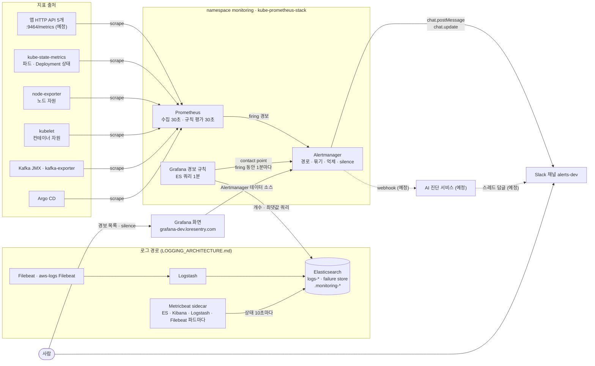
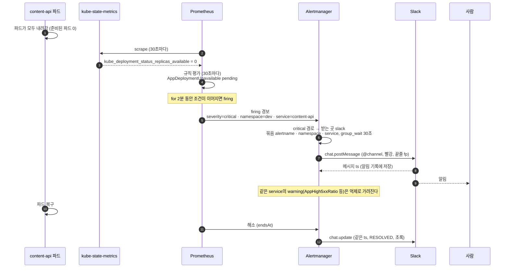
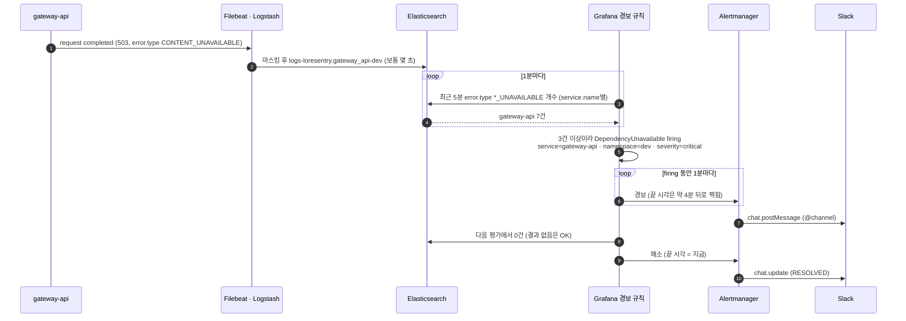
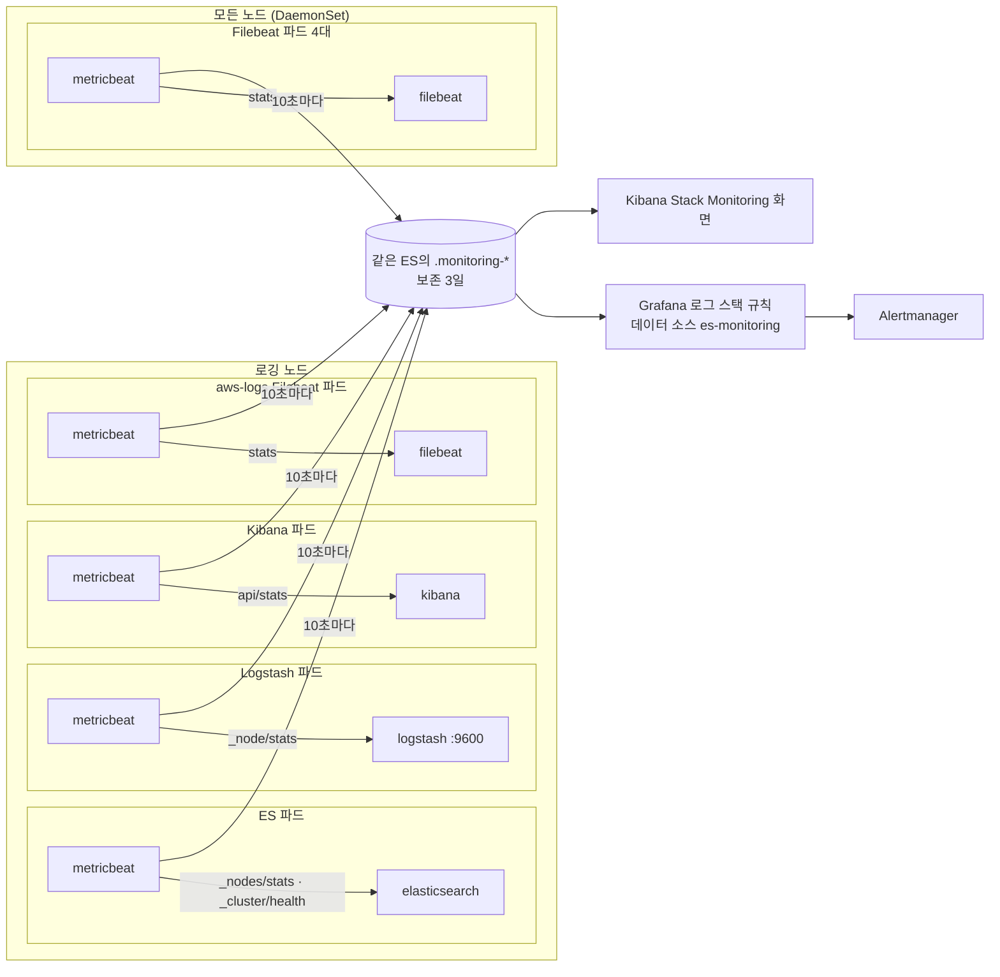
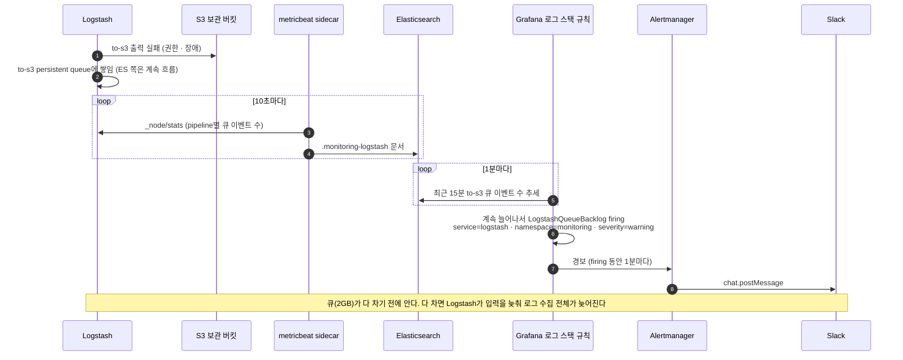
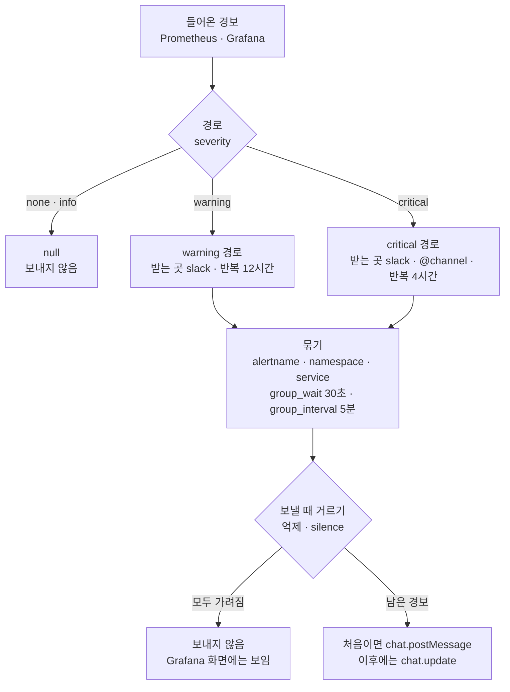
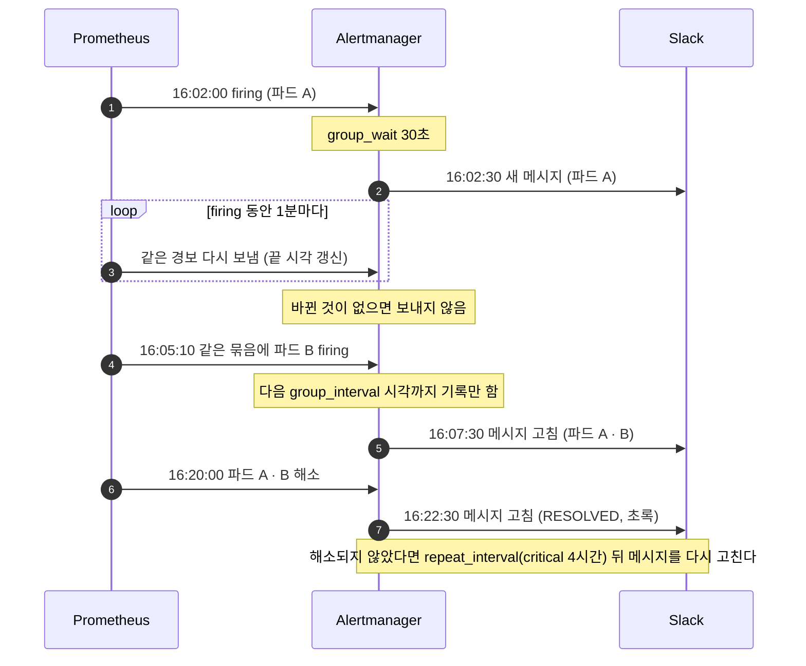
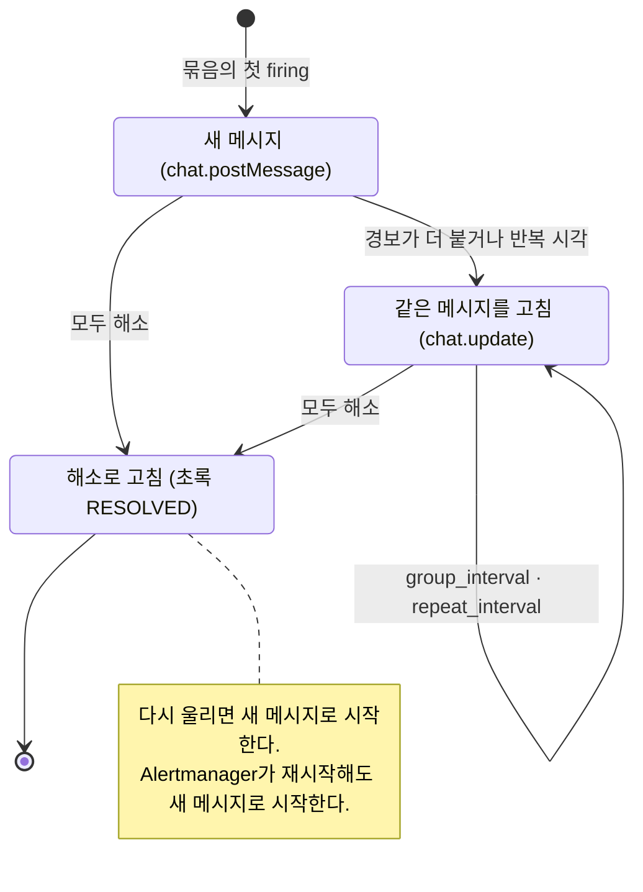
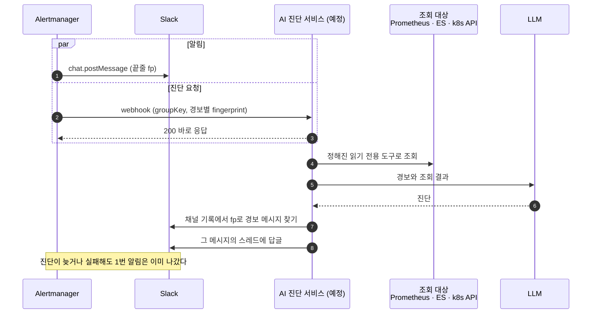
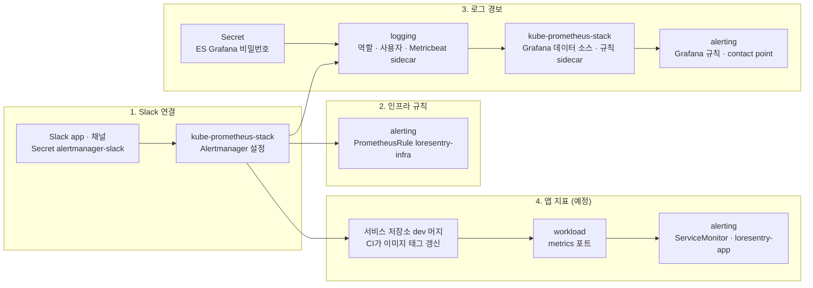

# 경보 아키텍처 — Prometheus·Grafana에서 Alertmanager를 거쳐 Slack까지

> 최신화: 2026-11-05
> 대상: 클러스터 지표·앱 지표·Elasticsearch 로그로 평가하는 경보와 그 전달 경로
> 상태: **dev 운영 중. 앱 지표만 아직 없다(APM 세팅 뒤).** prod는 prod 환경을 세팅할 때 같은 구성으로 붙인다. AI 진단은 이 경로 위에
> 나중에 얹는다.
> 관련: severity·라벨·규칙 목록은 [ALERTING.md](ALERTING.md), 로그 수집 경로는 [LOGGING_ARCHITECTURE.md](LOGGING_ARCHITECTURE.md),
> 매니페스트는 `loresentry-gitops/alerting/`과 `argocd-apps-dev/kube-prometheus-stack.yaml`

경보는 두 곳에서 평가되고 한 곳으로 나간다.

- **지표 경보**: Prometheus가 지표를 30초마다 수집하고 규칙(PrometheusRule)을 평가한다. 앱 지표(예정), 파드·Deployment 상태, 노드
  자원, Kafka, Argo CD를 본다.
- **로그 경보**: Grafana가 1분마다 Elasticsearch에 개수 쿼리를 보내 규칙을 평가한다. 앱 error·warn, 의존 서비스 실패, ALB 5xx,
  DB 오류·느린 쿼리, 로그 수집 멈춤을 본다.
- **로그 스택 경보**: ECK가 ES·Kibana·Logstash·Filebeat 파드마다 붙인 Metricbeat sidecar가 각 구성요소의 상태를 ES
  `.monitoring-*`에 쓰고(Elastic Stack Monitoring), Grafana가 같은 방식으로 읽어 평가한다. 클러스터 상태, heap, 거부, 디스크,
  Logstash 큐 적체, Filebeat 전송 실패를 본다.
- **출구는 kps Alertmanager 하나다.** 묶기·억제·silence·경로를 여기서만 하고, Slack에는 Alertmanager만 쓴다.

## 1. 전체 구조



Alertmanager와 Prometheus는 클러스터 밖에서 열리지 않는다. 사람은 Grafana 화면에서 Alertmanager 데이터 소스로 경보를 보고
silence를 건다. Slack 메시지의 링크도 Grafana로 간다.

## 2. 구성요소

| 구성요소 | 종류 | 하는 일 | 설정 위치 |
|---|---|---|---|
| Prometheus | kps Helm chart 91.8.2 | 지표 수집, PrometheusRule 평가, 경보를 Alertmanager로 보냄. 보존 15일 | `argocd-apps-dev/kube-prometheus-stack.yaml` |
| Prometheus Operator | kps | PrometheusRule·ServiceMonitor CR을 Prometheus 설정으로 바꾼다. 클러스터의 모든 CR을 읽는다 | 같은 곳 |
| kube-state-metrics, node-exporter, kubelet | kps | 쿠버네티스 상태, 노드 자원, 컨테이너 자원 지표 | 같은 곳 |
| 앱 `/metrics` (예정) | 각 서비스 코드 | 요청 수·응답 시간·상태 코드(`http_server_requests_seconds`), Spring은 JVM·HikariCP | 서비스 저장소, gitops `workload/base/<svc>/` |
| Grafana | kps 하위 chart | ES 로그·로그 스택 규칙 평가, Alertmanager로 넘김, 경보·silence 화면 | `argocd-apps-dev/kube-prometheus-stack.yaml`(데이터 소스·규칙 sidecar), `alerting/base/grafana/`(규칙, contact point `kps-alertmanager`·policy) |
| Elasticsearch | ECK | 로그(`logs-*`)와 로그 스택 모니터링 데이터(`.monitoring-*`) 저장. Grafana는 읽기 전용 역할 `grafana_reader`로 읽는다 | `logging/base/elasticsearch/` |
| Metricbeat sidecar | ECK가 만든다(`spec.monitoring`) | ES·Kibana·Logstash·Filebeat 파드마다 하나. 각 구성요소의 상태 API를 10초마다 읽어 `.monitoring-*`에 쓴다 | `logging/base/`의 각 CR |
| Alertmanager | kps, v0.34.1 | 경로·묶기·억제·silence, Slack 전송과 메시지 수정. 받는 곳은 `slack`(그리고 보내지 않는 `null`) 하나다. 저장소는 emptyDir | `argocd-apps-dev/kube-prometheus-stack.yaml`의 `alertmanager.config`·`alertmanager.templateFiles` |
| Slack app | Slack | bot token 하나로 경보 메시지를 쓰고 고친다. 나중에 진단 답글도 단다 | token은 Git 밖 Secret `monitoring/alertmanager-slack` |

## 3. 지표 경보가 Slack까지 가는 길

예: dev의 content-api 파드가 모두 내려갔을 때.



firing까지 걸리는 시간은 대략 `for` + 평가 주기 + `group_wait`이다. 이 예에서는 2분 + 30초 + 30초, 약 3분이다.

## 4. 로그 경보가 Slack까지 가는 길

예: gateway가 content에 닿지 못해 503(`CONTENT_UNAVAILABLE`)을 연달아 돌려줄 때.



- Grafana는 경보 끝 시각을 약 4분 뒤로 찍어 보낸다. 그래서 firing인 동안 1분마다 다시 보내야 Alertmanager가 해소로 오해하지
  않는다. Grafana 쪽 policy를 `group_wait 0s`, `group_interval 1m`, `repeat_interval 1m`으로 두는 이유다. 묶기와 반복 알림은
  Alertmanager가 한다.
- 로그 경보는 수집 지연만큼 늦다. 앱 로그는 몇 초, RDS·Neptune은 2~3분, ALB는 4~7분이 더 걸린다
  ([LOGGING_ARCHITECTURE.md](LOGGING_ARCHITECTURE.md) §4).
- ES가 응답하지 않으면 개수 규칙은 직전 상태를 유지하고, LogIngestionStopped 하나만 오류 경보를 낸다.

## 5. 로그 스택 자신을 보는 길

로그 스택은 세 겹으로 본다([ALERTING.md](ALERTING.md) §1). 파드·노드·디스크는 Prometheus가, 로그가 끝까지 들어오는지는 `logs-*`
규칙이, 구성요소 안쪽 상태는 여기 그린 Stack Monitoring이 본다.



- sidecar는 ECK가 CR의 `spec.monitoring.metrics`를 보고 파드마다 붙인다. 구성요소의 상태 API 주소와 인증도 ECK가 맞춘다.
- sidecar는 8개다(ES·Kibana·Logstash·aws-logs Filebeat 각 1, Filebeat 4). 자원은 ECK 기본값을 쓰고, 노드 자리가 모자라면 노드를 늘린다.
- 감시 데이터가 감시 대상(ES) 안에 있다. ES가 죽으면 이 데이터도 끊기므로, ES 자체의 장애는 Prometheus 파드 규칙과
  LogIngestionStopped가 맡는다.

예: S3 보관 버킷이 막혀 Logstash의 `to-s3` 큐가 쌓일 때.



## 6. Alertmanager 안에서



| 억제 원천 | 가리는 대상 | 같아야 하는 라벨 |
|---|---|---|
| severity `critical` | `warning`·`info` | `namespace`, `alertname` |
| severity `warning` | `info` | `namespace`, `alertname` |
| `InfoInhibitor` | `info` | `namespace` |
| `AppDeploymentUnavailable` | `warning` | `namespace`, `service` |

### 반복해서 들어오는 경보를 어떻게 거르나

Prometheus는 firing인 동안 같은 경보를 **1분마다 다시 보낸다**(`resend-delay` 기본값). 보낼 때마다 "약 4분 뒤까지 유효"라는 끝
시각(`endsAt`)을 붙여 아직 울리는 중이라는 신호를 준다. 끝 시각은 보내는 간격의 4배(`4 × max(평가 주기, 재전송 간격)`)라서,
몇 번 못 보내도 Alertmanager가 해소로 오해하지 않는다. 조건이 풀리면 끝 시각을 "지금"으로 바로 보내므로 정상 해소는 늦어지지
않는다. 4분 여유는 보내는 쪽이 사라졌을 때만 쓰인다. Grafana도 같은 이유로 1분마다 보낸다. Alertmanager는 같은
fingerprint를 하나로 세고, 묶음마다 타이머 시각에만 지난번 보낸 내용(알림 기록)과 비교해 보낼지 정한다.

| 시점 | 판단 |
|---|---|
| 묶음이 처음 생김 | `group_wait`(30초) 뒤 첫 알림. 새 메시지 |
| 그 뒤 `group_interval`(5분)마다 | 경보가 더 붙었거나 일부가 해소됐으면 메시지를 고친다. 그대로면 보내지 않는다 |
| 바뀐 것 없이 `repeat_interval`이 지남 | 다시 알린다(critical 4시간, warning 12시간). 메시지를 고치므로 `@channel`은 다시 울리지 않는다 |
| 모두 해소됨 | 다음 `group_interval` 시각에 해소 알림. 초록으로 고친다 |
| 보내는 쪽이 멈춤(Prometheus 장애 등) | 마지막 끝 시각이 지나면 해소로 처리한다 |



## 7. Slack 메시지의 생애



- 고칠 때는 `@channel`이 다시 울리지 않는다.
- 메시지를 지우면 그 묶음이 해소될 때까지 고치기가 실패한다. 경보 메시지는 지우지 않는다.
- 메시지 하나가 묶음 하나다. 나중에 진단 답글이 이 메시지의 스레드에 달린다.

## 8. AI 진단이 붙는 자리 (예정)

알림 경로에 webhook 받는 곳을 하나 더할 뿐이다. Slack 받는 곳은 그대로 두므로, 진단이 늦거나 실패해도 알림은 이미 나가 있다.



## 9. 배포

모두 GitOps로 배포한다. gitops 저장소에 PR을 올리고 머지하면 Argo CD가 자동 sync로 클러스터에 반영한다(보통 3분 안). 되돌릴
때는 그 커밋을 `git revert`한다. 서비스 코드(앱 지표)는 서비스 저장소 `dev`에 머지하면 CI가 이미지를 만들고 gitops의 이미지 태그를
바꾼다. 클러스터에 직접 `kubectl apply`하지 않는다. 예외는 Git에 넣을 수 없는 Secret뿐이다.

### 9.1 환경 나누기

dev와 prod는 클러스터가 다르고, 클러스터마다 자기 Argo CD가 자기 Application만 읽는다. 아래 `ENV`는 `dev` 또는 `prod`다.
`logging/`·`workload/`와 같은 base + overlay 구조다.

```text
alerting/
├── base/            # 두 환경이 같이 쓰는 규칙
│   ├── prometheus/  # loresentry-infra (loresentry-app · ServiceMonitor는 앱 지표 때)
│   └── grafana/     # 로그 · 로그 스택 규칙, contact point · policy ConfigMap
└── overlays/
    ├── dev/         # argocd-apps-dev/alerting.yaml이 읽는다
    └── prod/        # argocd-apps/alerting.yaml이 읽는다 (prod 세팅 때 만든다)
```

| 어디에 | 무엇을 |
|---|---|
| `alerting/base` | 규칙 이름·조건·severity. 두 환경이 같다 |
| `alerting/overlays/ENV` | 환경마다 다른 값만. Grafana 규칙의 `namespace` 라벨(`dev`·`prod`), 앱 namespace를 가리키는 조건, 트래픽에 따라 다를 기준값(예: 5xx 최소 건수) |
| `argocd-apps-dev/kube-prometheus-stack.yaml` / `argocd-apps/kube-prometheus-stack.yaml` | Alertmanager·Grafana 설정. Slack 채널(`#alerts-dev`·`#alerts-prod`), Grafana 주소처럼 환경마다 다른 값이 원래 이 파일에 있다 |

### 9.2 무엇이 어디로 가고, 바뀌면 무엇이 재시작되나

| Argo CD Application | 경보와 관련된 것 | 바뀌면 |
|---|---|---|
| `kube-prometheus-stack` (`argocd-apps-dev/kube-prometheus-stack.yaml`의 Helm values) | Alertmanager 설정(경로·받는 곳·억제·메시지 템플릿), Slack Secret 마운트. Grafana 설정(ES 데이터 소스 3개, 규칙 sidecar, ES 비밀번호 환경 변수·CA 마운트) | Alertmanager 설정은 재시작 없이 다시 읽는다. Secret 마운트를 처음 넣을 때는 Alertmanager 파드가 한 번 재시작한다. Grafana의 환경 변수·마운트·sidecar를 바꾸면 Grafana 파드가 재시작한다(DB가 emptyDir이지만 설정은 모두 provisioning이라 그대로 돌아온다) |
| `alerting` (`alerting/overlays/ENV`, wave -2) | PrometheusRule `loresentry-infra`, Grafana 규칙과 contact point·policy ConfigMap(label `grafana_alert`), Grafana 대시보드 ConfigMap(label `grafana_dashboard`). 앱 지표 때 `loresentry-app`·앱 ServiceMonitor가 더해진다 | 재시작 없음. Prometheus Operator가 규칙·수집 대상을 Prometheus에 다시 읽히고, Grafana sidecar가 규칙을 다시 읽힌다 |
| `logging` (`logging/overlays/ENV`) | ES 역할 `grafana_reader`와 file realm 사용자, ES·Kibana·Logstash·Filebeat CR의 `spec.monitoring`(Metricbeat sidecar) | 역할·사용자는 재시작 없음(1~2분 안에 반영). **`spec.monitoring`을 처음 켜면 sidecar가 붙으면서 ES·Kibana·Logstash·Filebeat 파드가 모두 재시작한다.** ES가 1노드라 1~3분 동안 색인·검색이 멈추고, 그동안 로그는 Logstash 큐에 쌓였다가 이어서 들어간다 |
| `workload-ENV` (`workload/overlays/ENV`) | 앱 Deployment·Service의 `metrics` 포트(9464), 앱 이미지 태그, Kafka PrometheusRule | 앱 파드가 롤링 업데이트된다. 서비스 중단은 없다 |

### 9.3 Git 밖 Secret

| Secret | 만드는 사람·때 | 없으면 |
|---|---|---|
| `monitoring/alertmanager-slack` (`bot-token`) | 사용자. Slack app을 만든 뒤, Alertmanager 설정 PR을 머지하기 **전에** | Secret 마운트가 필수라 Alertmanager 파드가 뜨지 못한다(ContainerCreating) |
| ES의 Grafana 사용자 비밀번호 (basic-auth Secret) | `bootstrap/dev/05-cluster-bootstrap.sh`가 무작위 값으로. ES 역할·사용자 PR보다 먼저 | ES file realm에 사용자가 없고, Grafana 파드가 환경 변수를 못 읽어 뜨지 못한다 |

### 9.4 순서

앞의 것이 뒤의 것을 쓴다. 화살표 순서대로 배포하고, 단계마다 확인한 뒤 다음으로 간다.



- **1이 먼저다.** 출구가 있어야 뒤 단계의 경보가 실제로 Slack에 오는지 확인할 수 있다. 2·3·4는 1 뒤에 서로 따로 진행할 수 있다.
- **3에서는 logging을 Grafana 규칙보다 먼저 배포한다.** sidecar를 켤 때 ES가 1~3분 멈추는데, 그때 Grafana 규칙이 이미 있으면
  LogIngestionStopped가 데이터 소스 오류로 울린다. 규칙이 생기기 전에 재시작을 끝낸다.
- **4에서는 앱 이미지가 먼저다.** 9464를 아직 열지 않은 앱에 ServiceMonitor가 먼저 붙으면 수집이 실패해 AppMetricsDown이 울린다.
- 각 PR은 머지한 뒤 Argo CD가 Synced·Healthy인지, 파드 재시작이 예상한 것뿐인지, 경보가 의도대로 오는지 보고 다음으로 간다.

### 9.5 바꾸는 것과 위치

| 바꾸는 것 | 위치 |
|---|---|
| Slack 채널·묶기·반복·억제·메시지 형식 | `argocd-apps-dev/kube-prometheus-stack.yaml`의 `alertmanager.config`·`alertmanager.templateFiles` |
| Grafana 데이터 소스 | `argocd-apps-dev/kube-prometheus-stack.yaml`의 `grafana` |
| Grafana가 Alertmanager로 넘기는 설정(contact point·policy) | `alerting/base/grafana/notifications.yaml` |
| 지표 규칙 | `alerting/base/prometheus/` |
| 로그·로그 스택 규칙 | `alerting/base/grafana/` |
| Grafana 대시보드(경보 현황·ArgoCD) | `alerting/base/grafana/dashboards/`의 JSON. 폴더는 kps values의 `grafana.sidecar.dashboards.folderAnnotation` |
| 수집 대상 (앱 지표 때) | `alerting/base/prometheus/servicemonitor.yaml`, 앱 Service의 `metrics` 포트 |
| Grafana가 읽는 ES 범위 | `logging/base/elasticsearch/`의 역할 정의 |
| 로그 스택 모니터링 sidecar | `logging/base/`의 Elasticsearch·Kibana·Logstash·Beat CR `spec.monitoring` |
| prod | `argocd-apps/kube-prometheus-stack.yaml`과 `*/overlays/prod`. prod 환경을 세팅할 때 만든다 |

## 10. 장애가 나면

| 상황 | 동작 |
|---|---|
| Slack API가 실패함 | Alertmanager가 다시 시도한다. 계속 실패하면 `AlertmanagerFailedToSendAlerts`가 울리지만 Slack으로는 못 가므로 Grafana 경보 화면에서 보인다 |
| Grafana가 내려감 | 로그 경보만 멈춘다. 지표 경보는 Prometheus → Alertmanager로 그대로 간다. Grafana 파드 재시작은 kps 기본 규칙이 알린다 |
| Elasticsearch가 응답하지 않음 | 개수 규칙은 직전 상태를 유지하고, LogIngestionStopped가 오류 경보로 알린다. `.monitoring-*`도 함께 끊기므로 ES 파드 상태는 Prometheus 파드 규칙이 알린다 |
| Metricbeat sidecar가 멈춤 | 그 구성요소의 `.monitoring-*`가 끊겨 5분 안에 StackMonitoringDataMissing(warning) |
| 로그 수집이 멈춤(Filebeat·Logstash) | 10분 안에 LogIngestionStopped(critical) |
| Prometheus가 내려감 | 지표 경보가 멈춘다. 외부 감시(`Watchdog`)가 아직 없어 알 수 없다 |
| Alertmanager가 내려감 | 모든 알림이 멈춘다. 외부 감시가 아직 없다. 재시작하면 silence와 메시지 기록이 사라지고 다음 알림은 새 메시지로 나간다 |
