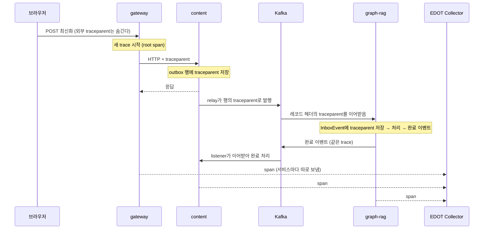
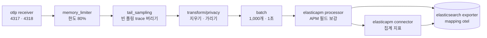
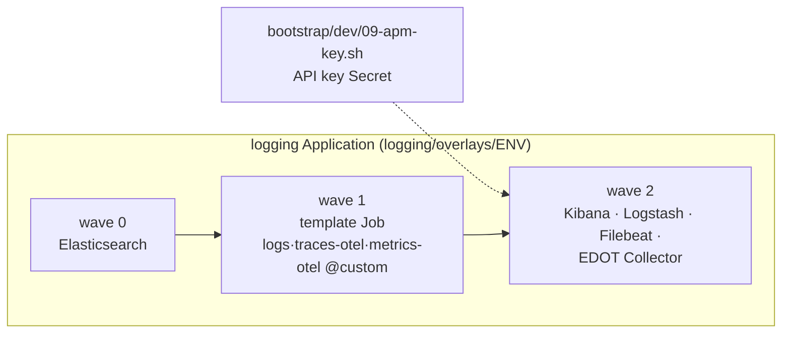

# APM 아키텍처 — span을 모아 Kibana APM에서 호출 그림 보기까지

> 최신화: 2026-11-04
> 대상: gateway, authentication, content, ai-chat(API·summarizer), graph-rag가 만드는 trace(span)
> 상태: **dev 운영 중(2026-11-04).** 서비스 6개가 span을 보내고 Kibana APM에서 본다. 남은 결정은 [11절](#11-남은-일).
> prod는 prod 환경을 세팅할 때 같은 구성으로 옮긴다.
> 관련: trace 규약은 [LOG_SCHEMA.md 7절](LOG_SCHEMA.md#7-trace), span 마스킹은 [4절](LOG_SCHEMA.md#4-금지-항목과-마스킹),
> template은 [9절](LOG_SCHEMA.md#9-index-template-logscustom), 로그 흐름은 [LOGGING_ARCHITECTURE.md](LOGGING_ARCHITECTURE.md),
> 매니페스트는 `loresentry-gitops/logging/base/otel-collector/`(설명은 `logging/README.md`의 "APM")

로그와 trace는 같은 `trace.id`로 묶이지만 하는 일이 다르다.

- **로그**: 무슨 일이 있었나. 줄마다 메시지·상태·ID·오류가 있다. Filebeat → Logstash → ES `logs-*`로 간다.
- **trace**: 누가 누구를 불렀고 어디서 시간이 걸렸나. 작업 하나가 span 하나이고, span이 부모·자식으로 이어져 한 요청의 호출
  그림이 된다. 앱 SDK → **EDOT Collector** → ES `traces-*.otel-*`로 간다. Kibana APM이 이것으로 서비스 목록, 지연 시간,
  trace 폭포 그림을 그린다.
- span은 Logstash를 거치지 않는다. 그래서 개인정보 처리(지우기·가리기)는 collector가 한다.

## 1. 전체 구조

- 서비스 사이에서는 W3C `traceparent` 헤더(HTTP·Kafka)로 trace가 이어진다. 그래서 서비스마다 따로 보낸 span이 ES에서
  한 trace로 모인다. 전파는 span 전송과 상관없이 지금도 동작한다.
- collector는 받은 span을 ES에 쓰기만 한다. 앱은 collector가 멈춰도 영향을 받지 않는다([10절](#10-장애가-나면)).

## 2. 구성요소

| 구성요소 | 종류 | 어디서 | 하는 일 |
|---|---|---|---|
| Java 서비스 3개 | Spring Boot 4 `spring-boot-starter-opentelemetry`(Micrometer Tracing → OTel bridge) | namespace dev | 요청·호출·Kafka 소비마다 span을 만들고 OTLP로 보낸다(전송 설정은 환경 변수) |
| Python 서비스 3개 | OpenTelemetry SDK 1.45.1, 계측 0.66b1(FastAPI·httpx·psycopg) | namespace dev | 같은 일. Kafka 레코드는 헤더에서 직접 이어받는다 |
| EDOT Collector | Deployment 1대, 이미지 `elastic-agent:9.5.5`(`ELASTIC_AGENT_OTEL=true`) | 로깅 노드 | span 받기, 민감한 값 지우기·가리기, APM 필드 보강, 집계 지표 만들기, ES 쓰기 |
| template Job | Job(Argo CD Sync hook) | 로깅 노드 | collector보다 먼저 `traces-otel@custom`·`metrics-otel@custom`을 ES에 넣는다(로그용 `logs@custom`과 같은 Job) |
| 쓰기 계정 | ES API key `edot-collector`, Secret `monitoring/edot-collector-es` | ES | `*.otel-*` data stream 만들기·쓰기만 한다 |
| Kibana APM | Kibana 9.5.5 Observability → APM | 로깅 노드 | 서비스·트랜잭션·trace·오류 화면. 따로 설정할 것이 없다(기본 APM 인덱스에 `*.otel-*`가 들어 있다) |

## 3. span이 만들어지고 이어지는 길

규약은 [LOG_SCHEMA.md 7절](LOG_SCHEMA.md#7-trace)에 있다. 문서 최신화 요청을 예로 들면 이렇게 이어진다.

- **시작점**: gateway가 외부 요청마다 새 trace를 연다. 스케줄·폴링은 1회마다 새 trace다.
- **저장했다 나중에 처리**: outbox 행, ai-chat `summary_queue`, graph-rag `InboxEvent`가 저장 시점의 `traceparent`를 갖고 있어,
  나중에 처리해도 같은 trace에 붙는다.
- **로그와 잇기**: 모든 로그 줄의 `trace.id`·`span.id`가 span의 ID와 같다. APM에서 느린 trace를 찾아 그 `trace.id`로 Discover에서
  줄을 보고, 반대로 오류 줄의 `trace.id`로 APM의 호출 그림을 연다.

## 4. collector 안의 처리

| 단계 | 하는 일 |
|---|---|
| `memory_limiter` | 컨테이너 메모리 한도의 80%에 가까워지면 받기를 잠시 거절한다. 앱 SDK가 다시 보낸다 |
| `tail_sampling` | 빈 폴링 회차의 trace를 통째로 버리고 나머지는 모두 남긴다(아래 "빈 폴링 회차"). 판단하려고 trace를 5초 모았다가 내보낸다 |
| `transform/privacy` | 로그에 남기지 않는 값을 지우고, 남은 값을 가린다(아래 표) |
| `batch` | 묶어서 ES에 보낸다 |
| `elasticapm` processor | span을 Kibana APM이 읽는 모양으로 보강한다(`transaction.*`·`span.*`, `processor.event`, 결과·성공 여부) |
| `elasticapm` connector | span으로 서비스·트랜잭션·호출 대상별 지연·건수·오류율을 1분·10분·60분 단위로 집계한다. APM 목록 화면이 이것을 읽는다 |
| `elasticsearch` exporter | OTel 원래 모양(`mapping.mode: otel`)으로 data stream에 쓴다 |

민감한 값 처리([LOG_SCHEMA.md 4절](LOG_SCHEMA.md#4-금지-항목과-마스킹)):

| 처리 | 대상 |
|---|---|
| 지우기 | URL 쿼리(`url.full`·`url.original`·`http.url`·`http.target`의 `?` 뒤, `url.query`), SQL(`db.statement`·`db.query.text`), 예외 event의 `exception.message`·`exception.stacktrace` |
| 가리기 | 남은 모든 span·event 문자열 속성. 이메일, OAuth `code`·`state`, 광고 클릭 ID, 서명 URL, 세션 쿠키, 인증 헤더, JWT, 비밀번호, DB 키 값 |

- 예외는 `exception.type`만 남는다. 스택은 같은 `trace.id`의 앱 로그 `error.stack_trace`(메시지 없는 스택)로 본다.
- HTTP 헤더와 요청·응답 본문은 계측 라이브러리가 기본으로 담지 않는다. 그 설정을 켜지 않는다.

빈 폴링 회차([LOG_SCHEMA.md 7절](LOG_SCHEMA.md#7-trace) 시작점):

| 서비스 | span을 여는 쪽 | 빈 회차 처리 |
|---|---|---|
| content(1초 relay, 1분 최신화 timeout), auth(1초 relay) | Spring이 `@Scheduled` 실행마다 연다. 회차 로그의 `trace.id`가 이 span이라 끌 수 없다 | `LogFlow.polling`이 줄 없는 회차의 span에 `loresentry.polling.idle=true`를 단다 |
| ai-chat summarizer tick | `LogFlow.polling`이 회차마다 열고, 대기열 조회 DB span이 그 아래 생긴다 | 같은 표시를 단다 |
| graph-rag relay | `LogFlow.polling`이 첫 줄 직전에만 연다 | span 자체가 없다 |

- 표시가 붙은 trace는 `tail_sampling`의 `drop` 정책이 자식 span까지 버린다. span 하나만 거르면 자식 DB span이 부모 없이 남기 때문이다.
- 확인(2026-11-04 부하 테스트 중 4분): content relay가 남긴 회차 span 29건, 같은 시간 relay 종료 로그 28건. 빈 회차 표시가 붙은 span은 ES에 0건이다.

## 5. 저장

| data stream | 내용 | Kibana에서 |
|---|---|---|
| `traces-<dataset>.otel-<namespace>` | span. 서비스가 받은 요청·소비한 레코드는 transaction, 그 안의 호출·쿼리는 span | trace 폭포 그림, 트랜잭션 목록 |
| `logs-<dataset>.otel-<namespace>` | span의 예외 event | APM 오류 |
| `metrics-{service_summary,service_transaction,transaction,service_destination}.{1m,10m,60m}.otel-*` | connector가 만든 집계 | 서비스 목록, 지연·처리량·오류율 그래프, 호출 대상 |

| 설정 | 값 | 정하는 곳 |
|---|---|---|
| 레플리카 | 0(1노드 ES) | `traces-otel@custom`, `metrics-otel@custom`, 예외 event는 `logs@custom` |
| 보존 | 30일. 로그와 같다 | 같은 template. 내장 ILM 정책은 삭제 단계가 없어 `prefer_ilm: false`로 data stream lifecycle을 쓴다 |
| 디스크 | 로그와 같은 ES 128Gi를 나눠 쓴다(2026-11-04에 20Gi에서 늘림) | 부하 테스트 중 실측은 traces 하루 약 4GB, 로그 하루 약 1GB. 디스크가 95%를 넘으면 ES가 index를 읽기 전용으로 바꿔 로그 수집도 멈추므로 kps `KubePersistentVolumeFillingUp`이 마지막 경보다 |

## 6. 계정과 권한

- collector는 ES API key(이름 `edot-collector`)로 쓴다. 권한은 `traces-*.otel-*`·`metrics-*.otel-*`·`logs-*.otel-*`에
  `auto_configure`(data stream 만들기)와 `create_doc`(문서 넣기)뿐이다. 읽기와 앱 로그 data stream 쓰기는 거부된다(403).
- 키는 Git에 넣지 않는다. dev는 `loresentry-gitops/bootstrap/dev/09-apm-key.sh`가 `elastic` 계정으로 발급해 Secret
  `monitoring/edot-collector-es`에 넣는다. 비밀번호와 키는 stdin으로만 넘겨 명령줄·화면에 남지 않는다.
- 만료는 두지 않는다. 만료되면 span이 조용히 끊기기 때문이다. 바꿀 때는 Kibana(Stack Management → API keys)에서 키를 무효화하고
  Secret을 지운 뒤 스크립트를 다시 돌리고 collector를 재시작한다.

## 7. Kibana에서 보기

- 주소는 `https://kibana-dev.loresentry.com`, 메뉴는 Observability → APM이다.
- Basic 라이선스에서 쓸 수 있는 것과 없는 것:

| 기능 | Basic |
|---|---|
| 서비스 목록, 트랜잭션, trace 폭포 그림, 오류, 지연·처리량·오류율 그래프 | 된다 |
| service map, 이상 탐지(ML), correlations | 안 된다(Platinum) |
| custom links | 안 된다(Gold) |

- OTel 데이터의 제약: span의 스택 trace는 보이지 않는다(어차피 지운다). Kafka 소비 같은 messaging span은 transaction으로 보일 수 있다.
- 자주 쓰는 길: Discover의 앱 로그에서 `trace.id` 값을 누르면 그 trace의 폭포 그림이 새 탭으로 열린다(아래 링크 설정). 폭포 그림에서
  느린 span을 찾고, 그 서비스 로그를 Discover에서 같은 `trace.id`로 본다.

편의 설정(2026-11-04, Kibana API로 만듦. 매니페스트가 아니라 Kibana 저장 객체다):

| 설정 | 내용 |
|---|---|
| `trace.id` 링크 | data view `loresentry-app-logs-dev`(앱 로그)·`dev-all-logs`(dev 전체)의 `trace.id`에 URL 형식 `/app/apm/link-to/trace/{{value}}` |
| APM 기본 환경 | 고급 설정 `observability:apmDefaultServiceEnvironment` = `dev`(서비스가 `deployment.environment.name=dev`를 보낸다) |
| data view | `loresentry-apm-traces` "APM trace (dev)"(`traces-*.otel-*`), `loresentry-apm-errors` "APM 오류 (dev)"(`logs-*.otel-*`) |

대시보드(위쪽 Links 패널로 서로 오가고 APM 서비스 목록으로 간다. 기본 범위 24시간, 패널은 ES|QL):

| 대시보드 | id | 패널 |
|---|---|---|
| LoreSentry 앱 (dev) | `loresentry-dash-app` | 서비스별 로그량, warn·error 추이, `request completed`의 p95(ms), 상태 클래스(2xx~5xx), 느린 `http.route`, 상위 `error.type`, `log.level: unknown` 수 |
| Kafka (dev) | `loresentry-dash-kafka` | 토픽별 이벤트 처리 추이와 결과(`loresentry.result.outcome`), 처리 실패 `error.type`, outbox relay 발행·격리·실패 건수, 브로커·Strimzi warn·error |
| DB (dev) | `loresentry-dash-db` | RDS 오류(SQLSTATE `error.code`), RDS·Neptune 느린 쿼리 수와 p95, 앱의 DB 관련 `error.type`(트랜잭션·JDBC·psycopg 등), Valkey warn·error |
| APM (dev) | `loresentry-dash-apm` | 서비스별 처리량·p95 지연·실패율, span 유형 분포, 느린 트랜잭션, 예외 유형 |

- 다시 만들 때 쓸 내보내기(NDJSON)와 생성 스크립트는 저장소에 두지 않았다. Kibana 저장 객체 내보내기(Stack Management → Saved objects)로 백업한다.

## 8. 자원과 배치

| 항목 | 값 |
|---|---|
| collector | 1대, 요청 100m·256Mi, 한도 500m·512Mi, `GOMEMLIMIT` 400MiB |
| 로깅 노드 | `r7i.large`(2 vCPU·16GiB) 1대에 ES·Logstash·Kibana·Filebeat·collector가 함께 뜬다 |
| CPU 예약 | collector 전 1,610m/1,930m(83%). collector 요청을 작게 둔 이유다 |
| 부하 테스트 때 최고치(2026-11-04) | 노드 CPU 1,950m(100%, Logstash 1,546m·ES 950m), ES 메모리 2,894Mi/3Gi, Kibana 1,506Mi/1,536Mi |
| span 전송 뒤 실측(2026-11-04 부하 테스트 중) | span 초당 약 155개. traces 저장량 시간당 약 165MB(병합 전 크기). collector CPU 38m·메모리 217Mi. 노드 CPU 2,000m(103%) |

노드는 그대로 두고 다음 부하 테스트 지표를 근거로 증설을 정한다. 관리형 노드 그룹은 인스턴스 타입을 그 자리에서 바꿀 수 없어,
새 노드 그룹(같은 2b·label·taint)을 만들고 이전 노드를 drain한다.

## 9. 배포

- 첫 data stream이 생기기 전에 template이 들어가야 레플리카 0으로 만들어진다. 그래서 template Job(wave 1)이 collector(wave 2)보다 먼저다.
- Secret이 없으면 collector 파드는 만들어지지 않고 기다린다. 스크립트를 돌리면 저절로 뜬다.

| 바꾸는 것 | 위치 |
|---|---|
| 지우기·가리기 규칙, 파이프라인 | `logging/base/otel-collector/otel.yml`(바꾸면 ConfigMap 이름이 바뀌어 collector가 다시 뜬다). LOG_SCHEMA 4절도 같이 고친다 |
| 자원, 이미지 버전 | `logging/base/otel-collector/collector.yaml`. 버전은 ES·Kibana와 같게 둔다 |
| 보존·레플리카 | `logging/base/elasticsearch/{traces,metrics}-otel-custom.json`(새 data stream·다음 rollover부터 적용) |
| 앱 쪽 전송 | `workload/overlays/dev/kustomization.yaml`의 환경 변수. Java는 `MANAGEMENT_TRACING_EXPORT_OTLP_ENABLED=true`·`MANAGEMENT_OPENTELEMETRY_TRACING_EXPORT_OTLP_ENDPOINT=http://edot-collector.monitoring.svc:4318/v1/traces`, Python은 `OTEL_EXPORTER_OTLP_ENDPOINT=http://edot-collector.monitoring.svc:4318`(이 값이 있을 때만 `setup_tracing`이 exporter를 붙인다), 공통 `OTEL_RESOURCE_ATTRIBUTES=deployment.environment.name=dev` |

설정을 바꾼 뒤에는 로컬에서 ES 9.5.5(보안 켬)와 같은 collector 이미지에 시험 span을 보내, ES 문서에 지운 값이 없는지 확인한다.

## 10. 장애가 나면

| 상황 | 동작 |
|---|---|
| collector가 멈춤·재시작 | 앱 SDK가 잠시 다시 보내다가 못 보낸 span은 버린다. 요청 처리와 로그는 영향이 없다. collector 메모리 안의 보내기 대기분은 사라진다 |
| ES가 멈춤 | exporter가 메모리 큐에서 다시 시도하다가, 큐가 차면 span을 버린다. 로그는 Logstash 디스크 큐에 따로 쌓인다 |
| 메모리 한도 근처 | `memory_limiter`가 받기를 거절하고 SDK가 다시 보낸다 |
| API key 무효·만료 | ES가 401을 돌려주고 span이 버려진다. collector 로그(`logs-kubernetes.container-*`의 `edot-collector` 파드)에 남는다 |
| Secret 없음 | collector 파드가 `CreateContainerConfigError`로 기다린다 |

## 11. 남은 일

| 일 | 내용 |
|---|---|
| 부모 없는 DB span | ai-chat API·summarizer에서 요청·흐름 밖의 psycopg 쿼리가 root span이 된다(4분에 수 건). 양이 적어 지켜본다 |
| 로깅 노드 | span 전송 뒤 부하 테스트 중 노드 CPU가 103%였다. 다음 부하 테스트 지표로 증설을 정한다([8절](#8-자원과-배치)) |
| prod | prod 로깅 스택과 함께 collector·template·키를 만들고 prod overlay에 전송 환경 변수를 넣는다. sampling 비율은 prod 실측으로 정한다 |
