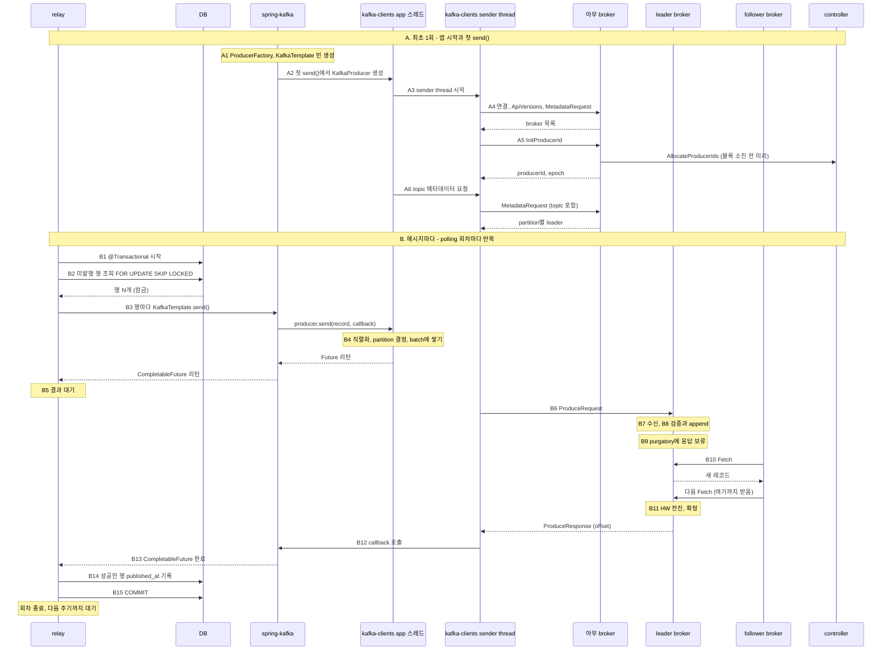
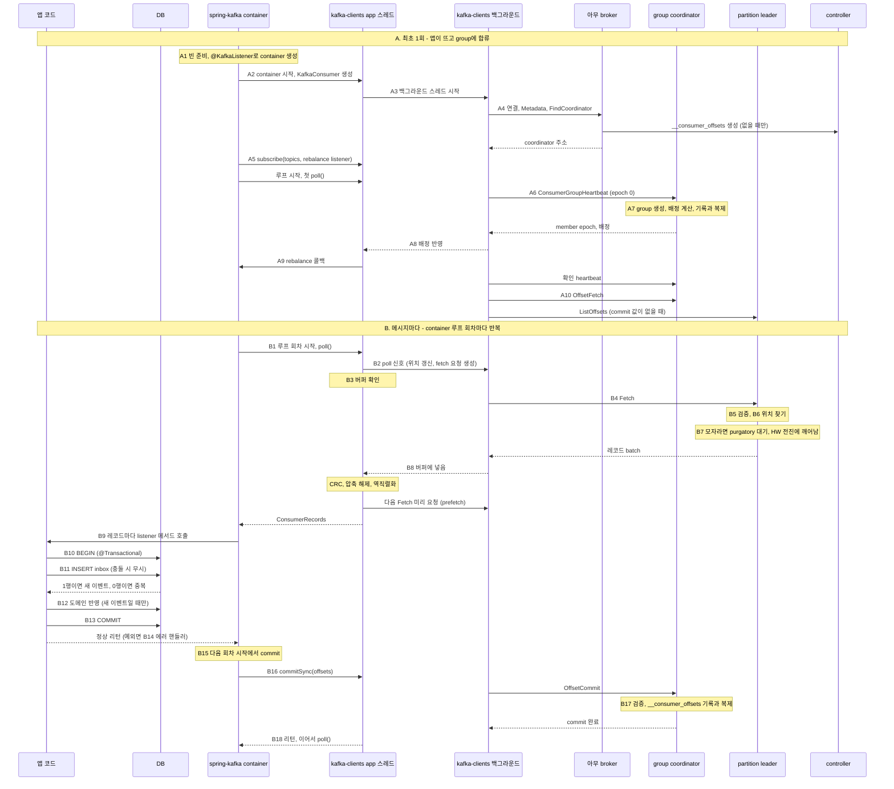

# Kafka Design

> 팀 Notion "Kafka Document"의 **Design** 섹션(버전 v1-26.09.26)을 옮긴 문서입니다.
> 원본: https://app.notion.com/p/3e096dfc3df280839ba4d3a748e17e69 (2026-10-15 기준)

## 목차

- [End-to-end workflow](#end-to-end-workflow)
  - [Producer → Kafka](#producer--kafka)
  - [Consumer → Kafka](#consumer--kafka)
  - [구간별 실패 지점과 책임 주체](#구간별-실패-지점과-책임-주체)
  - [전달 보장](#전달-보장)
- [네트워크 · 보안](#네트워크--보안)
  - [접속 주소와 리스너](#접속-주소와-리스너)
  - [TLS](#tls)
  - [인증 · 인가](#인증--인가)
  - [NetworkPolicy](#networkpolicy)
  - [외부 접근](#외부-접근)
- [Message 계약](#message-계약)
  - [Event](#event)
  - [Topic 네이밍 · 파티션 수 · 키 선택](#topic-네이밍--파티션-수--키-선택)
  - [Message format (value 스키마)](#message-format-value-스키마)
  - [Headers 규약](#headers-규약)
  - [Schema versioning](#schema-versioning)
  - [크기 제한과 Claim Check](#크기-제한과-claim-check)
  - [DLQ](#dlq)
- [Producer 실행 모델 (Outbox Pattern)](#producer-실행-모델-outbox-pattern)
  - [1. 의존성·설정·topic](#1-의존성설정topic)
  - [2. Outbox 테이블](#2-outbox-테이블)
  - [3. 도메인 트랜잭션에서 outbox 쓰기](#3-도메인-트랜잭션에서-outbox-쓰기)
  - [4. Relay 구현](#4-relay-구현)
  - [5. 발행 실패 처리 계단](#5-발행-실패-처리-계단)
  - [6. 여러 인스턴스·순서·종료](#6-여러-인스턴스순서종료)
  - [7. 비교: kafka-clients로 직접 짜면](#7-비교-kafka-clients로-직접-짜면)
  - [8. 테스트](#8-테스트)
- [Consumer 실행 모델 (Inbox Pattern)](#consumer-실행-모델-inbox-pattern)
  - [1. 의존성·설정](#1-의존성설정)
  - [2. Inbox 테이블](#2-inbox-테이블)
  - [3. Listener와 처리 서비스](#3-listener와-처리-서비스)
  - [4. 에러 처리: 재시도와 DLQ](#4-에러-처리-재시도와-dlq)
  - [5. 처리 시간 예산](#5-처리-시간-예산)
  - [6. rebalance와 종료](#6-rebalance와-종료)
  - [7. 비교: kafka-clients로 직접 짜면](#7-비교-kafka-clients로-직접-짜면-1)
  - [8. 테스트](#8-테스트-1)
- [운영](#운영)
  - [lag 모니터링](#lag-모니터링)
  - [DLQ 재투입 절차](#dlq-재투입-절차)
  - [재처리(replay) 절차](#재처리replay-절차)

## End-to-end workflow

### Producer → Kafka

> **참고사항**
>
> - 범위: relay의 **@Scheduled** 메서드가 outbox를 polling하는 순간부터, KafkaTemplate과 kafka-clients를 거쳐 보낸 메시지가 확정(ack)되고 **published_at**을 기록한 뒤 DB commit으로 그 회차를 끝내기까지.
> - 가정: Spring Boot + spring-kafka(KafkaTemplate), 그 아래 Java kafka-clients. `acks=all`, `enable.idempotence=true`(kafka-clients 기본값), Kafka transaction은 쓰지 않음(`spring.kafka.producer.transaction-id-prefix` 없음). partition마다 replica 3개(leader 1 + follower 2), `min.insync.replicas` 2, 모든 메시지에 key가 있음. DB는 JDBC와 @Transactional.
> - 코드에서 broker까지의 층
>   - 앱 코드(relay) → spring-kafka(KafkaTemplate, ProducerFactory) → kafka-clients(KafkaProducer) → broker.
>   - relay 코드, KafkaTemplate, kafka-clients의 send()는 모두 relay 스레드 하나에서 차례로 실행됨. 네트워크는 kafka-clients의 sender thread만 함.
> - 등장 주체: relay(애플리케이션 안의 스케줄러 작업), DB(outbox 테이블), spring-kafka, kafka-clients(**send()**가 도는 app 스레드 쪽 + 백그라운드 sender thread), leader broker, follower broker, controller.
> - 읽는 법: 토글 제목의 대괄호가 그 단계를 실행하는 층. \[spring-kafka\] 다음에 \[kafka-clients\]가 오면 그 사이가 spring-kafka가 kafka-clients를 부르는 지점. A는 앱 시작과 첫 send() 때 한 번, B는 polling 회차마다 반복됨. 다이어그램의 A2, B5 같은 번호가 아래 토글 번호와 같음.



#### A. 최초 1회: 앱 시작과 첫 send() 때 준비

<details>
<summary>1. [Spring Boot] 앱 시작: ProducerFactory와 KafkaTemplate 빈 준비</summary>

- KafkaAutoConfiguration이 `spring.kafka.*` 속성을 모아 ProducerFactory(DefaultKafkaProducerFactory)와 KafkaTemplate 빈을 만듦. 실패를 로그로 남기는 LoggingProducerListener도 붙음.
- 속성은 kafka-clients 설정으로 옮겨짐
  - 예: `spring.kafka.bootstrap-servers` → `bootstrap.servers`, `spring.kafka.producer.acks` → `acks`.
  - 전용 속성이 없는 설정은 `spring.kafka.producer.properties.*`에 적으면 그대로 전달됨. producer와 consumer 공통 설정은 `spring.kafka.properties.*`.
- serializer 기본값은 key, value 모두 문자열용(StringSerializer). 객체를 보내려면 value serializer를 JSON용(JacksonJsonSerializer)으로 바꾸거나, relay가 JSON 문자열로 만들어 넘김.
- 이 시점엔 KafkaProducer가 아직 없음. 연결도 sender thread도 없음 (2번).
- relay 쪽: @EnableScheduling이 있으면 @Scheduled 메서드를 실행할 스케줄러도 이때 준비됨. virtual thread를 켜 두면 가상 스레드용 스케줄러가 만들어짐.

</details>

<details>
<summary>2. [spring-kafka → kafka-clients] 첫 <b>KafkaTemplate.send()</b>에서 KafkaProducer 생성</summary>

- relay가 처음 KafkaTemplate.send()를 부르면(B3), KafkaTemplate이 ProducerFactory에 producer를 달라고 함.
- ProducerFactory는 아직 없으면 그 자리에서 new KafkaProducer(설정)를 부름. 여러 스레드가 동시에 와도 하나만 만들도록 lock을 잡음. 여기부터 kafka-clients (3번).
- 만든 producer는 CloseSafeProducer로 감싸 모든 스레드가 공유함.
  - KafkaTemplate은 전송이 끝날 때마다 close()를 부르지만, 공유 producer는 실제로 닫히지 않음. 이 producer를 더 쓸 수 없는 에러(OutOfOrderSequenceException 등)가 난 경우에만 실제로 닫힘.
- 그래서 3번부터 6번까지가 모두 첫 KafkaTemplate.send() 한 번 안에서 일어남.

</details>

<details>
<summary>3. [kafka-clients] <b>KafkaProducer</b> 생성과 sender thread 시작</summary>

- ProducerFactory가 부른 new KafkaProducer(설정)의 안쪽. 이 producer 하나를 모든 스레드가 계속 재사용함.
- 생성자에서 조립하는 부품
  - serializer: key와 value를 bytes로 바꾸는 변환기.
  - partitioner: 레코드를 보낼 partition을 정하는 규칙.
  - accumulator: partition별 batch 대기열. batch 메모리는 `buffer.memory`(기본 32MB) 크기의 풀에서 빌림.
  - 메타데이터 캐시: 처음엔 bootstrap 주소만 알고, '갱신 필요' 표시가 켜진 상태.
  - idempotence 관리자: producerId, epoch, partition별 sequence 번호를 관리.
- 마지막으로 백그라운드 **sender thread**를 띄움. 이후 네트워크 I/O는 전부 이 스레드 하나가 함.
  - 소켓 여러 개를 selector 하나로 감시하는 이벤트 루프 구조 (개념 › Network 섹션).
- 생성자는 연결을 열지 않음. 연결은 sender thread가 첫 루프에서 시작함 (4, 5번).

</details>

<details>
<summary>4. [kafka-clients → broker] bootstrap 접속과 클러스터 메타데이터</summary>

- sender thread가 첫 루프에서 '갱신 필요' 표시를 보고, bootstrap 주소 중 하나로 TCP 연결을 시작함.
- 연결되면 먼저 **ApiVersions**를 주고받음.
  - broker가 요청 종류별로 지원하는 버전 범위를 알려 주고, 라이브러리는 양쪽이 모두 아는 가장 높은 버전을 씀.
  - broker와 새로 연결할 때마다 한 번씩 함.
- 그다음 **MetadataRequest**를 보냄. 아직 보낼 topic을 모르므로 topic 목록이 비어 있고, 응답에는 broker 목록(id, 주소)만 담김.
- broker 내부
  - 이 요청도 다른 요청처럼 network thread → request queue → I/O thread를 거침 (B7과 같은 경로).
  - I/O thread는 자기 메모리의 메타데이터 캐시로 바로 답함. controller에 묻지 않음.
  - 이 캐시는 controller가 메타데이터 로그에 기록한 내용을 broker가 복제해 둔 사본 (Controller 섹션). 그래서 어느 broker에 물어도 같은 답이 나옴.
- bootstrap 주소는 이 첫 접속에만 쓰임. 이후에는 응답에 담긴 broker별 주소로 직접 연결함.

</details>

<details>
<summary>5. [kafka-clients → broker → controller] producerId 발급 (<b>InitProducerId</b>)</summary>

- idempotence가 켜져 있으면 sender thread가 시작하자마자 producerId부터 요청함. 4번과 거의 동시에 진행됨.
- 보내는 곳: 지금 가장 한가한 broker 아무 데나. transaction을 쓰지 않으면 특정 coordinator를 찾을 필요가 없음.
- broker 내부
  - transaction coordinator 모듈이 받지만, `transactional.id`가 없으므로 트랜잭션 로그에 아무것도 쓰지 않고 producerId 하나와 epoch 0을 돌려줌.
  - producerId는 broker가 controller에게 미리 받아 둔 블록(1000개 단위)에서 하나씩 꺼내 줌.
  - 블록을 90% 쓰면 다음 블록을 controller에 **AllocateProducerIds**로 미리 요청함. controller는 발급 기록을 메타데이터 로그에 남겨, 재시작 후에도 같은 id를 두 번 주지 않음.
  - broker가 막 떠서 첫 블록을 아직 못 받았으면 '잠시 후 재시도' 에러로 답하고, 라이브러리가 다시 보냄.
- producerId를 받기 전에는 sender thread가 accumulator에서 batch를 꺼내지 않음. 모든 batch에 producerId, epoch, sequence가 붙어야 하기 때문.
- 한계: 프로세스가 재시작하면 새 producerId를 받음. 그래서 재시작 전후의 중복은 broker가 구분하지 못함 (Producer 섹션 idempotent producer).

</details>

<details>
<summary>6. [kafka-clients] 첫 <b>send()</b> 때 topic 메타데이터 받기</summary>

- 처음 보내는 topic이면 send() 안(relay 스레드)에서 그 topic을 메타데이터 요청 목록에 추가하고 sender thread를 깨움.
- sender thread가 topic을 담은 **MetadataRequest**를 보내고, partition 수와 partition별 leader(주소, leader epoch)를 받아 캐시에 넣음.
- 그동안 send()는 블록됨. 최대 `max.block.ms`(기본 60초) 기다리고, 넘으면 예외.
  - 실제로는 B의 첫 회차 4번 안에서 일어남. 2번부터 이 6번까지가 모두 첫 KafkaTemplate.send() 한 번 안에서 일어나므로 첫 회차만 조금 느림.
- 이후에는 캐시에서 바로 꺼내 씀. 캐시를 갱신하는 때
  - 주기적으로: `metadata.max.age.ms`(기본 5분).
  - 에러 응답을 받았을 때 즉시 (B12).
  - 아는 broker가 전부 연결 불가일 때: bootstrap 주소로 다시 시작 (`metadata.recovery.strategy`, 4.x 기본값 rebootstrap).

</details>

#### B. 메시지마다: polling 1회차

<details>
<summary>1. [relay · Spring] <b>@Scheduled</b> 메서드 시작, <b>@Transactional</b>로 DB 트랜잭션 시작</summary>

- relay는 애플리케이션 안의 스케줄러 작업. @Scheduled(fixedDelay)로 정해진 주기(예: 1초)마다 한 회차씩 돎.
  - virtual thread를 켜 두면 Spring Boot가 가상 스레드용 스케줄러를 써서, 회차마다 새 가상 스레드에서 돎.
- @Transactional: Spring이 만든 프록시가 메서드 앞에서 트랜잭션 매니저를 부름 → Hikari 풀에서 DB 커넥션을 빌려 autocommit을 끄고 이 스레드에 묶어 둠 → 이 메서드 안의 JDBC 호출은 모두 이 커넥션, 즉 같은 트랜잭션을 씀.
- 이 트랜잭션은 도메인 트랜잭션(데이터 변경 + outbox 행 INSERT)과 별개. 도메인 쪽은 이미 커밋됐고, relay는 커밋된 outbox 행만 봄.
- 발행을 도메인 트랜잭션 안에서 하지 않는 이유: Kafka 전송은 DB 롤백으로 되돌릴 수 없음. 도메인 트랜잭션이 롤백돼도 메시지는 이미 나가 버림.

</details>

<details>
<summary>2. [relay · DB] 미발행 행을 조회하고 잠금</summary>

- 조회: JDBC로 **published_at**이 비어 있는 행을 생성 순서대로 N개(예: 100). 끝에 **FOR UPDATE SKIP LOCKED**를 붙임.
- DB 내부
  - FOR UPDATE: 읽은 행에 행 잠금을 걺. 이 트랜잭션이 끝날 때까지 다른 트랜잭션은 이 행을 잠그거나 수정하지 못함.
  - SKIP LOCKED: 이미 잠긴 행은 기다리지 않고 건너뜀. relay 인스턴스가 여러 개여도 서로 다른 행을 나눠 가져가고, 같은 행을 두 번 보내지 않음.
  - 미발행 행만 담는 부분 인덱스를 두면, 발행된 행이 쌓여도 조회가 느려지지 않음.
- 커서(마지막으로 본 시각) 대신 플래그(published_at)로 고르는 이유: 먼저 시작했지만 늦게 커밋된 행도 다음 회차에 잡힘. 커서 방식은 이런 행을 영영 건너뜀.
- 행이 0개면 바로 커밋하고 회차를 끝냄 (15번).

</details>

<details>
<summary>3. [relay → spring-kafka] 행마다 <b>KafkaTemplate.send()</b></summary>

- relay 코드는 행마다 kafkaTemplate.send(topic, key, value) 한 줄. 돌려받은 CompletableFuture\<SendResult\>를 행과 짝지어 모아 둠.
- spring-kafka 내부 (relay 스레드에서 차례로 실행)
  1. ProducerRecord(topic, key, value)를 만듦. partition과 timestamp는 비워 둠 → kafka-clients가 정함 (4번).
  2. 공유 producer를 꺼냄. 첫 회차라면 여기서 A2부터 A6까지가 일어남.
  3. 전송 시간 측정 타이머를 시작하고, producer interceptor를 등록했다면 먼저 거침. 분산 추적(observation)은 켰을 때만 동작함 (기본 꺼짐).
  4. producer.send(record, callback)을 부름. callback은 KafkaTemplate이 만든 것으로, 결과가 오면 CompletableFuture를 채움 (13번). 여기서 kafka-clients로 넘어감 (4번).
  5. send()가 이미 실패로 끝난 Future를 돌려주면(레코드가 너무 큼 같은 즉시 실패) 그 자리에서 예외를 던짐.
  6. CompletableFuture를 relay에 리턴.

</details>

<details>
<summary>4. [kafka-clients · app 스레드] <b>send()</b>: batch에 쌓고 바로 리턴</summary>

- KafkaTemplate이 부른 send()도 relay 스레드에서 실행되고, 네트워크를 타지 않음.
- 순서
  1. 메타데이터 캐시에서 topic 정보 확인. 첫 회차라면 여기서 A6이 일어남.
  2. serializer로 key와 value를 bytes로 바꿈. Spring Boot 기본은 문자열용(StringSerializer) (A1).
  3. partitioner로 partition 결정: key의 murmur2 해시를 partition 수로 나눈 나머지. 같은 key는 항상 같은 partition으로 가서 순서가 유지됨.
  4. 크기 검사: 레코드가 `max.request.size`(기본 1MB)나 `buffer.memory`보다 크면 즉시 예외.
  5. accumulator에 추가: 그 partition의 batch 줄 마지막 batch에 붙임. 없거나 꽉 찼으면 새 batch(`batch.size`, 기본 16KB)를 만듦. 메모리 풀이 가득 차면 `max.block.ms`까지 블록됨.
  6. Future를 리턴. 결과는 나중에 sender thread가 채우고, 그때 KafkaTemplate이 넘긴 callback도 불림 (12, 13번).
- batch가 꽉 찼거나 새 batch가 생겼으면 sender thread를 깨움 (selector 대기에서 바로 빠져나오게 함).
- send() 자체는 메모리 작업이라 행이 많아도 금방 끝남. 같은 partition의 레코드는 batch 몇 개에 모임.

</details>

<details>
<summary>5. [relay] <b>CompletableFuture</b>로 결과를 기다림</summary>

- relay는 행마다 성공 여부를 알아야 **published_at**을 채울 수 있으므로 여기서 멈춤.
- 기다리는 방법
  - 모아 둔 CompletableFuture를 한꺼번에 기다림 (CompletableFuture.allOf(...).join(), 또는 행마다 get()). 이것만 쓰면 마지막 batch는 `linger.ms`(기본 5ms)만큼 늦게 나감.
  - 먼저 kafkaTemplate.flush()를 부르면 공유 producer의 flush()가 불림. 쌓인 batch를 `linger.ms`를 기다리지 않고 바로 보낼 수 있게 표시하고, 아직 끝나지 않은 batch가 전부 완료될 때까지 블록함.
    - producer를 공유하므로 다른 스레드가 쌓은 batch까지 함께 기다리게 됨.
  - 대기에 상한을 두려면 get(timeout). 시간이 지나 예외가 나도 전송이 취소되지는 않음. kafka-clients는 `delivery.timeout.ms`까지 계속 시도함.
- 기다리는 동안에도 DB 트랜잭션과 행 잠금은 그대로 유지됨. Kafka 쪽이 느려지면 잠금 시간도 길어짐 (최악은 `delivery.timeout.ms`).
- 주의: CompletableFuture의 후속 작업(whenComplete 등) 안에서 flush()를 부르면 예외. 그 코드는 sender thread에서 도는데, sender thread가 자기 일이 끝나기를 기다리는 꼴이 되기 때문 (13번).
- 이제부터 13번까지는 sender thread와 broker에서 일어남.

</details>

<details>
<summary>6. [kafka-clients · sender thread] batch를 leader별로 묶어 <b>ProduceRequest</b> 전송</summary>

- sender thread는 루프를 돌며 매번 이렇게 함
  1. 보낼 수 있는 batch 고르기: 꽉 찼거나, `linger.ms`가 지났거나, flush 중이거나, 메모리가 부족할 때. 재시도 backoff 중인 batch는 제외.
  2. leader를 모르는 partition이 있으면 메타데이터 갱신을 요청함.
  3. leader broker 연결 확인: 처음 보내는 broker면 이때 연결하고 ApiVersions부터 주고받음. 응답을 기다리는 요청이 이미 `max.in.flight.requests.per.connection`(기본 5)개면 이번엔 그 broker를 건너뜀.
  4. batch 꺼내기: broker별로, partition당 batch 1개씩, 요청 하나가 `max.request.size`를 넘지 않을 때까지. 꺼내는 순간 batch에 producerId, epoch, partition별 sequence 번호를 붙임.
  5. `delivery.timeout.ms`를 넘긴 batch는 보내지 않고 실패로 끝냄.
  6. broker마다 **ProduceRequest** 하나를 만들어 보냄. `acks`와 timeout(`request.timeout.ms`, 기본 30초)이 함께 실림.
- `compression.type`을 켰다면 batch는 쌓일 때부터 압축된 상태로 나감.
- 보낸 뒤 응답을 기다리며 멈추지 않음. 다음 루프에서 다른 batch를 보내거나 도착한 응답을 읽음. 이렇게 응답을 기다리는 요청을 in-flight라고 함.

</details>

<details>
<summary>7. [leader broker] 요청 수신: network thread → request queue → I/O thread</summary>

- network thread(`num.network.threads`, 기본 3)가 소켓에서 요청을 끝까지 읽으면 request queue(`queued.max.requests`, 기본 500)에 넣음.
- 그 연결은 응답을 보낼 때까지 mute됨. 연결 하나에서는 요청을 하나씩 처리해 순서를 지킴. in-flight로 뒤따라온 요청은 소켓 버퍼에서 기다림.
- I/O thread(`num.io.threads`, 기본 8)가 큐에서 꺼내 8번을 실행함.
- 자세한 구조는 개념 › Network 섹션.

</details>

<details>
<summary>8. [leader broker] 검증하고 log 끝에 기록</summary>

- partition마다 이 순서로 처리함. 걸리면 그 partition만 에러로 응답함.
  1. 이 broker가 그 partition의 leader인가 → 아니면 **NOT_LEADER_OR_FOLLOWER**. 응답에 새 leader 정보를 실어 줌.
  2. `acks=all`인데 ISR 수가 `min.insync.replicas`보다 적은가 → **NOT_ENOUGH_REPLICAS**. 기록하지 않음.
  3. 레코드 검증과 offset 부여: CRC, 압축 형식, timestamp, 크기(`message.max.bytes`)를 확인하면서 현재 LEO부터 연속 offset을 매김.
  4. producer 상태 확인: partition마다 producerId별로 최근 batch 5개의 sequence를 기억함.
     - 이미 받은 sequence면 다시 쓰지 않고, 처음 기록한 offset으로 성공 응답함. 재시도 중복이 여기서 걸러짐.
     - 기대보다 큰 sequence(중간이 빔)면 **OUT_OF_ORDER_SEQUENCE_NUMBER**.
  5. active segment 파일 끝에 append. page cache에 쓰고 바로 리턴하며 fsync는 하지 않음 (Broker 섹션 '빠른 이유'). 색인은 `index.interval.bytes`(기본 4KB)마다 한 항목만 추가하는 희소 색인.
  6. LEO가 전진함. 아직 leader에만 있는 상태라 consumer는 이 레코드를 읽지 못함.
- controller: 1, 2번 판단의 근거(누가 leader인지, ISR이 누구인지)는 controller가 메타데이터 로그에 기록한 값. broker는 그 사본을 보고 판단함.

</details>

<details>
<summary>9. [leader broker] 응답을 purgatory에 보류</summary>

- `acks=all`이라 follower들이 따라올 때까지 응답할 수 없음. (`acks=1`이면 8번 직후 바로 응답하고 끝.)
- 요청 하나당 **DelayedProduce** 하나를 만들어 produce purgatory에 넣고, 요청에 든 partition마다 감시 키를 걸어 둠.
- 완료 조건: partition마다 high watermark가 이번에 쓴 마지막 offset보다 커지는 것.
- I/O thread는 여기서 바로 반납되어 다른 요청을 처리함. 기다리는 건 스레드가 아니라 DelayedProduce 객체 (Network 섹션 '기다림은 스레드가 아니라 객체').
- 요청의 timeout(`request.timeout.ms`) 안에 조건이 안 차면 **REQUEST_TIMED_OUT**으로 응답함.

</details>

<details>
<summary>10. [follower broker] <b>Fetch</b>로 새 레코드를 복제</summary>

- follower broker에는 leader broker별로 ReplicaFetcherThread가 있음. consumer처럼 leader에게 **Fetch**를 보내는 pull 방식.
- 평소 follower의 Fetch는 leader의 fetch purgatory에서 기다리고 있음. 새 데이터가 없으면 최대 `replica.fetch.wait.max.ms`(기본 500ms) 기다림.
- 8번의 append가 기다리던 Fetch를 깨움 → leader가 새 레코드를 담아 바로 응답함.
- follower는 받은 레코드를 자기 log에 append하고, 다음 Fetch를 '내 LEO부터 줘'로 보냄.
- 이 다음 Fetch의 시작 offset이 곧 '여기까지 받았다'는 신호. follower가 따로 ack를 보내지 않음.

</details>

<details>
<summary>11. [leader broker] high watermark 전진 → 메시지 확정(committed) → 응답 전송</summary>

- leader는 follower의 Fetch를 받으면 그 시작 offset으로 follower의 LEO를 갱신함.
- high watermark = ISR 전원의 LEO 중 최솟값. follower 2개가 모두 따라오면 HW가 이번에 쓴 offset을 넘음.
- HW가 오르면 그 partition에 걸린 지연 요청을 다시 검사함 → 9번의 DelayedProduce 조건이 충족되어 완료됨.
- 이 순간 메시지가 확정(committed)됨.
  - ISR 전원이 가진 상태라 leader가 죽어도 ISR 중에서 뽑히는 새 leader가 이 메시지를 갖고 있음.
  - consumer도 이제 이 메시지를 읽을 수 있음 (consumer는 HW까지만 읽음).
- 응답(**ProduceResponse**, partition별 시작 offset)은 response queue에 들어가고, network thread가 소켓으로 보냄. 이때 연결의 mute가 풀림.
- 실패하면: 기다리는 동안 ISR이 `min.insync.replicas` 미만으로 줄면 **NOT_ENOUGH_REPLICAS_AFTER_APPEND**로 응답함. leader에는 기록됐지만 확정은 못 한 상태.
- controller
  - follower가 `replica.lag.time.max.ms`(기본 30초) 동안 끝까지 따라오지 못하면 leader가 ISR에서 빼 달라고 요청하고, 다시 따라잡으면 넣어 달라고 요청함.
  - 요청은 **AlterPartition**, 확정은 controller가 함. ISR은 leader 선출 후보 명단이라 선출하는 쪽이 확정해야 함.
  - ISR이 줄면 줄어든 ISR 기준으로 HW가 다시 움직여, 기다리던 요청이 풀릴 수 있음.

</details>

<details>
<summary>12. [kafka-clients · sender thread] 응답 처리 → callback 호출</summary>

- 성공
  - batch 안 레코드마다 kafka-clients의 Future를 완료하고, send()에 함께 넘어온 callback(KafkaTemplate이 만든 것)을 부름 (13번). batch 메모리는 풀에 돌려줌.
  - callback은 sender thread에서 실행됨. callback이 오래 걸리면 이 producer의 모든 전송이 멈춤.
- 실패하면
  - 재시도 가능한 에러(**NOT_LEADER_OR_FOLLOWER**, **NOT_ENOUGH_REPLICAS**, **REQUEST_TIMED_OUT**, 연결 끊김 등): batch를 accumulator에 다시 넣음 → 6번부터 다시. relay 쪽 CompletableFuture는 그동안 완료되지 않은 채로 있음.
    - backoff: `retry.backoff.ms`(기본 100ms)에서 시작해 지수적으로 늘려 `retry.backoff.max.ms`(기본 1초)까지 쉼. 단 leader가 바뀐 경우는 쉬지 않고 새 leader로 바로 보냄.
    - 같은 batch를 다시 보내므로 sequence도 같음. broker가 중복을 거르고(8번의 4) 순서도 유지됨.
  - leader 관련 에러: 응답에 실린 새 leader 정보를 캐시에 바로 반영하고, 메타데이터 갱신도 요청함.
    - leader broker가 죽은 경우: controller가 heartbeat 끊김으로 감지해 ISR 중에서 새 leader를 뽑음 → 그 결과가 메타데이터로 전파되어 여기서 반영됨.
  - batch가 너무 크다는 에러: batch를 쪼개서 다시 보냄.
  - 재시도 횟수(`retries`)는 기본값이 사실상 무제한이고, 실제 한도는 시간(`delivery.timeout.ms`, 기본 120초). send() 시점부터 이 시간을 넘으면 실패로 callback이 불림 → 13번에서 CompletableFuture가 예외로 끝남.
  - 즉시 실패하는 에러도 있음: 레코드가 너무 큼, 직렬화 실패, 인증·인가 실패. 이 경우 KafkaTemplate.send()가 바로 예외를 던짐 (3번).
- 여기서 부른 callback이 spring-kafka 쪽 13번.

</details>

<details>
<summary>13. [spring-kafka · sender thread] callback이 <b>CompletableFuture</b>를 완료</summary>

- 12번에서 kafka-clients가 부른 callback은 3번에서 KafkaTemplate이 넘긴 것. sender thread에서 실행됨.
- 순서
  1. producer interceptor가 있으면 결과를 알려 줌.
  2. 성공: SendResult(보낸 ProducerRecord + partition, offset 등 RecordMetadata)로 CompletableFuture를 완료 → 그다음 ProducerListener.onSuccess (기본 LoggingProducerListener는 아무것도 안 함).
  3. 실패: 원인 예외와 실패한 레코드를 KafkaProducerException으로 감싸 CompletableFuture를 예외로 완료 → 그다음 onError가 에러 로그를 남김.
  4. 마지막으로 producer의 close()를 부르지만 공유 producer라 닫히지 않음 (A2).
- CompletableFuture가 완료되는 순간 5번에서 기다리던 relay 스레드가 깨어남.
- 주의: relay가 붙인 후속 작업(whenComplete, thenApply 등)은 executor를 따로 주지 않으면 이 sender thread에서 실행됨. 여기서 DB 작업처럼 오래 걸리는 일을 하면 producer를 공유하는 모든 전송이 멈춤. 결과는 relay 스레드에서 get()이나 join()으로 받아 처리할 것.

</details>

<details>
<summary>14. [relay] 성공한 행만 <b>published_at</b> 기록</summary>

- relay 스레드가 CompletableFuture 결과(SendResult 또는 예외)를 행별로 확인함.
- 성공한 행: JDBC로 published_at을 지금 시각으로 UPDATE. 같은 트랜잭션 안이고, 잠금은 2번부터 들고 있음.
- 실패한 행: 그대로 둠. 커밋 후 잠금이 풀리면 다음 회차에 다시 조회되어 새 KafkaTemplate.send()로 발행됨.
  - 이건 라이브러리 재시도가 아니라 새 메시지라 broker가 중복을 거르지 못함 (sequence가 새로 붙음). 그래서 consumer 쪽 Inbox가 막아야 함.

</details>

<details>
<summary>15. [relay · Spring] 메서드 리턴 → <b>@Transactional</b> COMMIT → 회차 종료</summary>

- relay 메서드가 정상 리턴하면 @Transactional 프록시가 트랜잭션 매니저로 COMMIT을 부름 → published_at 변경이 확정되고 행 잠금이 풀림 → 커넥션은 Hikari 풀로 돌아감. 스케줄 작업이 끝나면서 이번 회차가 끝남.
- 메서드가 예외로 끝나면 트랜잭션 전체가 롤백됨. 이미 Kafka에 성공한 행의 published_at 기록도 취소되므로 다음 회차에 그 행들까지 다시 발행됨 → 중복. 그래서 행 하나의 실패는 예외로 던지지 말고 그 행만 비워 둠 (14번).
- 다음 회차: 이번에 N개를 꽉 채웠으면 바로, 행이 없었으면 주기를 점점 늘리고(backoff), 그 외에는 기본 주기 뒤.
- 중간에 죽으면
  - ack를 받기 전에 죽음: 트랜잭션이 롤백되어 행이 미발행으로 남음 → 다음 회차에 다시 발행. Kafka에 이미 기록됐었다면 중복.
  - ack를 받고 COMMIT 전에 죽음: Kafka에는 기록됐지만 published_at이 비어 있음 → 다음 회차에 다시 발행 → 중복.
  - 어느 경우든 유실은 없고 중복만 생김. 이 구조의 전달 보장은 at-least-once이고, 중복은 consumer가 거름.
- 한 회차에 걸리는 시간은 DB 조회, batch 대기(`linger.ms` 또는 flush), follower 복제 왕복 한 번, UPDATE와 COMMIT을 더한 것.

</details>

### Consumer → Kafka

> **참고사항**
>
> - 범위: 앱이 뜰 때 listener container가 KafkaConsumer를 만들고 group에 합류해 읽을 위치를 정하기까지(A), 그리고 container 루프 한 회차에서 레코드를 받아 **@KafkaListener** 메서드가 Inbox로 중복을 거르며 처리하고 offset commit이 확정되기까지(B).
> - 가정
>   - Spring Boot + spring-kafka(@KafkaListener, 레코드 단위 listener, AckMode BATCH 기본값, DefaultErrorHandler에 DLT recoverer를 붙임), 그 아래 Java kafka-clients.
>   - `group.protocol=consumer`(`spring.kafka.consumer.properties.group.protocol`로 켬), `isolation.level` 기본값.
>   - **Inbox가 기본**: consumer 쪽 DB에 Inbox 테이블(이벤트 id가 기본 키)을 두고, listener 메서드가 @Transactional로 Inbox 기록과 도메인 반영을 한 트랜잭션에서 함. 모든 이벤트에 고유한 이벤트 id가 있음.
> - 코드에서 broker까지의 층
>   - broker → kafka-clients(KafkaConsumer) → spring-kafka(listener container) → 앱 코드(@KafkaListener 메서드).
>   - container 스레드 하나가 spring-kafka 루프, kafka-clients의 poll()과 commitSync(), 앱의 listener 메서드를 모두 차례로 실행함. 네트워크는 kafka-clients 백그라운드 스레드만 함.
>   - 앱 코드는 poll()과 commit을 직접 부르지 않음. container가 대신 부름.
> - 등장 주체: 앱 코드(listener 메서드), DB(Inbox와 도메인 테이블), spring-kafka(listener container), kafka-clients(container 스레드에서 도는 app 스레드 쪽 + 백그라운드 스레드), 아무 broker, group coordinator broker, partition leader broker, controller.
> - 읽는 법: 토글 제목의 대괄호가 그 단계를 실행하는 층. A는 앱이 뜰 때 한 번(rebalance 때는 일부가 다시 일어남), B는 container 루프 회차마다 반복됨. 다이어그램의 A6, B11 같은 번호가 아래 토글 번호와 같음.



#### A. 최초 1회: 앱이 뜨고 group에 합류

<details>
<summary>1. [Spring Boot · spring-kafka] 앱 시작: 빈 준비와 <b>@KafkaListener</b>로 container 생성</summary>

- auto-configuration이 `spring.kafka.consumer.*`로 ConsumerFactory를, `spring.kafka.listener.*`로 container factory(ConcurrentKafkaListenerContainerFactory)를 만듦.
  - 전용 속성이 없는 설정(예: `group.protocol`)은 `spring.kafka.consumer.properties.*`로 그대로 전달됨.
  - deserializer 기본값은 key, value 모두 문자열용(StringDeserializer). 역직렬화 실패에 대비해 ErrorHandlingDeserializer로 감싸 두는 것이 좋음 (B14).
- @KafkaListener가 붙은 메서드를 찾아 endpoint로 등록함. 모든 빈이 만들어진 뒤 endpoint마다 container factory로 container(ConcurrentMessageListenerContainer)를 만듦.
- 이 시점엔 container를 만들기만 하고 시작하지 않음. KafkaConsumer도 아직 없음.

</details>

<details>
<summary>2. [spring-kafka → kafka-clients] container 시작: ConsumerFactory로 KafkaConsumer 생성</summary>

- 애플리케이션 컨텍스트가 뜨는 마지막 단계(refresh 끝, 다른 빈보다 늦은 순서)에서 container들이 자동으로 start됨.
- `concurrency`가 N이면 자식 container N개가 각자 start되고, 각자 ListenerConsumer 하나를 만듦. 생성자에서 차례로:
  1. AckMode와 consumer 설정을 정리함.
  2. `enable.auto.commit`을 직접 설정하지 않았으면 false로 덮어씀. commit은 container가 함 (B15).
  3. ConsumerFactory.createConsumer(...) → new KafkaConsumer(설정). 여기부터 kafka-clients (3번).
  4. subscribe(topics, rebalance listener)를 부름 (5번).
- 그다음 ListenerConsumer를 executor에 넘겨 container 스레드에서 루프를 시작함 (6번, B1). 시작한 쪽은 container 스레드가 뜰 때까지 잠깐 기다림.
  - 스레드 이름은 '리스너 id-번호-C-n'. virtual thread를 켜 두면 가상 스레드 'kafka-n'.
- 여기까지는 컨텍스트를 띄우는 스레드에서 실행되고, 이후 KafkaConsumer는 container 스레드만 씀.

</details>

<details>
<summary>3. [kafka-clients] <b>KafkaConsumer</b> 생성과 백그라운드 스레드 시작</summary>

- ConsumerFactory가 부른 new KafkaConsumer(설정)의 안쪽. `group.protocol=consumer`면 새 구현(AsyncKafkaConsumer)이 선택됨. classic이면 예전 구현이라 스레드 구조가 다름.
- 생성자가 하는 일
  - deserializer, 설정, 메타데이터 캐시(처음엔 bootstrap 주소만 앎)를 준비함.
  - member id를 UUID로 직접 만듦. consumer가 살아 있는 동안 바뀌지 않음. (classic에서는 broker가 발급)
  - 백그라운드 스레드를 띄움. 이 스레드가 request manager들을 만들고, 생성자는 그 준비가 끝날 때까지 기다림.
    - request manager: coordinator 찾기, heartbeat, group 멤버 상태, commit, offset 조회, fetch를 하나씩 맡는 부품. 백그라운드 스레드가 루프를 돌며 차례로 불러 보낼 요청을 모음.
- 두 스레드의 역할
  - app 스레드(poll()을 부르는 스레드, 여기서는 container 스레드): 레코드 파싱과 역직렬화, rebalance 콜백 실행.
  - 백그라운드 스레드: 모든 네트워크 I/O(heartbeat, fetch, commit, 메타데이터).
  - 둘은 이벤트 큐 2개로 대화함. app → 백그라운드는 요청 이벤트, 백그라운드 → app은 에러와 콜백 요청.
- 이 프로토콜에서는 `session.timeout.ms`, `heartbeat.interval.ms`, `partition.assignment.strategy`를 설정하면 예외가 남. 이 값들은 broker가 정함 (7번).

</details>

<details>
<summary>4. [kafka-clients → broker] bootstrap 접속, 메타데이터, coordinator 찾기 (<b>FindCoordinator</b>)</summary>

- 백그라운드 스레드가 시작하자마자 bootstrap 주소로 연결 → **ApiVersions** → **MetadataRequest** (Producer A4와 같음).
- coordinator를 모르는 동안 매 루프 **FindCoordinator**를 가장 한가한 broker에 보냄. key는 group id. subscribe()를 기다리지 않음.
- broker 내부
  - group id의 해시를 `__consumer_offsets` partition 수로 나눈 나머지 → 그 partition의 leader broker가 이 group의 coordinator.
  - 이 계산은 어느 broker가 해도 같음. broker는 자기 메타데이터 사본에서 그 partition의 leader를 찾아 알려 줌.
  - `__consumer_offsets`가 아직 없으면(클러스터에 group이 처음 생길 때) broker가 controller에 생성을 요청하고, 일단 **COORDINATOR_NOT_AVAILABLE**로 답함 → 라이브러리가 잠시 후 다시 물음.
    - 이 내부 topic은 `auto.create.topics.enable`과 상관없이 만들어짐. partition 수는 `offsets.topic.num.partitions`(기본 50), 복제 수는 `offsets.topic.replication.factor`.
- 이후 coordinator가 바뀌면(그 partition의 leader가 바뀌면) 요청이 **NOT_COORDINATOR**로 실패함 → 라이브러리가 coordinator를 모르는 상태로 되돌리고 다시 찾음.

</details>

<details>
<summary>5. [spring-kafka → kafka-clients] <b>subscribe()</b>: 구독 topic과 rebalance listener 등록</summary>

- container가 @KafkaListener의 topic 목록(또는 정규식)과 함께 spring-kafka의 rebalance listener를 넘김. 앱이 등록한 rebalance listener가 있으면 이 안에서 불러 줌 (9번).
- 호출한 스레드는 백그라운드가 구독 정보를 반영할 때까지 잠깐 기다리지만, 반영 내용은 '구독이 바뀌었다'는 표시 하나뿐. 네트워크를 타지 않음.
- 실제 group 합류는 6번, container 루프의 첫 poll()에서 시작됨. subscribe()만 하고 poll()을 부르지 않으면 group에 들어가지 않음.

</details>

<details>
<summary>6. [kafka-clients → coordinator] container 루프의 첫 <b>poll()</b>에서 group 합류: <b>ConsumerGroupHeartbeat</b></summary>

- container 스레드의 루프(B1)가 처음 poll()을 부르는 순간이 이 단계. 앱 코드는 poll()을 직접 부르지 않음.
- 첫 poll()이 백그라운드에 신호를 보내면, 멤버 상태가 '구독 안 함'에서 '합류 중'으로 바뀌고 heartbeat를 바로 보냄.
- 이 프로토콜에서는 합류, 배정 받기, 생존 신호, 탈퇴가 전부 이 요청 하나로 이루어짐. classic의 JoinGroup, SyncGroup, Heartbeat, LeaveGroup을 대체함.
- 첫 heartbeat에 담는 것
  - group id, member id(3번에서 만든 UUID), member epoch 0('새로 들어왔다'는 뜻).
  - 구독 topic 이름.
  - rebalance timeout: 값은 `max.poll.interval.ms`. partition을 내려놓으라는 요청을 받았을 때 이 시간 안에 처리하겠다는 약속.
  - 지금 가진 partition: 합류할 때는 반드시 빈 목록.
  - 서버 assignor 이름: `group.remote.assignor`를 지정했을 때만.
- 두 번째 heartbeat부터는 바뀐 항목만 보냄.
- 배정과 시작 위치가 준비될 때까지(7번부터 10번까지) 처음 몇 번의 poll()은 빈 결과를 돌려줌.

</details>

<details>
<summary>7. [coordinator broker] group과 멤버 생성, partition 배정 계산</summary>

- 수신 경로는 다른 요청과 같음. coordinator 안에서는 `__consumer_offsets` partition 하나가 상태 기계 하나라, 같은 partition에 모인 group들의 요청은 순서대로 처리됨 (Consumer Group 섹션).
- 처리 순서
  1. member epoch가 0이고 group이 없으면 새로 만들고 멤버를 추가함.
  2. 구독 정보가 바뀌었으므로 group epoch를 올림. group epoch는 '배정을 다시 계산해야 하는 변화'의 세대 번호.
  3. 목표 배정 계산: 서버 쪽 assignor(`group.consumer.assignors`, 기본 uniform)가 모든 멤버와 partition을 보고 누가 무엇을 가질지 정함.
     - 멤버가 한꺼번에 여러 명 들어와도 매번 다시 계산하지 않도록, 계산 간격을 `group.consumer.assignment.interval.ms`(기본 1초)로 제한함. 그 사이에는 직전 목표 배정을 씀.
  4. 멤버별 조정: 각 멤버를 목표 배정 쪽으로 옮김. 다른 멤버가 아직 들고 있는 partition은 그 멤버가 내려놓기 전까지 넘겨주지 않음 → 한 partition을 두 멤버가 동시에 읽는 일이 없음.
  5. 멤버 정보, group epoch, 목표 배정, 현재 배정을 레코드로 `__consumer_offsets`의 그 partition에 씀.
  6. 메모리 상태에는 바로 반영하지만, 응답은 이 레코드가 복제로 확정(high watermark 통과)될 때까지 보류함. coordinator가 바뀌어도 새 leader가 이 로그로 상태를 복원할 수 있어야 하기 때문.
- 응답에 담는 것: member epoch, 배정된 partition(topic 이름이 아니라 topic id로), 다음 heartbeat까지의 간격(`group.consumer.heartbeat.interval.ms`, 기본 5초).
- 생존 감시도 broker가 함: `group.consumer.session.timeout.ms`(기본 45초) 동안 heartbeat가 없으면 멤버를 빼고 그 partition을 다른 멤버에게 재배정함.
- classic과의 차이: 배정을 client 쪽 group leader가 아니라 coordinator가 직접 계산하고, 바뀌는 partition만 옮김. 다른 멤버는 멈추지 않음.

</details>

<details>
<summary>8. [kafka-clients] 배정 반영 (reconciliation)</summary>

- 백그라운드가 응답의 topic id를 메타데이터로 topic 이름으로 바꿈. 모르는 id면 메타데이터를 새로 받아 옴.
- 반영 순서
  1. 내려놓을 partition부터: 그 partition의 fetch를 멈추고, auto commit이 켜져 있으면 여기서 commit함.
  2. 회수 콜백(**onPartitionsRevoked**)을 실행함. 이 콜백은 5번에서 넘긴 spring-kafka의 rebalance listener (9번).
  3. 새 partition을 할당하고 할당 콜백(**onPartitionsAssigned**)을 실행함 (역시 9번).
  - 콜백은 백그라운드가 아니라 app 스레드(container 스레드)가 poll() 안에서 실행함. 백그라운드가 '콜백 필요' 이벤트를 보내면 app 스레드가 poll()에서 처리함.
  - 그래서 poll()을 부르지 않으면 rebalance가 끝나지 않음.
- 다 반영하면 확인 상태로 바꾸고 바로 heartbeat를 보내 지금 가진 partition을 알림 → coordinator가 이를 보고 조정을 마무리함 → 안정 상태.
- 멤버 상태 흐름: UNSUBSCRIBED → JOINING → RECONCILING → ACKNOWLEDGING → STABLE. 이후 배정이 바뀌면 RECONCILING으로 돌아감.
- 이후 heartbeat는 응답이 알려 준 간격마다 백그라운드가 보냄. 응답에 새 배정이 오면 이 8번과 9번이 다시 일어남 (= rebalance).

</details>

<details>
<summary>9. [spring-kafka] rebalance 콜백 처리</summary>

- 8번에서 kafka-clients가 부르는 콜백은 5번에서 넘긴 spring-kafka의 rebalance listener. container 스레드가 poll() 안에서 실행함.
- partition을 내려놓을 때 (revoked)
  1. 앱이 등록한 listener의 'commit 전' 콜백을 부름.
  2. 그때까지 처리했지만 아직 commit하지 않은 offset(B9에서 모아 둔 것)을 **먼저 commit**함. 넘어가는 partition을 새 담당자가 중복 없이 이어받게 하려는 것.
  3. 앱 listener의 'commit 후' 콜백을 부름.
- partition을 받을 때 (assigned)
  1. listener가 ConsumerSeekAware를 구현했다면 초기 위치를 지정(seek)할 기회를 먼저 줌.
  2. 앱이 등록한 rebalance listener의 onPartitionsAssigned를 부름.
  3. 에러 핸들러에도 새 배정을 알림.
- 앱이 listener를 등록하지 않으면 로그만 남기는 기본 listener가 쓰임.
- KIP-848에서는 배정이 조금씩 바뀌므로 이 콜백이 작은 partition 묶음으로 여러 번 불릴 수 있음.

</details>

<details>
<summary>10. [kafka-clients → broker] 읽기 시작할 위치 정하기 (<b>OffsetFetch</b>, <b>ListOffsets</b>)</summary>

- poll()의 신호를 받으면 백그라운드가 새로 받은 partition의 위치를 채움.
- 순서
  1. **OffsetFetch**를 coordinator에 보내 이 group이 commit해 둔 offset을 받음. coordinator는 메모리에 올려 둔 값으로 바로 답함.
  2. commit 값이 있으면 그 위치부터 읽음. commit 값은 '마지막으로 처리한 offset'이 아니라 '다음에 읽을 offset'.
  3. 없으면 `auto.offset.reset`을 따름: **ListOffsets**를 partition leader에 보내 가장 오래된 위치(earliest) 또는 끝 위치(latest, 기본값)를 받음. 새 group이 latest면 그 전에 쌓인 메시지는 읽지 않음.
  4. leader가 바뀐 뒤처럼 필요할 때는 **OffsetsForLeaderEpoch**로 그 위치가 새 leader의 log에서도 유효한지 확인함 (KIP-320). log가 잘려 나간 경우를 잡아냄.
- 위치가 정해지면 그 partition은 fetch 대상이 됨 → B로.

</details>

#### B. 메시지마다: container 루프 1회차

<details>
<summary>1. [spring-kafka · container 스레드] 루프 회차 시작 → <b>poll()</b> 호출</summary>

- container 스레드는 멈출 때까지 같은 순서를 반복함 (ListenerConsumer 루프 한 바퀴):
  1. 앞 회차에서 처리가 끝난 offset이 있으면 먼저 commit함. 15번과 16번이 실제로 일어나는 자리.
  2. 필요하면 poll 사이에 쉬고, 요청된 seek를 반영하고, pause 요청이 있으면 consumer를 멈춤.
  3. consumer.poll(poll timeout)을 부름. `spring.kafka.listener.poll-timeout`, 기본 5초. 여기서 kafka-clients로 넘어감 (2번).
  4. 받은 레코드가 있으면 listener를 부름 (9번).
  5. resume 요청이 있으면 다시 풀어 줌.
- 앱 코드는 이 루프를 직접 짜지 않음. listener 메서드만 제공함.

</details>

<details>
<summary>2. [kafka-clients · app 스레드] <b>poll()</b> 호출</summary>

- container가 부른 poll(timeout). timeout은 container의 poll timeout(1번)이고, '레코드가 없을 때 최대로 기다릴 시간'이지 주기가 아님.
- poll()이 하는 일 (app 스레드 = container 스레드)
  1. poll 타이머를 리셋함. `max.poll.interval.ms`(기본 5분) 안에 다음 poll()이 와야 '처리 루프가 살아 있다'로 인정됨.
  2. 백그라운드에 '지금 poll 중' 신호를 하나 보냄. 결과를 기다리지 않음. 이 신호를 받은 백그라운드는 위치를 갱신하고(A10) fetch 요청을 만듦(4번). auto commit을 켰다면 주기가 지났는지도 이때만 검사함.
  3. 백그라운드가 보낸 이벤트를 처리함: 에러 전달, rebalance 콜백 실행(A8, A9).
- 그동안 백그라운드는 heartbeat를 따로 계속 보냄. heartbeat는 '프로세스가 살아 있다', poll 간격은 '처리 루프가 돈다'를 증명하는 별개의 신호.
- 실패하면: poll 간격이 `max.poll.interval.ms`를 넘으면 백그라운드가 먼저 group을 떠남(탈퇴 heartbeat, epoch -1). 가진 partition을 잃고 유실 콜백(**onPartitionsLost**)이 불림. 다음 poll()에서 다시 합류함(A6부터).

</details>

<details>
<summary>3. [kafka-clients · app 스레드] 버퍼 확인</summary>

- 전에 받아 둔 응답이 버퍼에 있으면 네트워크 없이 바로 8번으로 감.
- 없으면 레코드가 도착하거나 poll timeout이 될 때까지 기다림.
- Java의 새 consumer는 백그라운드가 혼자 계속 fetch하지 않음. fetch 요청은 poll()의 신호(2번)와, 레코드를 돌려주기 직전의 미리 요청(8번)으로만 만들어짐. 그래서 앱이 처리하는 동안 미리 받아 두는 양은 대략 fetch 한 번 분량.

</details>

<details>
<summary>4. [kafka-clients · 백그라운드] <b>Fetch</b> 전송</summary>

- fetch 대상 partition: 버퍼에 데이터가 없고, pause나 회수 대기 중이 아니고, 읽을 위치가 정해진 partition.
- broker 단위로 묶음: partition leader(또는 지정된 read replica)별로 **Fetch** 요청 하나. 이미 응답을 기다리는 fetch가 있거나 버퍼에 그 broker의 데이터가 남아 있으면 그 broker는 이번에 건너뜀.
- 요청에 싣는 것
  - partition별 읽을 위치와 알고 있는 leader epoch.
  - 대기 조건: `fetch.min.bytes`(기본 1), `fetch.max.wait.ms`(기본 500ms).
  - 양의 상한: `max.partition.fetch.bytes`(기본 1MB), `fetch.max.bytes`(기본 50MB).
  - `isolation.level`.
- fetch session (KIP-227): broker별로 세션을 두고, 두 번째 요청부터는 바뀐 partition만 보냄. partition이 많을 때 요청 크기를 줄임.

</details>

<details>
<summary>5. [leader broker] 요청 수신과 검증</summary>

- network thread → request queue → I/O thread (Producer B7과 같은 경로).
- partition마다 검증
  - 이 broker가 leader인가 → 아니면 **NOT_LEADER_OR_FOLLOWER**. 새 leader 정보를 실어 줌.
  - 요청의 leader epoch가 현재와 맞는가 → 옛 epoch면 **FENCED_LEADER_EPOCH**. 라이브러리가 메타데이터를 갱신하고 위치를 검증함(A10의 4).
  - 읽을 위치가 log 범위 안인가 → 아니면 **OFFSET_OUT_OF_RANGE**. 라이브러리가 `auto.offset.reset`으로 위치를 다시 정함. 보존 기간이 지나 지워진 구간이면 그 사이 메시지는 유실.

</details>

<details>
<summary>6. [leader broker] 읽을 범위와 위치 찾기</summary>

- 어디까지 읽을 수 있나
  - consumer(read_uncommitted, 기본값): high watermark까지. 확정된 메시지만.
  - read_committed: LSO(아직 끝나지 않은 가장 오래된 트랜잭션의 시작)까지.
  - follower: LEO까지. 복제하려면 확정 전 데이터도 가져가야 하기 때문.
- 위치 찾기: 읽을 위치가 든 segment를 시작 offset으로 이진 탐색 → 그 segment의 희소 색인에서 가장 가까운 앞 항목을 이진 탐색 → 그 파일 위치부터 앞으로 스캔.
- batch 단위로 잘라 줌: 읽을 위치가 든 batch의 시작부터 보내므로, 앞부분의 이미 읽은 레코드는 라이브러리가 버림.
- 데이터를 복사하지 않고 '파일의 이 구간'만 가리켜 둠. 응답을 보낼 때 page cache에서 소켓으로 바로 보냄(zero-copy). TLS를 켜면 암호화 때문에 이게 안 됨 (Broker 섹션).
- 방금 쓰인 데이터는 page cache에 있어 디스크를 읽지 않음. 오래된 데이터를 다시 읽는 consumer는 디스크를 읽음.

</details>

<details>
<summary>7. [leader broker] 모자라면 purgatory에서 대기</summary>

- 모은 바이트가 `fetch.min.bytes`보다 적으면 바로 응답하지 않고 **DelayedFetch**를 fetch purgatory에 넣음. I/O thread는 반납됨.
- 깨어나는 때: 요청한 partition에 읽을 수 있는 데이터가 생겼을 때, 또는 `fetch.max.wait.ms`가 지났을 때.
- consumer의 Fetch를 깨우는 건 leader의 append가 아니라 **high watermark 전진**(Producer B11). consumer는 확정된 메시지만 읽기 때문.
  - 그래서 produce부터 consume까지의 지연은 대략 follower 복제 시간 + fetch 왕복.
- 이 대기 덕분에 poll을 계속 돌아도 바쁜 대기가 되지 않음 (long polling, Consumer 섹션).

</details>

<details>
<summary>8. [kafka-clients] 응답을 버퍼에 넣고, <b>poll()</b>이 레코드를 꺼내 돌려줌</summary>

- 백그라운드는 응답을 받아 partition별로 버퍼에 넣기만 함. 파싱은 하지 않음.
- app 스레드가 poll() 안에서 버퍼를 꺼내 처리함
  1. batch마다 CRC 검사(`check.crcs`).
  2. 압축 해제.
  3. key와 value 역직렬화.
  4. 읽을 위치보다 앞의 레코드는 버리고, 최대 `max.poll.records`(기본 500)개까지 모음.
  - 압축 해제와 역직렬화가 app 스레드에서 일어나므로, 이 비용은 poll() 시간에 들어감.
- 돌려주기 직전에 다음 Fetch를 미리 요청함(prefetch). listener가 9번부터 13번까지를 처리하는 동안 다음 데이터가 도착해 버퍼에 쌓임.
- 레코드가 있으면 poll()이 ConsumerRecords를 container에 리턴함 (9번). 각 partition의 읽을 위치는 돌려준 마지막 offset + 1로 전진함.

</details>

<details>
<summary>9. [spring-kafka] 레코드를 메서드 인자로 바꿔 <b>@KafkaListener</b> 메서드 호출</summary>

- poll()이 돌려준 ConsumerRecords를 레코드마다 차례로 처리함 (레코드 단위 listener).
  1. 역직렬화 실패 확인: ErrorHandlingDeserializer로 감싸 두었다면 실패가 여기서 드러나 바로 14번으로 감.
  2. record interceptor를 등록했다면 먼저 거침.
  3. 메시지 변환: ConsumerRecord를 Spring Message로 바꿈. payload는 kafka-clients deserializer가 이미 만든 value, 헤더에는 key, topic, partition, offset 등이 들어감. 문자열 value를 DTO로 받으려면 JSON용 message converter가 필요함.
  4. 메서드 파라미터(@Payload, @Header 등)에 맞춰 인자를 만들고 listener 메서드를 부름 → 10번부터 13번.
  5. 메서드가 정상 리턴하면 그 레코드를 'commit 대기' 큐에 넣음. AckMode BATCH는 여기서 commit하지 않음 (15번).
- 예외를 던지면 14번으로.
- 순서: 레코드는 한 container 스레드에서 차례로 처리되므로 partition 안의 순서가 지켜짐. listener 안에서 다른 스레드로 넘기면 순서도 commit 시점도 깨짐.
- 처리 시간 주의: 한 번 poll한 묶음을 다 처리하는 시간이 `max.poll.interval.ms`를 넘으면 2번의 이탈이 일어남. 오래 걸리는 처리는 `max.poll.records`를 줄이거나 pause와 별도 작업자로 풀어야 함 (Design 'Consumer 실행 모델').

</details>

<details>
<summary>10. [앱 · Spring] <b>@Transactional</b>로 DB 트랜잭션 시작</summary>

- listener 메서드에 @Transactional을 붙여 둠. Spring 프록시가 메서드 앞에서 트랜잭션 매니저를 부름 → DB 커넥션을 빌려 autocommit을 끄고 이 스레드(container 스레드)에 묶어 둠.
- 레코드 하나마다 트랜잭션 하나. 11번부터 13번까지의 DB 작업은 모두 이 트랜잭션 안에서 일어남.
- Kafka offset commit은 이 트랜잭션에 들어가지 않음. DB와 Kafka는 따로 커밋되므로, 그 사이의 틈을 Inbox가 메움 (11번).

</details>

<details>
<summary>11. [앱 · DB] Inbox에 이벤트 id 기록 시도: 중복 판정</summary>

- 이벤트 id를 기본 키로 Inbox 테이블에 INSERT하되, 이미 있으면 무시하게 씀 (PostgreSQL이면 ON CONFLICT DO NOTHING). 몇 행이 들어갔는지로 판정함.
  - 1행: 처음 보는 이벤트 → 12번으로.
  - 0행: 이미 처리한 이벤트 → 도메인 반영을 건너뛰고 정상 리턴 (13번). 예외를 던지면 에러 핸들러가 재시도를 반복하므로 던지지 않음.
- SELECT로 먼저 확인하고 INSERT하는 방식은 쓰지 않음.
  - 같은 레코드가 동시에 두 번 처리될 수 있음. 예: rebalance 뒤에도 쫓겨난 옛 멤버가 처리를 계속하는 경우.
  - 둘 다 SELECT에서 '없음'을 보면 둘 다 반영하게 됨.
  - INSERT를 먼저 하면 두 번째 트랜잭션은 기본 키에서 첫 번째가 끝나길 기다렸다가, 첫 번째가 커밋되면 충돌(0행)로 끝남 → 한 번만 반영됨.
- 중복이 오는 이유
  - producer 쪽 재발행 (Producer B14, B15).
  - 이 consumer가 DB COMMIT 후 offset commit 전에 죽거나 partition을 빼앗긴 경우 (18번).
  - Kafka offset commit과 DB 트랜잭션은 원자적으로 묶이지 않으므로 Inbox가 필요함.
- Inbox 행은 계속 쌓이므로 주기적으로 지움. 단 보관 기간은 같은 이벤트가 다시 올 수 있는 기간(topic 보존 기간, replay 범위)보다 길어야 함. 먼저 지우면 그 뒤에 온 중복을 못 거름.

</details>

<details>
<summary>12. [앱 · DB] 도메인 반영 (새 이벤트일 때만)</summary>

- 11번에서 1행이 들어갔을 때만 이벤트 내용을 도메인 테이블에 반영함. 같은 트랜잭션이라 Inbox 행과 함께 확정되거나 함께 취소됨.
- 이벤트가 '변화'가 아니라 '현재 상태'를 담고 버전(revision)이 있다면, 저장된 버전보다 오래된 이벤트는 반영하지 않는 버전 비교를 함께 두면 순서가 조금 꼬여도 마지막 상태로 수렴함.
- 여기서 예외가 나면(제약 위반, DB 장애 등) 메서드 밖으로 던짐 → 트랜잭션이 롤백되어 Inbox 행도 사라짐 → 14번에서 다시 시도할 때 처음 처리처럼 동작함.

</details>

<details>
<summary>13. [앱 · Spring] 메서드 리턴 → COMMIT: Inbox 행과 도메인 변경이 함께 확정</summary>

- listener 메서드가 정상 리턴하면 @Transactional 프록시가 COMMIT을 부름 → Inbox 행과 도메인 변경이 함께 확정되고 커넥션은 풀로 돌아감.
- COMMIT이 끝난 뒤에 제어가 spring-kafka로 돌아가고, 그때 레코드가 'commit 대기'에 들어감 (9번의 5). 즉 DB 확정이 항상 offset commit보다 먼저.
- COMMIT 자체가 실패하면 예외가 메서드 밖으로 나감 → 14번.

</details>

<details>
<summary>14. [spring-kafka] 처리 실패: 에러 핸들러와 DLT</summary>

- listener가 예외를 던지면(DB 트랜잭션은 이미 롤백됨) DefaultErrorHandler가 받음.
  1. 같은 poll 묶음에서 앞서 성공한 레코드들의 offset을 먼저 commit함.
  2. 실패한 레코드와 그 뒤 레코드 위치로 seek → 다음 poll에서 다시 받아 9번부터 다시 처리함. Inbox 행이 롤백됐으므로 처음 처리처럼 동작함.
  3. 기본은 간격 없이 최대 10번 시도. 간격(BackOff)을 주면 그동안 container 스레드가 잠듦 → 합이 `max.poll.interval.ms`를 넘으면 group에서 밀려나므로, 긴 대기는 container를 pause하는 방식으로 함.
  4. 다 실패하면 recoverer가 실행됨. DeadLetterPublishingRecoverer는 레코드를 DLT로 보냄.
     - 내부적으로 KafkaTemplate.send()를 부르므로 **Producer → Kafka의 B3부터 같은 경로**를 탐.
     - 보낸 결과를 기다려 확인함. 최대 대기는 `delivery.timeout.ms` + 5초(기본 125초).
  5. recoverer가 성공하면 그 레코드는 처리된 것으로 보고 'commit 대기'에 넣음 → 다음 회차 시작에서 commit (15번).
- 재시도해도 소용없는 예외(역직렬화 실패, 메시지 변환 실패 등)는 2, 3을 건너뛰고 바로 4로.
- recoverer를 붙이지 않으면(기본값) 4에서 로그만 남기고 5로 감 → 실패한 메시지가 사라짐.
- DLT로 간 레코드는 Inbox에 기록되지 않음. 나중에 DLT에서 원래 topic으로 재투입하면 처음 처리처럼 동작함.
- DLT 이름 기본값은 원래 topic + '-dlt'. 다른 이름을 쓰려면 목적지를 지정해야 함 (spring-kafka 섹션).

</details>

<details>
<summary>15. [spring-kafka] 다음 회차 시작에서 commit할 offset 정리</summary>

- AckMode BATCH에서는 9번에서 'commit 대기' 큐에 넣어 둔 레코드를 다음 루프 바퀴의 시작(1번의 1)에서 처리함.
  1. 큐에서 레코드를 꺼내 partition별로 가장 큰 offset만 남김.
  2. 각각 offset + 1(다음에 읽을 위치)로 commit할 목록을 만듦.
  3. consumer.commitSync(목록, 대기 시간)을 부름 → 16번. 기본이 동기 commit이라 container 스레드가 결과를 기다림.
- 그래서 이번 회차 레코드의 commit은 실제로는 다음 poll 직전에 일어남.
- partition을 빼앗길 때는 다음 회차를 기다리지 않고 rebalance 콜백 안에서 바로 commit함 (A9).
- 다른 AckMode: RECORD는 레코드마다 바로, TIME과 COUNT는 시간이나 개수가 차면, MANUAL 계열은 listener가 Acknowledgment.acknowledge()를 부른 것만.

</details>

<details>
<summary>16. [kafka-clients · app 스레드] <b>commitSync()</b>: OffsetCommit 요청과 대기</summary>

- 넘기는 값: container가 정리한 partition별 '처리한 마지막 offset + 1'(다음에 읽을 위치) (15번).
- app 스레드(container 스레드)는 결과를 기다림. 최대 `default.api.timeout.ms`(기본 60초). container가 대기 시간을 따로 정하지 않으면 이 값을 씀.
- 백그라운드가 **OffsetCommit**을 coordinator에 보냄. group id, member id, member epoch를 함께 실음.
- AckMode BATCH라 poll 한 번에 받은 묶음마다 한 번 commit함. 대신 죽으면 그 묶음을 다시 받음(Inbox가 흡수).
- 실패하면
  - coordinator가 옮겨 갔거나(**NOT_COORDINATOR**) 응답이 늦으면: coordinator를 다시 찾아 timeout 안에서 재시도함.
  - **UNKNOWN_MEMBER_ID**, **STALE_MEMBER_EPOCH**: 재시도하지 않고 **CommitFailedException**. 이미 group에서 빠졌거나 partition이 다른 멤버로 넘어간 상태. 이 레코드들은 새 담당자가 다시 받지만 Inbox가 거름.

</details>

<details>
<summary>17. [coordinator broker] <b>OffsetCommit</b> 처리</summary>

- 검증
  - 모르는 멤버 → **UNKNOWN_MEMBER_ID**.
  - member epoch가 현재보다 큼 → **STALE_MEMBER_EPOCH**.
  - member epoch가 현재보다 작음: 그 partition을 아직 배정이나 회수 대기로 들고 있고, 그 partition을 받은 시점의 epoch 이상이면 허용함. rebalance 중에도 내려놓기 전 마지막 commit을 할 수 있게 하려는 것. 아니면 **STALE_MEMBER_EPOCH**.
  - 이 검증이 '이미 다른 멤버에게 넘어간 partition의 offset을 옛 멤버가 덮어쓰는 일'을 막음.
- 기록: OffsetCommit 레코드(key: group, topic, partition → offset)를 `__consumer_offsets`의 그 group partition에 씀.
- 메모리의 offset 표에는 바로 반영하지만, 응답은 레코드가 복제로 확정(high watermark 통과)될 때까지 보류함. Producer의 `acks=all`과 같은 원리.
- `__consumer_offsets`는 compact topic이라 key별 최신 값만 남음. commit을 계속해도 로그가 끝없이 커지지 않음.
- controller: `__consumer_offsets` partition의 leader를 정하는 건 controller. coordinator broker가 죽으면 controller가 ISR 중에서 새 leader를 뽑고, 새 leader가 로그를 읽어 group 상태를 복원함. 그동안 요청은 **NOT_COORDINATOR**로 실패하고 라이브러리가 다시 찾음(A4).

</details>

<details>
<summary>18. [kafka-clients → spring-kafka] commit 완료 → 회차 종료</summary>

- 응답을 받으면 commitSync()가 리턴하고, container는 같은 루프 바퀴에서 이어서 poll()을 부름 (1번의 3). 8번에서 미리 요청한 데이터가 이미 버퍼에 있으면 네트워크 대기 없이 바로 레코드가 나옴.
- 중간에 죽으면
  - DB COMMIT 전에 죽음: 트랜잭션이 롤백되어 Inbox 행도 없음 → 다시 받아 처음부터 처리함.
  - DB COMMIT 후, offset commit 전에 죽음: 그 poll 묶음을 다시 받음(BATCH라 다음 회차 시작 전까지가 이 구간) → 11번 INSERT가 0행 → 도메인 반영 없이 넘어감.
  - offset commit까지 끝난 뒤 죽음: 다음 레코드부터 받음.
  - 어느 경우든 유실은 없고 중복만 생김. Kafka 전달은 at-least-once이지만, Inbox 덕분에 도메인 반영은 한 번만 일어남.
- 유실이 생기는 경우: 에러 핸들러에 recoverer를 붙이지 않아 실패 레코드를 건너뛸 때 (14번). 또는 commit 위치의 메시지가 보존 기간(`retention.ms`)으로 지워졌거나, 멤버 없는 group의 commit 값이 `offsets.retention.minutes`(기본 7일)로 만료된 경우 → `auto.offset.reset`이 적용되어 사이 구간을 건너뜀.

</details>

### 구간별 실패 지점과 책임 주체

### 전달 보장

## 네트워크 · 보안

### 접속 주소와 리스너

### TLS

### 인증 · 인가

### NetworkPolicy

### 외부 접근

## Message 계약

### Event

| 이벤트 | 발행 → 구독 | 필요한 경우 |
|---|---|---|
| FileChanged | content → graph-rag, search | 파일 생성, 수정(본문·제목·폴더·관계), 휴지통 이동, 복원, 영구 삭제 |
| ProjectDeleted | content → graph-rag, search | 프로젝트 영구 삭제. 유저 삭제로 그 유저의 프로젝트를 지울 때도 같음 |
| UserDeleted | auth → content | 유저 삭제(탈퇴) |
| GraphRefreshRequested | content → graph-rag | 그래프 최신화 요청 |
| GraphRefreshCompleted | graph-rag → content | 그래프 최신화 종료 (성공, 실패 모두) |

- 공통 필드 **event_id**, **event_type**, **occurred_at**는 header로 보냄(각각 ce_id, ce_type, ce_time, Headers 규약). 필드 이름은 content API와 같은 snake_case.
- **FileChanged**
  - 변경분이 아니라 파일의 현재 상태 전체를 담음.
  - 본문만 바뀐 저장도 발행함. search는 본문으로 색인하고, graph-rag는 changed_fields를 보고 할 일이 없으면 바로 offset commit.
  - 관계는 무방향이라 관계가 추가, 삭제, 수정되면 양쪽 파일의 이벤트를 모두 발행.
  - 파일을 영구 삭제하면 관계가 있던 상대 파일들의 이벤트도 발행. 관계 행이 CASCADE로 같이 지워지므로.
  - 휴지통 이동은 graph-rag, search에서 지우지 않고 trashed_at, is_trashed로 표시만 함. 조회와 그래프 탐색에서 휴지통 파일을 거르고, 복원하면 RESTORED 스냅샷으로 덮어쓰며 표시를 지움.

  ```json
  {
    "project_id": "…",
    "file_id": "…",
    "change_type": "UPDATED",
    "changed_fields": ["BODY"],
    "file": { "title": "도깨비 학살", "folder_code": "EVENT", "body_text": "…" },
    "relations": [ { "relation_id": "…", "relation_key": "related_character", "other_file_id": "…" } ]
  }
  ```

  - **순번(ce_sequence)**: 이벤트의 선후를 가리는 번호. payload가 아니라 header로 보냄(Headers 규약). 값은 content outbox 행의 seq이고 이벤트를 발행할 때마다 커짐.
    - 소비자는 같은 ce_subject(파일)에 대해 마지막으로 반영한 값을 기억하고, 더 큰 값의 이벤트만 반영함. key와 header만 보고 판단할 수 있어 value를 열지 않아도 됨.
    - changed_fields를 보고 건너뛴 이벤트는 반영한 것으로 치지 않음. 마지막으로 반영한 값을 그대로 둠. 건너뛴 값까지 기억하면, 그보다 작은 값의 이벤트가 늦게 왔을 때(발행 재시도, DLQ 재처리) 그 변경을 잃음.
    - 1씩 오르지 않음. content의 모든 이벤트가 같은 순번을 나눠 쓰므로 크기만 비교함.
    - ProjectDeleted도 같은 순번을 씀. 삭제보다 작은 값의 FileChanged가 늦게 오면 반영하지 않음.
    - 편집 충돌 검사용 revision_no는 쓰지 않음. 본문 저장에서만 올라서 휴지통, 폴더 이동, 파일 이름 변경의 선후를 가리지 못함.
  - **change_type**: CREATED, UPDATED, TRASHED, RESTORED, DELETED. TRASHED와 DELETED면 file, relations는 null.
  - **changed_fields**: TITLE, BODY, FOLDER, RELATIONS 중 바뀐 것. 소비자가 건너뛸지 판단하는 힌트라서, 무시하고 전체를 적용해도 결과가 같아야 함.
  - **body_text**: 서버가 에디터 JSON(body_json)에서 뽑은 순수 텍스트. 에디터 JSON은 싣지 않음. 상한이 100만 자라 크기 제한 섹션에서 claim check 기준을 정함.
  - **relations**: 이 파일이 속한 관계 전체. 관계 하나는 DB에 한 행이라 양쪽 파일 이벤트에 같은 relation_id, relation_key로 나옴.
- **ProjectDeleted**
  - 프로젝트를 영구 삭제하는 트랜잭션에서 같이 씀. 휴지통 이동은 발행하지 않음.
  - 유저 삭제도 이 이벤트로 전파됨. content가 UserDeleted를 받아 그 유저의 프로젝트를 지우면서 프로젝트마다 하나씩 발행.

  ```json
  { "project_id": "…", "reason": "OWNER_DELETED" }
  ```

  - **reason**: PROJECT_DELETED, OWNER_DELETED. 기록용.
- **UserDeleted**
  - auth가 유저를 삭제하는 트랜잭션에서 발행. 구독은 content만.
  - email, 이름 같은 개인정보는 넣지 않음.

  ```json
  { "user_id": "…" }
  ```

- **GraphRefreshRequested**
  - 마지막 최신화 이후 revision_no가 오른 파일을 보냄. 관계로 이어진 추가 파일은 graph-rag가 content HTTP API로 가져감.
  - 파일 수에 상한이 없어서 본문은 S3에 올리고, 이벤트에는 목록과 S3 위치만 담음.
  - 프로젝트당 진행 중인 요청은 하나.

  ```json
  {
    "request_id": "…",
    "project_id": "…",
    "files": [ { "file_id": "…", "revision_no": 42, "state": "ACTIVE" } ],
    "input": { "bucket": "…", "key": "refresh/{project_id}/{request_id}/input.json" }
  }
  ```

  - **request_id**: refresh_runs 행의 id. 결과 이벤트와 짝을 맞추는 키.
  - **files**: 휴지통, 삭제된 파일도 포함. state는 ACTIVE, TRASHED, DELETED이고 본문(body_text)은 ACTIVE만 S3에 올림.
  - **revision_no**: 본문 revision. FileChanged의 순번(ce_sequence)과 다른 번호.
- **GraphRefreshCompleted**
  - 최신화가 끝나면 graph-rag가 결과를 S3에 쓰고 발행. 실패도 같은 이벤트로 보냄.

  ```json
  {
    "request_id": "…",
    "project_id": "…",
    "outcome": "SUCCEEDED",
    "result": { "bucket": "…", "key": "refresh/{project_id}/{request_id}/result.json" },
    "error": null,
    "prompt_version": "…"
  }
  ```

  - **outcome**: SUCCEEDED면 result, FAILED면 error(code, message)를 채움.
  - **prompt_version**: 추출에 쓴 규칙 버전. refresh_runs에 기록.
  - 결과 파일에는 근거로 쓴 파일과 revision_no를 담음. HTTP로 가져온 파일도 포함.

### Topic 네이밍 · 파티션 수 · 키 선택

| topic | 이벤트 | 발행 → 구독 | key | partition |
|---|---|---|---|---|
| `content.project.changed.v1` | FileChanged, ProjectDeleted | content → graph-rag, search | project_id | 6 |
| `content.graph-refresh.requested.v1` | GraphRefreshRequested | content → graph-rag | project_id | 3 |
| `graph-rag.graph-refresh.completed.v1` | GraphRefreshCompleted | graph-rag → content | project_id | 3 |
| `auth.user.deleted.v1` | UserDeleted | auth → content | user_id | 3 |
| 소비자별 DLQ(DLQ 섹션) | 처리에 실패한 메시지 | - | 원본과 같음 | 3 |

- 공통 설정: replica 3, `min.insync.replicas` 2. 보존 기간과 크기 한도는 '크기 제한과 Claim Check' 참고.
- 클러스터에 있는 `content.file.changed.v1`과 `.dlq`는 CRD 확인용 잠정 topic이라 위 이름으로 교체함.
- **이름 규칙**
  - `<발행 서비스>.<대상>.<일어난 일(과거형)>.v<버전>`
  - 이벤트가 하나인 topic은 그 이벤트의 과거형(requested, completed, deleted), 여러 이벤트가 섞인 topic은 그것들을 아우르는 과거형(changed).
  - 소문자만 쓰고 구분자는 `.`, 단어 연결은 `-`. `_`는 쓰지 않음. `.`와 섞이면 metric 이름이 겹침.
  - 버전은 v1부터 시작하고, 호환이 깨지는 변경일 때만 새 버전 topic을 만듦.
  - DLQ는 `<원본 topic>.<소비자 서비스>.dlq`(DLQ 섹션). 재시도 topic은 순서를 깨므로 두지 않음.
- **key**
  - `content.project.changed.v1`은 project_id. 프로젝트 안의 모든 변경(파일, 관계, 삭제)이 커밋 순서대로 처리되고, 한 파일의 순서도 같이 지켜짐.
  - file_id로 하면 ProjectDeleted가 그 프로젝트의 파일 이벤트보다 먼저 처리될 수 있고, 관계 변경으로 함께 나가는 두 파일 이벤트의 순서도 섞임.
  - 대신 한 프로젝트 안에서는 병렬 처리가 안 됨. 프로젝트끼리는 partition에 나뉘어 병렬로 처리되고, 지금 트래픽에는 충분함.
  - 그래프 최신화 topic도 project_id. graph-rag가 프로젝트의 결과를 증분으로 갱신하므로 같은 프로젝트의 요청은 순서대로 하나씩 처리되어야 함. 요청과 결과의 짝은 key가 아니라 payload의 request_id로 맞춤.
- **ProjectDeleted를 FileChanged와 같은 topic에 둔 이유**
  - Kafka는 같은 topic, 같은 key 안에서만 순서를 보장함. topic을 나누면 밀려 있던 FileChanged가 ProjectDeleted보다 늦게 처리되어, 지운 프로젝트의 데이터를 다시 만들 수 있음.
  - 두 이벤트를 모두 graph-rag와 search가 구독하므로 합쳐도 필요 없는 이벤트를 받는 쪽이 없음. consumer는 event_type으로 구분.
- **partition 수**
  - `content.project.changed.v1`은 트래픽이 가장 많고, key 순서 때문에 나중에 늘리기 어려워서 처음부터 6. pod 1, 2, 3, 6개 어느 구성에도 고르게 나뉨.
  - 나머지는 broker 수와 같은 3. `content.graph-refresh.requested.v1`은 partition 수가 동시에 돌릴 수 있는 추출 수이고, 프로젝트당 진행 중인 요청이 하나라 나중에 늘려도 문제가 작음.
  - consumer의 pod 수 × concurrency는 partition 수를 넘지 않게 함.

### Message format (value 스키마)

- 기준은 CloudEvents 1.0 Kafka binding의 binary mode. value에는 이벤트 데이터(Event 섹션의 JSON)만 넣고, id·타입·시각 같은 메타데이터는 header로 보냄 (Headers 규약).
- value는 UTF-8 JSON 객체 하나. key는 UTF-8 문자열(project_id, user_id).
- **표기**
  - 필드 이름은 snake_case.
  - 시각은 RFC 3339 UTC, 밀리초까지. 예: `2026-09-30T10:00:00.123Z`
  - id는 소문자 UUID 문자열, enum은 대문자 스네이크 문자열(예: `UPDATED`), 정수는 JSON number.
- **null과 생략**
  - 스키마에 있는 필드는 항상 보내고, 값이 없으면 null. 예: TRASHED의 file.
  - 나중에 추가한 필드는 옛 메시지에 없을 수 있으므로 소비자는 없으면 기본값으로 읽음.
- **소비자 규칙 (Tolerant Reader)**
  - 모르는 필드는 무시.
  - 구독하는 topic에 처리하지 않는 ce_type이 오면 경고 로그만 남기고 건너뜀.
  - 알고 있는 이벤트에 모르는 enum 값이 오면 DLQ로 보냄. 조용히 넘기면 누락이 안 보임.
- 압축: `content.project.changed.v1` producer는 `compression.type=zstd` (한글 본문). Python 클라이언트도 zstd 지원을 확인.

### Headers 규약

- 기준은 CloudEvents 1.0 Kafka binding의 binary mode. consumer는 value를 파싱하기 전에 header만 보고 중복 확인과 타입 구분을 할 수 있음.

| header | 값 | 필수 |
|---|---|---|
| `ce_specversion` | `1.0` | O |
| `ce_id` | event_id. outbox 행 id(UUID)이고 Inbox 키 | O |
| `ce_type` | event_type. Event 섹션의 이름(FileChanged 등) | O |
| `ce_source` | 발행 서비스. `/content`, `/graph-rag`, `/auth` | O |
| `ce_subject` | 이벤트의 대상 id. payload의 같은 id와 항상 같은 값 | O |
| `ce_time` | occurred_at. RFC 3339 | O |
| `ce_sequence` | 발행 순번. 발행 서비스 outbox 행의 seq(정수)를 문자열로 적음 | `content.project.changed.v1`은 O, 그 외 선택 |
| `content-type` | `application/json` | O |
| `traceparent` | W3C Trace Context. 분산 추적을 붙일 때 | 선택 |

- 값은 UTF-8 문자열이고 같은 이름은 하나만 둠.
- ce_subject는 이벤트가 상태를 담고 있는 대상. FileChanged는 file_id, ProjectDeleted는 project_id, GraphRefreshRequested와 GraphRefreshCompleted는 request_id, UserDeleted는 user_id. payload에서 빼지 않고 header에 한 번 더 실음. 두 값이 같도록 발행자가 보장함.
- ce_sequence는 CloudEvents의 sequence 확장 속성. 같은 ce_source 안에서만 비교하고, 1씩 오르지 않으므로 크기만 비교함. 필수가 아닌 topic에도 붙어 올 수 있고, 쓰지 않는 소비자는 무시함.
- ce_type에는 표준이 권장하는 reverse-DNS 접두사를 붙이지 않음. 내부에서만 쓰는 이벤트라 Event 섹션 이름 그대로 씀.
- DLQ로 보낸 메시지에 붙이는 실패 정보 header는 DLQ 섹션.

### Schema versioning

- 스키마는 이벤트마다 JSON Schema 파일 하나. 위치는 docs 저장소 `events/schemas/<event>.v1.json`.
  - producer 테스트는 발행하는 payload를 스키마로 검증하고, consumer 테스트는 스키마의 예시 payload로 검증.
- **호환 규칙**
  - 기본은 FULL. 옛 소비자가 새 메시지를, 새 소비자가 옛 메시지를 모두 읽을 수 있어야 함.
  - 바로 발행해도 되는 변경: 선택 필드 추가, 설명 수정.
  - 소비자를 먼저 배포하고 발행하는 변경(BACKWARD): enum 값 추가, topic에 새 event_type 추가.
  - 새 버전 topic(`.v2`)이 필요한 변경: 필드 삭제, 이름·타입·의미 변경, 필수 필드 추가, key 변경.
- **새 버전 topic으로 옮기는 순서**
  1. `.v2` topic을 만듦.
  2. relay가 같은 outbox 행을 v1과 v2에 같은 ce_id로 발행. 둘 다 ack를 받은 뒤 발행 표시.
  3. 소비자를 v2로 옮김. Inbox가 ce_id로 중복을 거름.
  4. v1 발행을 멈추고, 보존 기간이 지나면 v1 topic을 지움.
- **Schema Registry**
  - 지금은 두지 않음. 스키마 파일과 테스트로 충분한 규모이고, 노드 CPU 여유가 적음.
  - 도입 조건: 서비스·소비자가 늘어 리뷰로 호환 규칙을 지키기 어려울 때, 외부 소비자가 생길 때, Avro나 Protobuf로 바꿀 때.
  - 후보는 Apicurio Registry(Apache-2.0, Confluent 호환 API). JSON Schema의 호환 판정은 `additionalProperties` 설정에 따라 달라지므로 호환 모드는 도입 때 정함.

### 크기 제한과 Claim Check

- **크기 한도** (Kafka 기본 약 1MB)
  - `content.project.changed.v1`과 그 DLQ들은 topic `max.message.bytes`를 4MiB(`4194304`)로 올림. FileChanged는 body_text 100만 자 기준 최대 약 3MB.
  - producer `max.request.size`도 4MiB(`4194304`). content와, DLQ로 보내는 graph-rag, search가 대상(librdkafka는 `message.max.bytes`). 압축 전 크기로 검사하므로 zstd를 켜도 필요함.
  - consumer의 fetch 한도는 기본값 그대로. 한도보다 큰 레코드도 받아 옴.
  - 나머지 topic은 수 KB라 기본 1MB.
  - 한도를 넘으면 producer가 바로 예외를 냄. outbox 행을 격리하고 알림(Producer 실행 모델 5번).
- **발행량과 디스크**
  - broker 3대에 replica 3이라 모든 broker가 전체 데이터를 가짐. broker당 디스크 10Gi이고 KRaft 메타데이터도 같은 볼륨을 씀.
  - relay는 같은 파일의 아직 안 보낸 FileChanged 중 최신 하나만 보냄. 건너뛴 이벤트의 changed_fields는 합쳐서 보냄. 합치지 않으면 소비자가 건너뛰기 판단을 잘못해 변경을 놓침.
  - `content.project.changed.v1`은 `retention.bytes` partition당 512MiB, `segment.bytes` 128MiB. 아직 닫히지 않은 segment가 partition마다 하나 더 있어 broker당 최대 약 3.75GiB.
  - 그 DLQ들은 `retention.bytes` partition당 256MiB, `segment.bytes` 64MiB(broker당 최대 약 1.9GiB). 소비자 하나가 모든 이벤트를 DLQ로 보내면 본문 topic이 통째로 복사되는데, broker 3대가 같은 데이터를 갖고 KRaft 메타데이터도 같은 디스크를 써서 클러스터 전체가 멈춤.
  - broker 디스크 사용량 알림(예: 70%).
- **보존 기간**
  - `content.project.changed.v1` 3일, 그 DLQ들 7일. 본문이 들어 있어 짧게 둠(개인정보처리방침의 "지체 없이 삭제").
  - 본문 topic과 그 DLQ 모두 `segment.ms` 1일. 닫힌 segment만 지워지므로 실제로는 보존 기간에 최대 1일이 더해짐.
  - 나머지 topic 7일, 그 DLQ 30일. id와 S3 위치만 들어 있음.
  - 모든 consumer group은 `auto.offset.reset=earliest`로 두고 lag 알림을 검. 보존 기간보다 긴 장애는 replay 대신 content에서 전체를 다시 동기화함(content에 없는 프로젝트는 지움).
- **Claim Check (S3)**
  - 대상: GraphRefreshRequested의 입력 본문, GraphRefreshCompleted의 결과.
  - 버킷: 미디어 버킷(CloudFront로 공개 조회)과 분리한 비공개 버킷. 새 버킷 기본값(공개 차단, SSE-S3 암호화)을 그대로 씀.
  - key: `refresh/{project_id}/{request_id}/input.json`, `refresh/{project_id}/{request_id}/result.json`
  - input을 먼저 올리고 그다음 refresh_runs와 outbox를 한 트랜잭션으로 씀. key에 request_id가 있어 덮어쓰지 않음.
  - graph-rag는 result가 이미 있으면 LLM을 다시 돌리지 않고 완료 이벤트만 다시 보냄.
  - 권한: content는 `refresh/*` Put, Get, Delete. graph-rag는 input Get, result Put, Get(Pod Identity 추가 필요).
- **S3 만료와 삭제**
  - Lifecycle 규칙: `refresh/`는 생성 후 3일에 만료, 끝나지 않은 multipart 업로드는 1일 뒤 정리.
  - 3일인 이유: content의 최신화 타임아웃(예: 1시간)이 지나면 객체를 다시 쓰지 않음. 장애를 들여다볼 여유만 둠.
  - S3는 만료를 다음 00:00 UTC에 맞춰 비동기로 처리하므로 실제로는 3\~4일.
  - 만료 뒤 DLQ 재처리에서 객체가 없으면(NoSuchKey) 지난 요청으로 보고 건너뜀.
  - 프로젝트 삭제: ProjectDeleted를 쓰는 트랜잭션이 커밋된 뒤 content가 `refresh/{project_id}/`를 지움(목록 조회 후 일괄 삭제).
  - graph-rag는 다른 topic을 읽으므로 삭제 뒤에 result를 쓸 수 있음. content는 삭제된 프로젝트의 완료 이벤트를 받으면 그 result도 지움. 나머지는 Lifecycle이 치움.

### DLQ

| 원본 topic | DLQ | 보내는 쪽 |
|---|---|---|
| `content.project.changed.v1` | `content.project.changed.v1.graph-rag.dlq` | graph-rag |
| `content.project.changed.v1` | `content.project.changed.v1.search.dlq` | search |
| `content.graph-refresh.requested.v1` | `content.graph-refresh.requested.v1.graph-rag.dlq` | graph-rag |
| `graph-rag.graph-refresh.completed.v1` | `graph-rag.graph-refresh.completed.v1.content.dlq` | content |
| `auth.user.deleted.v1` | `auth.user.deleted.v1.content.dlq` | content |

- **이름 규칙**: `<원본 topic>.<소비자 서비스>.dlq`. topic마다가 아니라 소비자마다 둠.
  - 실패는 소비자마다 다르게 일어남(ES 장애, Neptune 장애 등). topic마다 하나면 여러 소비자의 실패가 섞이고, 원래 topic으로 재투입하면 이미 성공한 소비자도 다시 받음.
  - 소비자가 하나인 topic도 같은 규칙. 소비자가 늘어도 기존 DLQ 이름을 바꿀 필요 없음.
  - DLQ는 그 소비자 서비스 소유. 알림과 재처리도 그 서비스가 맡음.
- **보내는 경우**
  - 재시도를 다 써도 실패한 메시지(Consumer 실행 모델 4번 재시도 계단).
  - 재시도해도 소용없는 실패는 바로 보냄: 역직렬화 실패, 스키마에 안 맞는 payload, 알고 있는 이벤트의 모르는 enum 값.
  - 처리하지 않는 ce_type은 DLQ로 보내지 않고 건너뜀(Message format).
- **설정**
  - partition 3, replica 3. key는 원본 그대로이고, 보낼 때 partition을 -1로 두어 key로 정해지게 함(원본 6개, DLQ 3개).
  - 보존 기간: `content.project.changed.v1`의 DLQ는 7일(본문 포함, `segment.ms` 1일), 나머지는 30일.
  - 크기: `content.project.changed.v1`의 DLQ는 `max.message.bytes` 4MiB이고, 보내는 producer도 4MiB. 안 올리면 큰 메시지가 DLQ로 못 가서 partition이 멈춤. `retention.bytes`는 partition당 256MiB('크기 제한과 Claim Check').
- **header**
  - 원본 header(ce_\*)는 그대로 두고 실패 정보를 붙임: `kafka_dlt-original-topic`, `kafka_dlt-original-partition`, `kafka_dlt-original-offset`, `kafka_dlt-original-timestamp`, `kafka_dlt-original-timestamp-type`, `kafka_dlt-exception-fqcn`, `kafka_dlt-exception-cause-fqcn`, `kafka_dlt-exception-message`
  - spring-kafka DeadLetterPublishingRecoverer가 붙이는 이름 그대로 씀. graph-rag(Python)도 같은 이름과 형식으로 붙임.
  - `exception-fqcn`은 소비자 코드가 던진 실제 예외(spring-kafka의 `ListenerExecutionFailedException` 껍데기를 벗긴 것), `exception-cause-fqcn`은 그 원인 사슬의 가장 안쪽 예외. 원인이 없으면 같은 값.
  - `exception-message`는 계약 위반(검사 실패)이면 어느 검사에 걸렸는지, 그 밖의 실패는 예외 클래스 이름. 받은 값·SQL·stacktrace는 싣지 않음. spring-kafka 기본값(예외 메시지와 stacktrace를 그대로 실음)은 쓰지 않음.
  - partition, offset header는 문자열이 아니라 int, long 바이트(big-endian), `original-timestamp`도 long 바이트(epoch ms). 나머지는 UTF-8 문자열.
  - spring-kafka 기본 DLQ 이름(`-dlt`)은 쓰지 않고 destination resolver로 위 이름을 지정함.
- 재처리는 운영 › DLQ 재투입 절차.

## Producer 실행 모델 (Outbox Pattern)

> **참고사항**
>
> - 이 섹션이 답하는 질문: DB 변경과 이벤트 발행을 안전하게 묶으려면 코드를 어떻게 짜고, 무엇을 신경 써야 하나.
> - 예시 도메인: 주문 서비스가 주문을 저장하면서 `order.events.v1` topic에 OrderPlaced 이벤트를 발행함. 이름과 값은 모두 예시.
> - 전제: Spring Boot 4.1 + spring-kafka 4.1(kafka-clients 4.2), Java 21, PostgreSQL, JdbcClient, Jackson 3. 메시지 key와 value는 문자열(value는 JSON), 이벤트 id는 헤더 event-id로 보냄.
> - 전체 흐름: 도메인 트랜잭션이 주문과 outbox 행을 함께 커밋 → relay가 주기적으로 outbox를 읽어 KafkaTemplate으로 발행 → 성공한 행에 발행 표시.
> - 라이브러리와 broker 안에서 일어나는 일은 End-to-end workflow › Producer → Kafka 참조.

### 1. 의존성·설정·topic

Kafka를 쓰려면 Spring Boot의 Kafka starter를 넣음. 이 starter가 spring-kafka를, spring-kafka가 kafka-clients를 가져옴. outbox를 쓰려면 JDBC도, payload를 JSON으로 만들려면 Jackson도 필요함.

```groovy
dependencies {
    implementation 'org.springframework.boot:spring-boot-starter-kafka'
    implementation 'org.springframework.boot:spring-boot-starter-jdbc'
    implementation 'org.springframework.boot:spring-boot-starter-jackson'   // 웹 starter가 있으면 이미 들어 있음
    runtimeOnly 'org.postgresql:postgresql'

    testImplementation 'org.springframework.boot:spring-boot-starter-kafka-test'
    testImplementation 'org.springframework.boot:spring-boot-testcontainers'
    testImplementation 'org.testcontainers:testcontainers-kafka'
    testImplementation 'org.testcontainers:testcontainers-postgresql'
    testImplementation 'org.testcontainers:testcontainers-junit-jupiter'
}
```

설정은 `spring.kafka.*`에 적음. Spring Boot가 이 값들을 kafka-clients 설정으로 옮겨 ProducerFactory와 KafkaTemplate 빈을 만들어 줌. 전용 속성이 없는 kafka-clients 설정은 `properties` 아래에 kafka-clients 이름 그대로 적음.

```yaml
spring:
  kafka:
    bootstrap-servers: kafka-1:9092,kafka-2:9092,kafka-3:9092
    client-id: order-service
    producer:
      key-serializer: org.apache.kafka.common.serialization.StringSerializer
      value-serializer: org.apache.kafka.common.serialization.StringSerializer
      acks: all
      compression-type: lz4
      properties:
        enable.idempotence: true      # 명시해 두면 acks 등을 잘못 바꿨을 때 앱 시작 시 예외로 드러남
        linger.ms: 10
        request.timeout.ms: 15000
        delivery.timeout.ms: 30000     # relay가 결과를 기다리는 상한과 맞춤 (4번)
        max.block.ms: 5000             # send()가 메타데이터나 buffer를 기다리며 멈추는 상한
```

각 값을 이렇게 정한 이유. 나머지는 kafka-clients 기본값을 그대로 씀.

| 설정 | 기본값 | 예시 값 | 이유 |
|---|---|---|---|
| `acks` | all | all | ISR 전원이 기록해야 성공. 기본값이지만 명시해 두면 누가 바꿀 때 눈에 띔. |
| `enable.idempotence` | true | true (명시) | 재시도로 생기는 중복과 순서 역전을 broker가 거름. 명시하지 않으면 acks를 all이 아니게 바꾸는 순간 조용히 꺼짐. |
| `linger.ms` | 5 | 10 | relay는 한 번에 여러 행을 보내므로 조금 더 모아 보내면 요청 수가 줄고 압축률이 오름. |
| `compression.type` | none | lz4 | JSON은 압축이 잘 됨. 네트워크와 broker 디스크를 아낌. |
| `request.timeout.ms` | 30000 | 15000 | 요청 하나의 응답을 기다리는 상한. 넘으면 재시도. |
| `delivery.timeout.ms` | 120000 | 30000 | send()부터 성공이나 실패가 확정되기까지의 상한. relay는 이 시간 동안 DB 잠금을 잡고 기다리므로 줄임. `linger.ms`와 `request.timeout.ms`를 더한 값 이상이어야 함(아니면 시작 시 예외). |
| `max.block.ms` | 60000 | 5000 | 메타데이터를 못 받거나 buffer가 찼을 때 send()가 멈추는 상한. topic이 없으면 행마다 이만큼 멈추므로 짧게. |
| `retries` | 사실상 무제한 | 건드리지 않음 | 재시도 한도는 `delivery.timeout.ms`가 정함. 0으로 두면 idempotence가 꺼짐. |
| `max.in.flight.requests.per.connection` | 5 | 건드리지 않음 | idempotence는 5 이하에서만 순서를 지킴. 5를 넘기면 시작 시 예외. |

topic은 운영 환경에서 미리 만들어 두는 것이 원칙. 앱이 뜰 때 만들게 하려면 NewTopic 빈을 등록함. Spring Boot의 KafkaAdmin이 없으면 만들고, 있으면 건드리지 않음.

```java
@Configuration
class KafkaTopicConfig {

    @Bean
    NewTopic orderEvents() {
        return TopicBuilder.name("order.events.v1")
                .partitions(6)
                .replicas(3)
                .config(TopicConfig.MIN_IN_SYNC_REPLICAS_CONFIG, "2")
                .build();
    }
}
```

> **신경 쓸 점**
>
> - idempotence가 조용히 꺼지는 조건: `enable.idempotence`를 명시하지 않은 상태에서 `acks`를 all이 아니게 하거나 `retries`를 0으로 두면, 로그 한 줄만 남기고 꺼짐. 명시해 두면 같은 상황에서 앱이 시작하지 못하고 예외가 남.
> - `spring.kafka.producer.transaction-id-prefix`를 설정해도 DB 트랜잭션과 Kafka 발행이 하나로 묶이지 않음. DB와 묶는 것은 outbox의 몫.
> - partition 수를 나중에 늘리면 같은 key가 다른 partition으로 가서 순서가 섞임. 처음부터 넉넉하게 잡음.
> - **topic을 Terraform, Strimzi 같은 도구로 관리한다면 NewTopic 빈은 두지 않음. 정의가 두 곳으로 갈라짐.**

### 2. Outbox 테이블

outbox는 "보내야 할 이벤트"를 적어 두는 테이블. 도메인 테이블과 같은 DB에 있어야 같은 트랜잭션으로 묶임.

```sql
CREATE TABLE outbox_event (
    id             UUID         PRIMARY KEY,                    -- 이벤트 id. 헤더 event-id로 나감
    seq            BIGINT       GENERATED ALWAYS AS IDENTITY,   -- 발행 순서
    aggregate_type VARCHAR(50)  NOT NULL,                       -- 예: ORDER
    aggregate_id   UUID         NOT NULL,
    event_type     VARCHAR(100) NOT NULL,                       -- 예: OrderPlaced
    event_key      VARCHAR(100) NOT NULL,                       -- Kafka key. 순서가 필요한 단위(보통 aggregate id)
    payload        JSONB        NOT NULL,
    created_at     TIMESTAMPTZ  NOT NULL DEFAULT now(),
    published_at   TIMESTAMPTZ,                                 -- 발행 성공 시각. NULL이면 아직 안 보냄
    attempts       INT          NOT NULL DEFAULT 0,             -- 발행 실패 횟수
    last_error     TEXT,
    quarantined_at TIMESTAMPTZ                                  -- 더 시도하지 않기로 격리한 시각 (5번)
);

-- relay가 찾는 행(미발행, 미격리)만 담는 부분 인덱스. 발행된 행이 쌓여도 커지지 않음
CREATE INDEX ix_outbox_event_pending
    ON outbox_event (seq)
    WHERE published_at IS NULL AND quarantined_at IS NULL;
```

발행 순서를 created_at이 아니라 seq로 정한 이유: PostgreSQL의 now()는 트랜잭션이 시작한 시각이라, 늦게 시작해 먼저 커밋한 행이 더 뒤의 시각을 가질 수 있음. seq는 INSERT하는 순간 번호를 받음.

> **신경 쓸 점**
>
> - Kafka key를 payload 안에서 꺼내지 말고 컬럼으로 따로 둠. relay가 JSON을 파싱하지 않아도 되고, key별 순서 처리(4번)에도 씀.
> - 발행된 행을 지우는 정리 작업이 없으면 테이블이 계속 커짐 (5번).

### 3. 도메인 트랜잭션에서 outbox 쓰기

이벤트를 Kafka로 바로 보내지 않고, 도메인 변경과 같은 트랜잭션에서 outbox 행을 INSERT함. 커밋되면 둘 다 남고, 롤백되면 둘 다 없음.

```java
public record OrderPlaced(UUID orderId, UUID customerId, long totalAmount, int version, Instant occurredAt) {
}

@Service
public class OrderService {

    private final OrderRepository orders;
    private final OutboxWriter outbox;

    public OrderService(OrderRepository orders, OutboxWriter outbox) {
        this.orders = orders;
        this.outbox = outbox;
    }

    @Transactional
    public Order placeOrder(PlaceOrderCommand command) {
        Order order = orders.insert(command);                        // 1. 도메인 쓰기

        OrderPlaced event = new OrderPlaced(order.id(), order.customerId(),
                order.totalAmount(), order.version(), Instant.now());
        outbox.append("ORDER", order.id(), "OrderPlaced",            // 2. 같은 트랜잭션에서 outbox 쓰기
                order.id().toString(), event);

        return order;                                                // 3. 메서드가 끝나면 둘이 함께 커밋
    }
}
```

outbox 쓰기는 작은 컴포넌트로 빼 둠. Propagation.MANDATORY라서 트랜잭션 밖에서 부르면 바로 예외가 나고, 실수로 따로 커밋되는 일을 막음.

```java
@Component
public class OutboxWriter {

    private final JdbcClient jdbc;
    private final JsonMapper json;

    public OutboxWriter(JdbcClient jdbc, JsonMapper json) {
        this.jdbc = jdbc;
        this.json = json;
    }

    /** 호출한 쪽의 트랜잭션 안에서만 실행됨. 트랜잭션이 없으면 예외 */
    @Transactional(propagation = Propagation.MANDATORY)
    public UUID append(String aggregateType, UUID aggregateId, String eventType, String key, Object event) {
        UUID eventId = UUID.randomUUID();
        jdbc.sql("""
                INSERT INTO outbox_event (id, aggregate_type, aggregate_id, event_type, event_key, payload)
                VALUES (:id, :aggregateType, :aggregateId, :eventType, :key, CAST(:payload AS jsonb))
                """)
            .param("id", eventId)
            .param("aggregateType", aggregateType)
            .param("aggregateId", aggregateId)
            .param("eventType", eventType)
            .param("key", key)
            .param("payload", json.writeValueAsString(event))   // 직렬화 실패도 이 트랜잭션 안에서 터짐
            .update();
        return eventId;
    }
}
```

> **신경 쓸 점**
>
> - 여기서 KafkaTemplate.send()를 부르지 않음 (dual write). 트랜잭션이 롤백돼도 메시지는 이미 나가고, 반대로 커밋 직전에 죽으면 주문은 있는데 이벤트가 없음.
> - payload 직렬화는 트랜잭션 안에서 함. 실패하면 주문까지 롤백되어 '이벤트 없는 주문'이 생기지 않음.
> - 같은 주문을 동시에 바꾸는 트랜잭션들은 주문 행 잠금(UPDATE 또는 SELECT … FOR UPDATE)으로 줄을 세워야 함. 그래야 seq 순서가 실제 변경 순서와 같아짐.
> - payload에는 '무엇이 바뀌었나'보다 '그 시점의 상태'와 버전을 담는 편이 consumer가 중복과 순서 역전을 다루기 쉬움 (Consumer 실행 모델 3번).

### 4. Relay 구현

relay는 커밋된 outbox 행을 주기적으로 읽어 Kafka로 보내는 스케줄 작업. 두 부분으로 나눔: 언제 돌지 정하는 OutboxRelay와, 한 번에 한 배치를 트랜잭션 안에서 보내는 OutboxPublisher.

```java
@Configuration
@EnableScheduling
class SchedulingConfig {
}

@Component
public class OutboxRelay {

    private static final int BATCH_SIZE = 100;
    private static final int MAX_BATCHES_PER_RUN = 10;

    private final OutboxPublisher publisher;

    public OutboxRelay(OutboxPublisher publisher) {
        this.publisher = publisher;
    }

    /** 이전 실행이 끝나고 1초 뒤에 다시 실행 */
    @Scheduled(fixedDelay = 1000)
    public void relay() {
        // 배치가 꽉 찼고 문제없이 보냈으면 밀린 행이 더 있다는 뜻이라 쉬지 않고 이어서 보냄. 한 번에 너무 오래 돌지 않게 상한을 둠
        // 종료 요청(인터럽트)이 오면 새 배치를 시작하지 않음
        for (int i = 0; i < MAX_BATCHES_PER_RUN && !Thread.currentThread().isInterrupted(); i++) {
            if (!publisher.publishBatch(BATCH_SIZE)) {
                return;                                  // 밀린 행이 없거나 일시 실패가 있었음 → 다음 회차(1초 뒤)에 다시
            }
        }
    }
}
```

publishBatch가 다른 빈에 있는 이유: @Transactional은 Spring 프록시가 적용하므로, 같은 클래스 안에서 this로 부르면 트랜잭션이 걸리지 않음.

다음은 한 배치를 보내는 본체. 한 트랜잭션 안에서 행을 잠그고, 보내고, 결과를 기다려, 성공한 행에 발행 표시를 함.

```java
@Component
public class OutboxPublisher {

    private static final Logger log = LoggerFactory.getLogger(OutboxPublisher.class);
    private static final String TOPIC = "order.events.v1";
    private static final long RELAY_LOCK_KEY = 7_001L;                 // 이 relay 전용 advisory lock 번호
    private static final Duration SEND_WAIT = Duration.ofSeconds(35); // delivery.timeout.ms(30초)보다 조금 길게

    private final JdbcClient jdbc;
    private final KafkaTemplate<String, String> kafka;

    public OutboxPublisher(JdbcClient jdbc, KafkaTemplate<String, String> kafka) {
        this.jdbc = jdbc;
        this.kafka = kafka;
    }

    /** 한 배치를 보냄. relay가 이어서 다음 배치를 보내도 되면 true (배치가 꽉 찼고 일시 실패가 없었음) */
    @Transactional
    public boolean publishBatch(int limit) {
        // 1. 인스턴스가 여러 개여도 relay는 하나만 돌게 함. 트랜잭션이 끝나면 자동으로 풀림 (6번)
        boolean leader = jdbc.sql("SELECT pg_try_advisory_xact_lock(:key)")
                .param("key", RELAY_LOCK_KEY)
                .query(Boolean.class).single();
        if (!leader) {
            return false;
        }

        // 2. 아직 안 보낸 행을 순서대로 가져와 잠금
        List<OutboxRow> rows = jdbc.sql("""
                SELECT id, event_type, event_key, payload::text AS payload
                FROM outbox_event
                WHERE published_at IS NULL AND quarantined_at IS NULL
                ORDER BY seq
                LIMIT :limit
                FOR UPDATE SKIP LOCKED
                """)
            .param("limit", limit)
            .query((rs, n) -> new OutboxRow(
                    rs.getObject("id", UUID.class),
                    rs.getString("event_type"),
                    rs.getString("event_key"),
                    rs.getString("payload")))
            .list();

        // 3. 행마다 보냄. 결과는 아직 기다리지 않음 → 여러 행이 batch로 묶여 나감
        Map<OutboxRow, CompletableFuture<SendResult<String, String>>> inFlight = new LinkedHashMap<>();
        Set<String> failedKeys = new HashSet<>();
        List<Failure> failures = new ArrayList<>();
        for (OutboxRow row : rows) {
            if (failedKeys.contains(row.eventKey())) {
                continue;                                  // 앞 행이 실패한 key는 순서를 지키려고 이번 회차에서 건너뜀
            }
            try {
                inFlight.put(row, kafka.send(toRecord(row)));
            } catch (RuntimeException e) {                 // send()가 바로 실패하는 경우 (메타데이터 대기 초과, 너무 큰 레코드 등)
                failedKeys.add(row.eventKey());
                failures.add(new Failure(row.id(), e));
                if (!isPermanent(rootCause(e))) {
                    break;                                 // 일시 실패(broker에 닿지 않음 등)면 남은 행도 행마다 max.block.ms씩 멈추므로 이번 배치는 여기까지
                }
            }
        }

        // 4. 결과 모으기
        List<UUID> published = new ArrayList<>();
        for (var entry : inFlight.entrySet()) {
            try {
                entry.getValue().get(SEND_WAIT.toMillis(), TimeUnit.MILLISECONDS);
                published.add(entry.getKey().id());
            } catch (InterruptedException e) {
                Thread.currentThread().interrupt();        // 종료 신호를 위로 전달 (relay 반복문이 확인함)
                break;                                     // 발행 실패가 아니므로 attempts를 올리지 않고 멈춤. 결과를 모르는 행은 미발행으로 남아 다음 회차에 다시 나감
            } catch (ExecutionException | TimeoutException e) {
                failures.add(new Failure(entry.getKey().id(), e));
            }
        }

        // 5. 성공한 행만 발행 표시. 실패한 행은 기록만 하고 예외는 던지지 않음
        if (!published.isEmpty()) {
            jdbc.sql("UPDATE outbox_event SET published_at = now() WHERE id IN (:ids)")
                .param("ids", published)
                .update();
        }
        boolean transientFailure = false;
        for (Failure failure : failures) {
            boolean permanent = recordFailure(failure);    // 5번 섹션
            transientFailure = transientFailure || !permanent;
        }
        // 일시 실패가 있었다면 broker 장애일 수 있으므로 이번 회차는 여기서 멈춤
        return rows.size() == limit && !transientFailure;
    }

    private ProducerRecord<String, String> toRecord(OutboxRow row) {
        ProducerRecord<String, String> record = new ProducerRecord<>(TOPIC, row.eventKey(), row.payload());
        record.headers().add("event-id", row.id().toString().getBytes(StandardCharsets.UTF_8));
        record.headers().add("event-type", row.eventType().getBytes(StandardCharsets.UTF_8));
        return record;
    }

    record OutboxRow(UUID id, String eventType, String eventKey, String payload) {
    }

    record Failure(UUID id, Throwable error) {
    }
}
```

코드에서 봐야 할 곳

- 3단계에서 send()를 모두 먼저 부르고 4단계에서 결과를 기다림. 행마다 send().get()을 하면 매번 왕복 한 번을 기다리느라 batch가 만들어지지 않음.
- 결과를 기다리는 시간(SEND_WAIT)은 `delivery.timeout.ms`보다 길게 잡음. 더 짧으면 Kafka에는 결국 들어갔는데 relay는 실패로 보고 다음 회차에 또 보냄(중복).
- 이벤트 id와 타입은 헤더로 보냄. consumer가 payload를 파싱하기 전에 중복 확인과 관심 없는 이벤트 거르기를 할 수 있음.
- publishBatch는 '이어서 보내도 되는가'를 돌려줌. 배치가 덜 찼으면 밀린 행이 없고, 일시 실패가 있었으면 broker 장애일 수 있으므로 false. relay는 그 회차를 끝내고 1초 뒤에 다시 시도하므로, 장애 중에 같은 행을 연달아 두드리지 않음.

> **신경 쓸 점**
>
> - 행 하나가 실패했다고 예외를 던지면 트랜잭션 전체가 롤백됨. 이미 Kafka에 나간 행의 발행 표시까지 취소되어 다음 회차에 다시 나감(중복). 실패는 기록만 하고 정상 리턴함.
> - send()는 두 가지 방식으로 실패함: 바로 예외를 던지거나(이때 `max.block.ms`까지 멈출 수 있음), 나중에 Future가 실패로 끝남. 둘 다 처리해야 함.
> - Future의 whenComplete 같은 후속 작업은 producer의 I/O 스레드에서 돎. 여기서 JDBC를 쓰면 그 producer를 공유하는 모든 전송이 멈춤. 결과는 relay 스레드에서 get()으로 받음.
> - kafkaTemplate.flush()는 공유 producer 전체를 비우므로, 다른 곳에서 보낸 메시지까지 함께 기다림. 위 코드처럼 Future를 기다리는 것으로 충분함.
> - 실패 원인은 한 겹 감싸여 옴. 비동기 실패는 KafkaProducerException, 즉시 실패는 spring-kafka의 KafkaException. getCause()로 원래 예외를 꺼내 판단함 (5번).
> - 트랜잭션이 결과를 기다리는 동안(최대 SEND_WAIT) 행 잠금과 DB 커넥션을 잡고 있음. 커넥션 풀 크기와 종료 시간(6번)에 이 시간을 반영함.

### 5. 발행 실패 처리 계단

발행 실패는 세 단계로 처리됨.

1. kafka-clients가 `delivery.timeout.ms` 안에서 알아서 재시도함. 대부분의 일시 장애(leader 변경, 잠깐의 네트워크 문제)는 여기서 끝남.
2. 그래도 실패하면 행이 미발행으로 남고, relay는 그 회차를 멈춘 뒤 다음 회차에 다시 보냄. 일시 실패(broker 장애, 메타데이터 대기 초과, 권한 설정 문제 등)는 몇 번이든 이 단계에서 기다림. 장애가 길어지면 아래 '가장 오래된 미발행 행 나이' 알림으로 사람이 알아챔.
3. 그 행 자체가 문제라 다시 해도 성공할 수 없는 실패(영구 실패)는 바로 격리함. 격리된 행은 relay가 더 보지 않고, 사람이 원인을 보고 처리함.

실패를 기록하는 코드. OutboxPublisher 안에 둠.

```java
/** 실패를 기록함. 영구 실패면 격리하고 true를 돌려줌 */
private boolean recordFailure(Failure failure) {
    Throwable cause = rootCause(failure.error());
    boolean permanent = isPermanent(cause);
    jdbc.sql("""
            UPDATE outbox_event
            SET attempts = attempts + 1,                              -- 기록용. 격리 기준으로 쓰지 않음
                last_error = :error,
                quarantined_at = CASE WHEN :permanent THEN now() END   -- 영구 실패만 격리. 일시 실패는 다음 회차에 다시 시도
            WHERE id = :id
            """)
        .param("id", failure.id())
        .param("error", cause.getClass().getSimpleName() + ": " + cause.getMessage())
        .param("permanent", permanent)
        .update();
    log.warn("outbox 발행 실패 id={} permanent={}", failure.id(), permanent, cause);
    return permanent;
}

/** 그 행 자체가 문제라 다시 보내도 성공할 수 없는 실패인가.
    권한이나 topic 설정 문제는 모든 행에 해당하므로 격리하지 않고 기다림 (고치면 순서대로 이어서 나감) */
static boolean isPermanent(Throwable cause) {
    return cause instanceof RecordTooLargeException      // 메시지가 너무 큼
        || cause instanceof SerializationException;       // 직렬화 불가
}

/** spring-kafka가 감싼 예외를 벗겨 kafka-clients의 원래 예외를 꺼냄 */
static Throwable rootCause(Throwable error) {
    Throwable t = (error instanceof ExecutionException && error.getCause() != null) ? error.getCause() : error;
    while (t instanceof org.springframework.kafka.KafkaException && t.getCause() != null) {
        t = t.getCause();                                  // KafkaProducerException도 이 타입의 하위 클래스
    }
    return t;
}
```

relay가 잘 돌고 있는지는 두 숫자로 봄. 메트릭으로 내보내 알림을 걸어 둠.

```sql
-- 가장 오래된 미발행 행의 나이(초). 계속 커지면 relay가 멈췄거나 broker 장애·설정 문제로 막힌 것 (일시 실패는 격리되지 않으므로 이 알림이 잡음)
SELECT COALESCE(EXTRACT(EPOCH FROM now() - min(created_at)), 0) AS oldest_pending_seconds
FROM outbox_event
WHERE published_at IS NULL AND quarantined_at IS NULL;

-- 격리된 행 수. 0이 아니면 사람이 봐야 함
SELECT count(*) FROM outbox_event WHERE quarantined_at IS NOT NULL;
```

발행된 행은 일정 기간 뒤에 지움. 재발행이나 조사에 쓸 기간만큼 남김.

```java
/** 매시 정각. 한 번에 너무 많이 지우지 않게 나눠서 지움 */
@Scheduled(cron = "0 0 * * * *")
public void purgePublished() {
    int deleted;
    do {
        deleted = jdbc.sql("""
                DELETE FROM outbox_event
                WHERE id IN (SELECT id FROM outbox_event
                             WHERE published_at < now() - interval '7 days'
                             LIMIT 5000)
                """).update();
    } while (deleted == 5000);
}
```

> **신경 쓸 점**
>
> - 격리 기준이 없으면 너무 큰 메시지 같은 poison 행이 매 회차 영원히 재시도됨.
> - 시도 횟수로 격리하면 안 됨. broker 장애가 길어지면 모든 행의 시도 횟수가 함께 올라 멀쩡한 행까지 poison으로 격리됨. 장애와 poison은 횟수로 구분되지 않으므로, 격리는 그 행 자체의 문제로 판별된 실패만 하고 장애는 알림으로 잡음.
> - 행을 격리하면 그 key의 뒤 이벤트는 다음 회차에 나가므로 순서가 한 번 깨짐. 순서가 엄격해야 한다면 격리 대신 그 key 전체를 멈추는 방식을 택함. 어느 쪽이든 consumer가 버전으로 오래된 이벤트를 무시하게 해 두면 피해가 줄어듦.
> - topic이 없거나 broker에 닿지 않으면 send()가 행마다 `max.block.ms`씩 멈춤. 그래서 즉시 실패가 일시 실패면 그 배치의 남은 행은 보내지 않고, 이 값도 짧게 둠.
> - 정리 작업이 relay와 같은 스케줄러 스레드를 쓰면, 오래 걸리는 DELETE가 relay를 막음 (6번).

### 6. 여러 인스턴스·순서·종료

앱 인스턴스가 여러 개면 relay도 여러 개가 동시에 돎. FOR UPDATE SKIP LOCKED만 쓰면 각자 다른 행을 나눠 가져가 중복 발행은 없음. 하지만 같은 key의 앞 행은 인스턴스 A가, 뒤 행은 인스턴스 B가 가져가 B가 먼저 보내면 순서가 뒤집힘.

그래서 순서가 중요하면 relay를 하나만 돌게 함. 위 코드의 pg_try_advisory_xact_lock이 그 역할. 잠금을 얻은 인스턴스만 보내고, 나머지는 바로 빠짐. 처리량이 모자라면 key의 해시로 행을 나눠(인스턴스마다 담당 key 범위) 각자 돌리는 방법도 있음.

종료할 때는 진행 중인 relay 한 번이 끝날 시간을 줘야 함. 중간에 끊기면 트랜잭션이 롤백되어 이미 나간 행이 다음에 다시 나감(중복).

```yaml
spring:
  lifecycle:
    timeout-per-shutdown-phase: 45s    # 종료 단계마다 기다리는 최대 시간 (기본 30s). SEND_WAIT(35s)보다 길게
  task:
    scheduling:
      shutdown:
        await-termination: true        # 진행 중인 @Scheduled 실행이 끝날 때까지 기다림
        await-termination-period: 45s
```

종료 순서: 스케줄러가 새 실행을 멈추고 진행 중인 배치를 기다림 → 그다음 ProducerFactory가 닫히며 producer.close()가 남은 batch를 보내고 연결을 닫음. 컨테이너 환경이라면 종료 유예 시간(예: Kubernetes terminationGracePeriodSeconds)도 이보다 길게 둠.

> **신경 쓸 점**
>
> - @Scheduled 작업들은 기본적으로 스케줄러 스레드 하나를 같이 씀. 정리 작업이 길어지면 relay가 그만큼 늦어짐. 정리 작업을 나눠 지우거나, 스케줄러 동시 실행 수를 늘림.
> - relay 트랜잭션은 결과를 기다리는 동안 잠금과 커넥션을 잡고 있음. `delivery.timeout.ms`와 SEND_WAIT를 줄이면 종료도 빨라지고 커넥션 점유도 짧아짐.
> - advisory lock 번호는 서비스마다 겹치지 않게 정함. 같은 DB를 쓰는 다른 기능이 같은 번호를 쓰면 서로를 막음.

### 7. 비교: kafka-clients로 직접 짜면

spring-kafka 없이 쓰면 producer를 직접 만들고, 공유하고, 닫아야 함.

```java
@Configuration
class RawKafkaProducerConfig {

    /** 앱 종료 때 close(): 남은 batch를 보내고 연결을 닫음 */
    @Bean(destroyMethod = "close")
    KafkaProducer<String, String> kafkaProducer() {
        Properties props = new Properties();
        props.put(ProducerConfig.BOOTSTRAP_SERVERS_CONFIG, "kafka-1:9092,kafka-2:9092,kafka-3:9092");
        props.put(ProducerConfig.KEY_SERIALIZER_CLASS_CONFIG, StringSerializer.class);
        props.put(ProducerConfig.VALUE_SERIALIZER_CLASS_CONFIG, StringSerializer.class);
        props.put(ProducerConfig.ACKS_CONFIG, "all");
        props.put(ProducerConfig.ENABLE_IDEMPOTENCE_CONFIG, true);
        return new KafkaProducer<>(props);   // 스레드 안전. 하나를 만들어 모든 스레드가 공유
    }
}

// 보내기: Future를 돌려받고, callback은 producer의 I/O 스레드에서 실행됨
Future<RecordMetadata> future = producer.send(record, (metadata, exception) -> {
    if (exception != null) {
        // 실패 기록. 무거운 일은 하지 않음
    }
});
```

spring-kafka가 대신 해 주는 것

- 설정을 `spring.kafka.*`로 모으고, producer를 처음 쓸 때 하나 만들어 공유하고, 앱이 끝날 때 닫음.
- 결과를 CompletableFuture로 돌려줌. 즉시 실패는 예외로, 비동기 실패는 KafkaProducerException으로 모양이 정리됨.
- 실패를 기본으로 로그에 남김(LoggingProducerListener).
- 테스트 지원(spring-kafka-test, Testcontainers 연결).

### 8. 테스트

실제 Kafka와 PostgreSQL을 컨테이너로 띄워 끝까지 확인함. @ServiceConnection이 컨테이너 주소를 `spring.kafka.bootstrap-servers`와 datasource 설정에 넣어 줌.

```java
@SpringBootTest(properties = "spring.kafka.consumer.auto-offset-reset=earliest")
@Testcontainers
class OutboxRelayIT {

    @Container
    @ServiceConnection
    static KafkaContainer kafka = new KafkaContainer("apache/kafka:4.2.1");   // 운영 broker와 같은 버전으로

    @Container
    @ServiceConnection
    static PostgreSQLContainer postgres = new PostgreSQLContainer("postgres:17");

    @Autowired
    OrderService orderService;

    @Autowired
    ConsumerFactory<String, String> consumerFactory;

    @Test
    void placedOrderIsPublishedThroughOutbox() {
        Order order = orderService.placeOrder(new PlaceOrderCommand(UUID.randomUUID(), 10_000));

        // relay는 @Scheduled로 테스트 안에서도 돎. topic에서 한 건을 읽어 확인
        try (Consumer<String, String> consumer = consumerFactory.createConsumer("outbox-it", "it")) {
            consumer.subscribe(List.of("order.events.v1"));
            ConsumerRecord<String, String> record =
                    KafkaTestUtils.getSingleRecord(consumer, "order.events.v1", Duration.ofSeconds(10));

            assertThat(record.key()).isEqualTo(order.id().toString());
            assertThat(record.headers().lastHeader("event-id")).isNotNull();
        }
    }
}
```

더 확인하면 좋은 경우: `max.request.size`보다 큰 payload를 넣으면 행이 격리되는지, Kafka 컨테이너를 멈췄다 다시 띄우면 행이 격리되지 않고 기다렸다가 순서대로 나가는지, 인스턴스 두 개(relay 두 번 호출)에서도 같은 행이 한 번만 나가는지.

## Consumer 실행 모델 (Inbox Pattern)

> **참고사항**
>
> - 이 섹션이 답하는 질문: 이벤트를 받아 비즈니스 로직에 넘기기까지 코드를 어떻게 짜고, 무엇을 신경 써야 하나.
> - 예시 도메인: 배송 서비스가 `order.events.v1`의 OrderPlaced를 받아 배송 준비 행을 만듦. Producer 실행 모델의 주문 서비스가 보낸 이벤트(key = 주문 id, 헤더 event-id·event-type, value = JSON)를 받는다고 가정. 이름과 값은 모두 예시.
> - 전제: Spring Boot 4.1 + spring-kafka 4.1(kafka-clients 4.2), Java 21, PostgreSQL, JdbcClient, Jackson 3.
> - Inbox가 기본: 메시지는 최소 한 번(at-least-once) 오므로 같은 이벤트가 두 번 올 수 있음. 처리한 이벤트 id를 Inbox 테이블에 남겨, 도메인 반영과 같은 트랜잭션에서 중복을 거름. 전체 흐름: listener container가 poll → 레코드마다 listener 메서드 호출 → 트랜잭션 안에서 Inbox 기록과 도메인 반영 → 정상 리턴한 묶음의 offset을 container가 commit.
> - 라이브러리와 broker 안에서 일어나는 일은 End-to-end workflow › Consumer → Kafka 참조.

### 1. 의존성·설정

producer와 같은 starter를 씀. Kafka starter에는 Jackson이 들어 있지 않으므로, 웹 starter가 없는 서비스라면 Jackson starter를 따로 넣음.

```groovy
dependencies {
    implementation 'org.springframework.boot:spring-boot-starter-kafka'
    implementation 'org.springframework.boot:spring-boot-starter-jdbc'
    implementation 'org.springframework.boot:spring-boot-starter-jackson'
    runtimeOnly 'org.postgresql:postgresql'

    testImplementation 'org.springframework.boot:spring-boot-starter-kafka-test'
    testImplementation 'org.springframework.boot:spring-boot-testcontainers'
    testImplementation 'org.testcontainers:testcontainers-kafka'
    testImplementation 'org.testcontainers:testcontainers-postgresql'
    testImplementation 'org.testcontainers:testcontainers-junit-jupiter'
}
```

consumer 설정은 `spring.kafka.consumer.*`, 루프를 도는 container 설정은 `spring.kafka.listener.*`에 적음.

```yaml
spring:
  kafka:
    bootstrap-servers: kafka-1:9092,kafka-2:9092,kafka-3:9092
    consumer:
      group-id: shipping-service           # 서비스(용도)마다 고정. 바꾸면 읽던 위치를 잃음
      auto-offset-reset: earliest          # commit 기록이 없을 때(첫 배포) 처음부터 읽음
      key-deserializer: org.apache.kafka.common.serialization.StringDeserializer
      value-deserializer: org.apache.kafka.common.serialization.StringDeserializer
      max-poll-records: 50                 # poll 한 번에 받는 최대 개수 (5번)
      max-poll-interval: 5m                # poll 사이 간격의 상한 (5번)
      properties:
        group.protocol: consumer           # 새 group 프로토콜(KIP-848). 쓰지 않으면 이 줄을 지움 (기본 classic)
    listener:
      ack-mode: batch                      # 기본값. poll 한 묶음을 다 처리한 뒤 commit
      concurrency: 3                       # consumer 스레드 수. topic partition 수 이하로
      immediate-stop: false                # 종료 때 받아 둔 묶음까지 처리하고 멈춤 (6번)
```

`enable-auto-commit`은 적지 않음. 적지 않으면 container가 auto commit을 끄고, 처리가 끝난 뒤에 직접 commit함.

> **신경 쓸 점**
>
> - group-id는 한 번 정하면 바꾸지 않음. 바꾸면 새 group이 되어 commit 기록이 없으므로 `auto-offset-reset`에 따라 처음부터 다시 읽거나(earliest) 그 사이 메시지를 건너뜀(latest).
> - 첫 배포 때 `auto-offset-reset`이 latest면 배포 전에 쌓인 이벤트를 읽지 않음. 놓치면 안 되는 이벤트라면 earliest.
> - `enable-auto-commit: true`로 두면 처리가 끝나기 전에 commit될 수 있어 유실 위험이 생김.
> - `concurrency`가 partition 수보다 크면 남는 스레드는 partition을 못 받고 놈.
>   - 전체 consumer 수 = pod replicas 수 \* `concurrency`
>   - 정확히는 전체 consumer 수 ≤ partition 수 이어야 함.
>   - 그래서 partition 수는 늘어날 것을 감안한 최대 멤버 수로 결정해야 함.
>   - pod 수가 Kafka를 제외한 이유로 늘어나야 할 때는 `concurrency`를 낮춰 곱이 partition을 넘지 않도록 함.
>   - 권장되는 partition 수는 약수가 많은 값(6, 12, 24)를 추천함. consumer에게 골고루 배정하는 것이 쉽기에.
> - `group.protocol: consumer`를 쓰면 `session.timeout.ms`, `heartbeat.interval.ms`, `partition.assignment.strategy`를 설정하는 순간 시작 시 예외가 남. 이 값들은 broker가 정함.
> - consumer를 오래 내려 두면 commit 기록이 만료될 수 있음(broker의 `offsets.retention.minutes`, 기본 7일). 다시 띄우면 `auto-offset-reset`이 적용됨.

### 2. Inbox 테이블

Inbox는 "이미 처리한 이벤트 id"를 남기는 테이블. 도메인 테이블과 같은 DB에 둬야 같은 트랜잭션으로 묶임.

```sql
CREATE TABLE inbox_event (
    consumer_name VARCHAR(100) NOT NULL,          -- 어느 처리기가 처리했나
    event_id      UUID         NOT NULL,          -- 헤더 event-id
    processed_at  TIMESTAMPTZ  NOT NULL DEFAULT now(),
    PRIMARY KEY (consumer_name, event_id)
);
```

consumer_name을 키에 넣는 이유: 같은 이벤트를 한 서비스 안의 여러 처리기가 각자 처리한다면, 한쪽이 기록한 id 때문에 다른 쪽이 건너뛰면 안 됨.

Inbox 행도 계속 쌓이므로 주기적으로 지움. 보관 기간은 같은 이벤트가 다시 올 수 있는 기간보다 길어야 함.

```sql
-- topic 보존 기간(예: 7일)보다 넉넉하게 남기고 지움
DELETE FROM inbox_event WHERE processed_at < now() - interval '14 days';
```

> **신경 쓸 점**
>
> - Inbox를 topic 보존 기간보다 먼저 지우면, 그 뒤에 재처리(offset을 되돌려 다시 읽기)할 때 이미 처리한 이벤트를 또 반영함.
> - DLQ에서 원래 topic으로 되돌려 보내는 경우도 '다시 오는' 경우임. DLQ 보존 기간과 재투입 절차도 보관 기간 계산에 넣음.

### 3. Listener와 처리 서비스

listener 메서드는 얇게 둠: 헤더에서 이벤트 id를 꺼내고, JSON을 DTO로 바꾸고, 처리 서비스에 넘기기만 함. DB 작업은 @Transactional이 붙은 서비스가 함.

```java
/** consumer 쪽 DTO. producer의 클래스를 공유하지 않고 JSON 계약만 맞춤 */
public record OrderPlaced(UUID orderId, UUID customerId, long totalAmount, int version, Instant occurredAt) {
}

/** 다시 시도해도 성공할 수 없는 메시지. 에러 핸들러가 재시도 없이 DLQ로 보냄 (4번) */
public class NonRetryableEventException extends RuntimeException {
    public NonRetryableEventException(String message) {
        super(message);
    }
}

@Component
public class OrderEventListener {

    private final ShipmentService shipmentService;
    private final JsonMapper json;

    public OrderEventListener(ShipmentService shipmentService, JsonMapper json) {
        this.shipmentService = shipmentService;
        this.json = json;
    }

    @KafkaListener(id = "shipping-order-events", groupId = "shipping-service", topics = "order.events.v1")
    public void onMessage(ConsumerRecord<String, String> record) {
        String eventType = header(record, "event-type");
        if (!"OrderPlaced".equals(eventType)) {
            return;                                    // 관심 없는 이벤트는 그냥 넘김 (정상 리턴 → commit됨)
        }

        String eventId = header(record, "event-id");
        if (eventId == null) {
            throw new NonRetryableEventException("event-id 헤더 없음: "
                    + record.topic() + "-" + record.partition() + "@" + record.offset());
        }

        // 트랜잭션 밖에서 파싱. 형식이 틀리면 JacksonException → 재시도 없이 DLQ (4번)
        OrderPlaced event = json.readValue(record.value(), OrderPlaced.class);
        shipmentService.handle(UUID.fromString(eventId), event);
    }

    private static String header(ConsumerRecord<?, ?> record, String name) {
        Header header = record.headers().lastHeader(name);
        return header == null ? null : new String(header.value(), StandardCharsets.UTF_8);
    }
}
```

코드에서 봐야 할 곳

- @KafkaListener에 id와 groupId를 둘 다 적음. groupId 없이 id만 적으면 id가 `group.id`로 쓰여, 이름을 바꾸는 순간 읽던 위치를 잃음.
- 헤더는 ConsumerRecord에서 직접 꺼내 null을 확인함. @Header 파라미터로 받으면 헤더가 없을 때 재시도 대상 예외가 나서 같은 메시지를 계속 재시도함.
- 이 메서드는 container 스레드에서 실행됨. 리턴하면 container가 다음 레코드로 넘어가고, 묶음이 끝나면 commit함.

다음은 실제 처리. Inbox INSERT를 먼저 해서 중복인지 판정하고, 새 이벤트일 때만 도메인에 반영함.

```java
@Service
public class ShipmentService {

    private static final String CONSUMER_NAME = "shipping.order-placed";

    private final JdbcClient jdbc;

    public ShipmentService(JdbcClient jdbc) {
        this.jdbc = jdbc;
    }

    @Transactional
    public void handle(UUID eventId, OrderPlaced event) {
        // 1. Inbox에 먼저 기록 시도. 이미 있으면 0행 → 처리한 적 있는 중복
        int inserted = jdbc.sql("""
                INSERT INTO inbox_event (consumer_name, event_id)
                VALUES (:consumer, :eventId)
                ON CONFLICT DO NOTHING
                """)
            .param("consumer", CONSUMER_NAME)
            .param("eventId", eventId)
            .update();
        if (inserted == 0) {
            return;                                    // 중복: 예외 없이 정상 리턴해야 offset이 넘어감
        }

        // 2. 도메인 반영. Inbox 기록과 같은 트랜잭션이라 함께 확정되거나 함께 취소됨
        jdbc.sql("""
                INSERT INTO shipment (order_id, customer_id, status, order_version)
                VALUES (:orderId, :customerId, 'READY', :version)
                ON CONFLICT (order_id) DO UPDATE
                    SET customer_id = EXCLUDED.customer_id,
                        order_version = EXCLUDED.order_version
                    WHERE shipment.order_version < EXCLUDED.order_version   -- 더 오래된 버전은 무시
                """)
            .param("orderId", event.orderId())
            .param("customerId", event.customerId())
            .param("version", event.version())
            .update();
    }
}
```

SELECT로 먼저 확인하지 않고 INSERT부터 하는 이유: 같은 레코드가 동시에 두 번 처리될 수 있음(예: rebalance 뒤에도 쫓겨난 옛 consumer가 처리를 이어 가는 경우). 둘 다 SELECT에서 '없음'을 보면 둘 다 반영함. INSERT를 먼저 하면 두 번째 트랜잭션은 기본 키에서 첫 번째가 끝나길 기다렸다가 충돌(0행)로 끝나므로 한 번만 반영됨.

도메인 쓰기의 버전 비교(order_version)는 Inbox가 못 막는 경우를 위한 것. 서로 다른 이벤트가 순서가 바뀌어 오면 둘 다 새 이벤트라 Inbox를 통과함. 버전을 비교하면 오래된 이벤트가 새 상태를 덮어쓰지 않음.

> **신경 쓸 점**
>
> - 중복이면 예외를 던지지 않고 정상 리턴함. 예외를 던지면 에러 핸들러가 같은 메시지를 계속 재시도함.
> - 반대로 진짜 실패는 반드시 예외로 던짐. 예외를 삼키고 리턴하면 성공으로 보고 offset이 commit되어 그 메시지는 다시 오지 않음.
> - listener 안에서 처리를 다른 스레드나 비동기 작업으로 넘기지 않음. listener가 리턴하는 순간 처리된 것으로 보고 commit하므로, 넘긴 작업이 실패해도 메시지는 사라짐. 같은 key의 순서도 깨짐.
> - Inbox는 같은 DB의 쓰기만 보호함. 이메일 발송, 외부 결제 API 호출 같은 외부 부수 효과는 Inbox로 못 막음. 외부 호출에는 event-id를 멱등 키로 넘기거나, outbox로 한 번 더 넘겨서 처리함.

### 4. 에러 처리: 재시도와 DLQ

listener가 예외를 던지면 container의 에러 핸들러가 받음. 아무것도 설정하지 않으면 기본 동작은 이럼: 간격 없이 10번 시도하고, 그래도 실패하면 로그만 남기고 그 메시지를 건너뜀(유실). 그래서 DLQ로 보내는 에러 핸들러를 직접 등록함.

```java
@Configuration
class KafkaErrorHandlingConfig {

    /** CommonErrorHandler 빈은 하나만 둠. 두 개면 Spring Boot가 아무것도 적용하지 않음 */
    @Bean
    DefaultErrorHandler kafkaErrorHandler(KafkaTemplate<String, String> template) {
        // 재시도를 다 쓴 레코드를 '원래 topic + .dlq'로 보냄.
        // partition을 -1로 두면 producer가 고름 → DLQ의 partition 수가 원래 topic과 달라도 안전
        var recoverer = new DeadLetterPublishingRecoverer(template,
                (record, ex) -> new TopicPartition(record.topic() + ".dlq", -1));

        // 1초 → 2초 → 4초 간격으로 3번 재시도 (처음 시도까지 총 4번)
        var backOff = new ExponentialBackOffWithMaxRetries(3);
        backOff.setInitialInterval(1_000);
        backOff.setMultiplier(2.0);
        backOff.setMaxInterval(10_000);

        var handler = new DefaultErrorHandler(recoverer, backOff);
        // 다시 해도 소용없는 실패는 재시도 없이 바로 DLQ로
        handler.addNotRetryableExceptions(JacksonException.class, NonRetryableEventException.class);
        return handler;
    }

    /** DLQ topic. 원래 topic보다 길게 보존해 원인을 보고 다시 넣을 시간을 줌 */
    @Bean
    NewTopic orderEventsDlq() {
        return TopicBuilder.name("order.events.v1.dlq")
                .partitions(3)
                .replicas(3)
                .config(TopicConfig.RETENTION_MS_CONFIG, String.valueOf(Duration.ofDays(30).toMillis()))
                .build();
    }
}
```

이 빈만 등록하면 Spring Boot가 listener container에 자동으로 붙여 줌. 실패한 메시지는 이렇게 처리됨.

1. 같은 묶음에서 앞서 성공한 레코드들의 offset을 먼저 commit함.
2. 실패한 레코드 위치로 되돌아가(seek) 다음 poll에서 다시 받아 재시도함. 트랜잭션이 롤백됐으므로 Inbox 기록도 없어서 처음 처리처럼 동작함.
3. 재시도를 다 쓰면 DLQ로 보냄. DLQ 메시지에는 원래 topic·partition·offset과 예외 정보가 kafka_dlt- 로 시작하는 헤더로 붙음.
4. DLQ로 보내는 데 성공하면 그 레코드는 처리된 것으로 보고 넘어감.

DLQ에 쌓인 메시지를 원인 수정 후 다시 넣는 절차는 운영 › DLQ 재투입 절차에서 다룸.

> **신경 쓸 점**
>
> - CommonErrorHandler 빈이 두 개 이상이면 Spring Boot는 어느 것도 적용하지 않고 기본 동작(10번 후 건너뜀)으로 돌아감. 경고도 없음.
> - DLQ로 보내는 것도 Kafka 발행이라 `spring.kafka.producer.*` 설정을 씀. DLQ topic이 없거나 broker에 닿지 않으면 DLQ 발행이 실패하고, 그 레코드를 다시 재시도하느라 그 partition 전체가 멈춤.
> - 재시도 횟수는 메모리에만 있음. 재시도 중에 앱이 재시작되거나 rebalance가 일어나면 처음부터 다시 셈.
> - 재시도 동안 그 partition의 뒤 메시지는 모두 기다림. 재시도 간격을 길게 잡을수록 지연이 커짐 (5번).
> - 실패한 메시지를 별도 retry topic으로 옮기는 방식(@RetryableTopic)은 뒤 메시지를 막지 않지만, 같은 key의 순서가 깨짐. 순서가 중요한 이벤트에는 쓰지 않음.

### 5. 처리 시간 예산

consumer에서 가장 흔한 장애는 "처리가 느려서 group에서 쫓겨나는 것". poll 사이 간격이 `max.poll.interval.ms`를 넘으면 consumer가 group을 떠나고, partition이 다른 consumer에게 넘어가며, 처리 중이던 묶음은 commit되지 못해 다시 처리됨. 그래서 두 가지를 계산해 둠.

- poll 한 번에 받는 개수 × 레코드 하나의 최악 처리 시간 \< `max.poll.interval.ms`. 예: `max-poll-records` 50 × 3초 = 150초 \< 5분.
- 재시도 간격 한 번 + 그 레코드 처리 시간 \< `max.poll.interval.ms`. 재시도 사이에도 container가 poll을 하므로 간격의 합계가 아니라 한 번의 간격이 기준.

처리 시간이 길거나 재시도 간격을 길게 잡아야 한다면, 기다리는 동안 스레드를 재우지 않고 container를 멈춰 두는 방식으로 바꿈.

```java
/** 4번의 kafkaErrorHandler 빈을 이것으로 바꿈 (빈은 하나만).
    재시도 간격 동안 container를 pause해 두고, 시간이 되면 resume함 */
@Bean
DefaultErrorHandler kafkaErrorHandler(KafkaTemplate<String, String> template,
                                      KafkaListenerEndpointRegistry registry,
                                      TaskScheduler taskScheduler) {   // @EnableScheduling이 있으면 Spring Boot가 만들어 줌
    var recoverer = new DeadLetterPublishingRecoverer(template,
            (record, ex) -> new TopicPartition(record.topic() + ".dlq", -1));
    var backOff = new ExponentialBackOffWithMaxRetries(5);
    backOff.setInitialInterval(30_000);
    backOff.setMaxInterval(600_000);

    var pauseService = new ListenerContainerPauseService(registry, taskScheduler);
    return new DefaultErrorHandler(recoverer, backOff, new ContainerPausingBackOffHandler(pauseService));
}
```

처리 자체를 비동기로 돌려야 하는 경우(외부 API가 오래 걸리는 등)에는 `spring.kafka.listener.ack-mode: manual`과 `async-acks: true`로 레코드마다 처리가 끝났을 때 Acknowledgment.acknowledge()를 부르는 방식이 있음. container가 순서가 뒤섞인 ack를 모아 앞 offset이 모두 끝났을 때만 commit해 줌. 대신 같은 partition 안의 처리 순서는 보장되지 않고 코드가 복잡해지므로, 먼저 `max-poll-records`를 줄이는 것으로 해결되는지 봄.

> **신경 쓸 점**
>
> - 외부 호출에는 반드시 타임아웃을 걺. 타임아웃 없는 호출 하나가 멈추면 `max.poll.interval.ms`를 넘겨 group에서 쫓겨나고, 넘겨받은 consumer도 같은 메시지에서 또 멈춤.
> - `max-poll-records`를 줄이면 commit이 잦아지고 처리량이 조금 줄지만, 쫓겨나는 위험과 재처리 범위가 줄어듦.
> - batch listener는 한 번에 받는 단위가 batch이기에, 중간에 멈출 지점이 없음. `immediate-stop=true` 옵션은 listener 단위가 record 일 때만 효과가 있음.

### 6. rebalance와 종료

rebalance(partition 재배정)와 종료 때 해야 할 일 대부분은 container가 해 줌.

- partition을 빼앗길 때: 그때까지 처리한 레코드의 offset을 먼저 commit하고 넘겨줌. 새 담당자는 그 다음부터 읽음.
- 앱을 종료할 때: 받아 둔 묶음까지 처리하고(`immediate-stop: false`), 남은 offset을 commit한 뒤 group을 떠남.

partition을 받거나 빼앗길 때 앱이 따로 할 일이 있을 때만 rebalance listener를 등록함. 빈으로 등록할 때는 ConsumerAwareRebalanceListener 타입이어야 Spring Boot가 붙여 줌(일반 ConsumerRebalanceListener 빈은 무시됨).

```java
@Bean
ConsumerAwareRebalanceListener rebalanceListener() {
    return new ConsumerAwareRebalanceListener() {

        @Override
        public void onPartitionsRevokedAfterCommit(Consumer<?, ?> consumer, Collection<TopicPartition> partitions) {
            // container가 대기 중인 offset을 commit한 뒤에 불림. partition별 로컬 캐시 정리 같은 일을 여기서
        }

        @Override
        public void onPartitionsAssigned(Consumer<?, ?> consumer, Collection<TopicPartition> partitions) {
            // 새로 받은 partition. 필요하면 로컬 상태를 준비
        }
    };
}
```

종료 시간: container가 멈추는 시간은 `spring.lifecycle.timeout-per-shutdown-phase`(기본 30초) 안에 끝나야 함. 묶음 하나의 최악 처리 시간이 이보다 길면 늘리거나, `immediate-stop: true`로 현재 레코드까지만 처리하고 멈추게 함(나머지는 다음 담당자가 다시 받음. Inbox가 중복을 거름).

> **신경 쓸 점**
>
> - 처리 도중 강제 종료되면(시간 초과, kill) 그 묶음은 commit되지 않아 다시 옴. Inbox가 있으면 안전함.
> - 컨테이너 환경이라면 종료 유예 시간(예: Kubernetes terminationGracePeriodSeconds)이 `timeout-per-shutdown-phase`보다 길어야 함.

### 7. 비교: kafka-clients로 직접 짜면

spring-kafka 없이 쓰면 스레드, poll 루프, commit, 종료를 모두 직접 짜야 함.

```java
public class RawOrderConsumer implements Runnable {

    private final KafkaConsumer<String, String> consumer;   // 한 번에 한 스레드만 써야 함
    private final AtomicBoolean running = new AtomicBoolean(true);

    public RawOrderConsumer(KafkaConsumer<String, String> consumer) {
        this.consumer = consumer;
    }

    @Override
    public void run() {                                      // 전용 스레드에서 실행
        try {
            consumer.subscribe(List.of("order.events.v1"));
            while (running.get()) {
                ConsumerRecords<String, String> records = consumer.poll(Duration.ofSeconds(1));
                for (ConsumerRecord<String, String> record : records) {
                    process(record);                         // 실패하면? 재시도, DLQ, seek을 직접 구현해야 함
                }
                if (!records.isEmpty()) {
                    consumer.commitSync();                   // 처리 후 commit (설정에서 auto commit을 꺼 둬야 함)
                }
            }
        } catch (WakeupException e) {
            if (running.get()) {
                throw e;                                     // 종료 요청이 아닌데 깨어났다면 진짜 에러
            }
        } finally {
            consumer.close();
        }
    }

    /** 다른 스레드(종료 훅)에서 부름. poll()에서 기다리던 스레드를 깨움 */
    public void shutdown() {
        running.set(false);
        consumer.wakeup();
    }
}
```

spring-kafka가 대신 해 주는 것

- consumer 생성, 전용 스레드, poll 루프, 앱 종료 시 wakeup과 close.
- auto commit을 끄고, 처리가 끝난 묶음만 commit(AckMode).
- 실패 시 seek, 재시도 간격, DLQ 발행(DefaultErrorHandler).
- partition을 빼앗기기 전 대기 offset commit.
- 레코드를 메서드 인자로 바꾸기(@KafkaListener), 여러 consumer 스레드(`concurrency`).

### 8. 테스트

컨테이너로 Kafka와 PostgreSQL을 띄우고, 같은 이벤트를 두 번 보내도 배송이 한 건만 생기는지 확인함.

```java
@SpringBootTest
@Testcontainers
class OrderEventListenerIT {

    @Container
    @ServiceConnection
    static KafkaContainer kafka = new KafkaContainer("apache/kafka:4.2.1");

    @Container
    @ServiceConnection
    static PostgreSQLContainer postgres = new PostgreSQLContainer("postgres:17");

    @Autowired
    KafkaTemplate<String, String> kafkaTemplate;

    @Autowired
    JdbcClient jdbc;

    @Test
    void sameEventTwiceCreatesOneShipment() throws Exception {
        UUID eventId = UUID.randomUUID();
        UUID orderId = UUID.randomUUID();
        String payload = """
                {"orderId":"%s","customerId":"%s","totalAmount":10000,"version":1,"occurredAt":"2026-01-01T00:00:00Z"}
                """.formatted(orderId, UUID.randomUUID());

        for (int i = 0; i < 2; i++) {                        // 같은 이벤트를 두 번 보냄
            ProducerRecord<String, String> record = new ProducerRecord<>("order.events.v1", orderId.toString(), payload);
            record.headers().add("event-id", eventId.toString().getBytes(StandardCharsets.UTF_8));
            record.headers().add("event-type", "OrderPlaced".getBytes(StandardCharsets.UTF_8));
            kafkaTemplate.send(record).get();
        }

        // 배송이 한 건 생길 때까지 기다림. 두 번째 메시지까지 처리된 뒤를 확실히 보려면,
        // 다른 이벤트를 하나 더 보내고 그 처리가 끝나기를 기다린 다음 확인함
        await().atMost(Duration.ofSeconds(10)).untilAsserted(() ->
                assertThat(jdbc.sql("SELECT count(*) FROM shipment WHERE order_id = :id")
                        .param("id", orderId).query(Long.class).single()).isEqualTo(1L));
    }
}
```

더 확인하면 좋은 경우: 형식이 틀린 JSON을 보내면 재시도 없이 `order.events.v1.dlq`에 들어가는지, 처리 중 예외가 나면 설정한 횟수만큼 재시도한 뒤 DLQ로 가는지.

## 운영

### lag 모니터링

- Kafka Exporter

### DLQ 재투입 절차

### 재처리(replay) 절차

---
