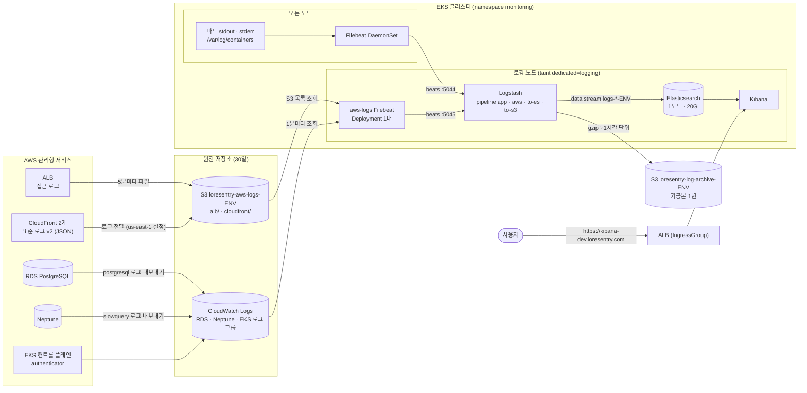
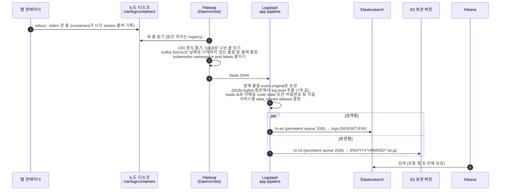
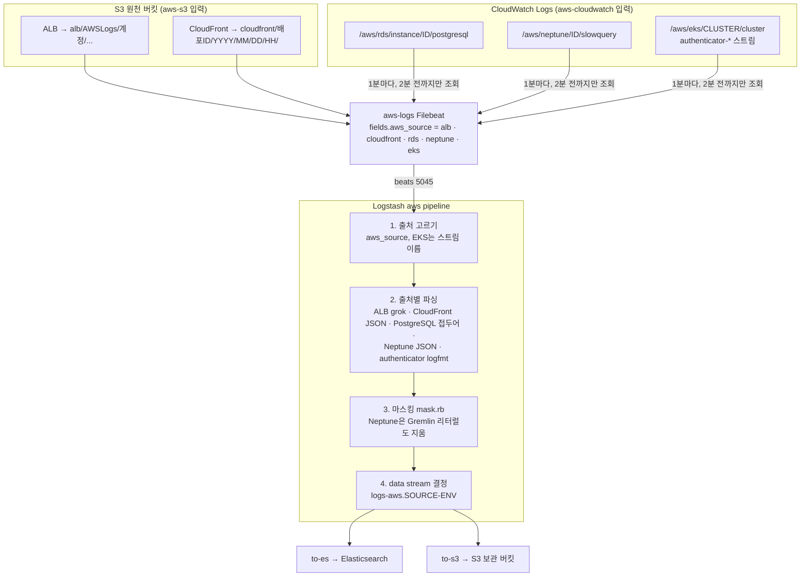
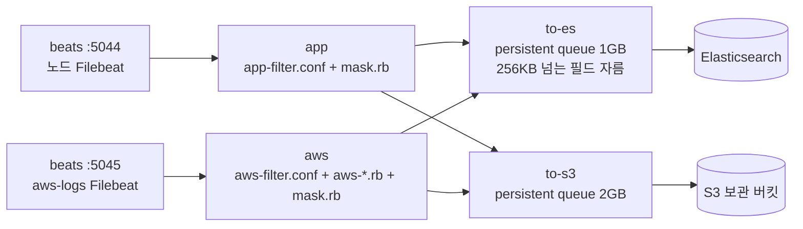
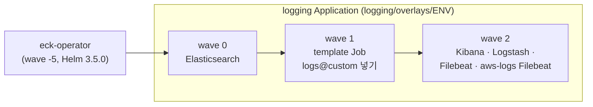

# 로깅 아키텍처 — ELK(ECK)로 로그를 모으고 Kibana에서 보기까지

> 최신화: 2026-11-01
> 대상: 클러스터 안 모든 파드 로그와 AWS 관리형 리소스(ALB·CloudFront·RDS·Neptune·EKS authenticator) 로그
> 상태: **dev 운영 중.** prod는 아직 Loki·Alloy이며, prod 환경을 세팅할 때 같은 구성으로 옮긴다.
> 관련: 필드·레벨·마스킹 규약은 [LOG_SCHEMA.md](LOG_SCHEMA.md), dev 리소스 목록은 [DEV_CLUSTER.md](DEV_CLUSTER.md),
> 매니페스트는 `loresentry-gitops/logging/`(설명은 그 아래 `README.md`)

로그는 두 갈래로 들어와 Logstash 한 곳에서 같은 규약으로 다듬어진 뒤, 검색용 Elasticsearch(30일)와 보관용 S3(1년)로
동시에 나간다. 사람은 Kibana에서 본다.

- **파드 로그**: 노드마다 뜬 Filebeat가 컨테이너 로그 파일을 읽는다.
- **AWS 관리형 로그**: AWS가 S3 원천 버킷이나 CloudWatch Logs에 쓴 것을, 로깅 노드의 aws-logs Filebeat 1대가 API로 가져온다.
- **가공은 Logstash에서만 한다.** 파싱, `log.level` 정규화, 개인정보 마스킹, 보낼 data stream 고르기가 모두 여기서 일어난다.
  ES와 S3로 갈라지기 전에 마스킹하므로 두 곳 모두 같은 마스킹된 값을 가진다.

## 1. 전체 구조



`ENV`는 `dev` 또는 `prod`다. ECK operator(namespace `elastic-system`)가 Elasticsearch·Kibana·Logstash·Filebeat를 만들고
버전을 맞춘다. 이 4개는 모두 9.5.5로 고정한다.

## 2. 구성요소

| 구성요소 | 종류 | 어디서 | 하는 일 | 저장 |
|---|---|---|---|---|
| ECK operator 3.5.0 | Helm chart | `elastic-system` | 아래 CR을 보고 StatefulSet·Deployment·Secret·인증서를 만든다 | — |
| Filebeat | Beat CR, DaemonSet | 모든 노드(로깅 노드 포함) | 컨테이너 로그 줄 읽기, CRI 형식 풀기, Kafka·Strimzi 여러 줄 묶기, `kubernetes.*` 붙이기 | 노드 hostPath registry |
| aws-logs Filebeat | Beat CR, Deployment 1대 | 로깅 노드 | S3 원천 버킷(`alb/`, `cloudfront/`)과 CloudWatch 로그 그룹 3개 읽기. 같은 원천을 두 번 읽지 않게 1대만 둔다 | PVC 1Gi(registry) |
| Logstash | Logstash CR, 1대 | 로깅 노드 | 파싱·정규화·마스킹·data stream 결정, ES·S3 출력 | PVC 5Gi(persistent queue, S3 임시 파일) |
| Elasticsearch | Elasticsearch CR, 1노드 | 로깅 노드 | 색인과 검색. 레플리카 0 | PVC 20Gi |
| Kibana | Kibana CR, 1대 | 로깅 노드 | 검색 화면 | — |
| template Job | Job | 로깅 노드 | 첫 data stream이 생기기 전에 `logs@custom` component template을 넣는다 | — |

로깅 노드는 `r7i.large` 1대이고 2b 서브넷에만 있다. ES·Logstash 디스크(EBS)가 2b에 묶여 있어서, 노드가 바뀌어도 같은 AZ에 떠야
디스크가 그대로 붙는다. 다른 파드는 taint `dedicated=logging:NoSchedule` 때문에 이 노드에 오지 않는다.

## 3. 파드 로그가 Kibana까지 가는 길



- 서비스마다 data stream이 따로다. 예: content는 `logs-loresentry.content_api-dev`, 형식을 모르는 파드는
  `logs-kubernetes.container-dev`. 전체 목록은 [LOG_SCHEMA.md](LOG_SCHEMA.md) §6.
- `log.level`은 모든 출처에서 `trace`·`debug`·`info`·`warn`·`error`·`fatal`·`unknown` 7개 값 중 하나다.
  못 찾으면 `unknown`이고, 원래 줄은 `event.original`에 남는다.
- 2xx 헬스체크 접근 로그와 RDS `rdsadmin` 연결 줄은 버린다(LOG_SCHEMA §4 소음 제거).

## 4. AWS 관리형 로그가 Kibana까지 가는 길



| 출처 | 원천 | data stream | `log.level` | Kibana에 보이기까지(dev 실측) |
|---|---|---|---|---|
| ALB 접근 로그 | S3 `alb/` | `logs-aws.alb-ENV` | 5xx `error`, 4xx `warn`, 그 외 `info` | 약 4~7분 (ALB가 5분마다 파일을 쓴다) |
| CloudFront v2 | S3 `cloudfront/` | `logs-aws.cloudfront-ENV` | ALB와 같음 | 약 3~5분 |
| RDS PostgreSQL | CloudWatch | `logs-aws.rds-ENV` | 심각도에 따라. 느린 쿼리·잠금 대기는 `warn` | 2~3분 |
| Neptune slowquery | CloudWatch | `logs-aws.neptune-ENV` | `warn`, 실패면 `error` | 2~3분 |
| EKS authenticator | CloudWatch | `logs-aws.eks_authenticator-ENV` | `level=` 값 | 2~3분 |
| 출처를 모르는 줄 | — | `logs-aws.unknown-ENV` | `unknown` | — |

CloudWatch는 이벤트 시각 기준으로 조회하고, 지나간 구간은 다시 읽지 않는다. 그래서 늦게 도착한 줄을 놓치지 않도록 "지금 − 2분"까지만
읽는다(`latency: 2m`). dev 실측 도착 지연은 최대 32초였다.

수집하지 않는 것:

- **EKS audit**(와 api·controllerManager·scheduler): dev에서 CloudWatch 수집이 하루 약 2.3GB였고 대부분 시스템 계정의 읽기와
  lease 갱신이었다. EKS는 CloudWatch에 보내기 전에 거를 수 없어서 켜지 않는다.
- **Neptune audit**: 모든 쿼리 원문이 남는다.
- **CloudFront `cs(Cookie)`**: 세션 쿠키가 들어 있어 전달 필드에서 고르지 않는다.

## 5. Logstash pipeline



- **출력마다 큐를 따로 둔다.** S3가 막혀도 `to-s3` 큐에만 쌓이고 ES 쪽은 계속 흐른다. dev에서 버킷 정책으로 S3를 10분 막아
  확인했다. 막힌 동안의 줄은 정책을 푼 뒤 빠짐없이 올라갔다.
- 재시작해도 큐와 S3 임시 파일이 PVC에 남아 이어서 보낸다(`restore => true`). Filebeat는 응답을 받지 못한 묶음을 다시 보낸다.
- aws 입력은 `client_inactivity_timeout => 900`이다. aws-logs Filebeat는 1~2분에 한 번만 보내서 기본값 60초면 연결이 끊긴다.

## 6. 저장

| 저장소 | 무엇을 | 보존 | 형식 |
|---|---|---|---|
| Elasticsearch | 마스킹된 ECS 문서. 출처별 data stream | 30일(data stream lifecycle) | 레플리카 0, `logs@custom` template(`log.level`·`error.code` 등 keyword, 필드 2,000개 상한) |
| S3 `loresentry-log-archive-ENV` | ES와 같은 문서 | 1년(lifecycle) | `ENV/YYYY/MM/DD/ls.s3.*.txt.gz`. 한 줄에 문서 하나(JSON lines, gzip). 1시간 또는 100MB마다 파일 |
| S3 `loresentry-aws-logs-ENV` | ALB·CloudFront 원천(마스킹 전) | 30일 | AWS가 쓰는 gzip 그대로 |
| CloudWatch 로그 그룹 3개 | RDS·Neptune·EKS 원천(마스킹 전) | 30일 | — |

- 색인에 실패한 문서는 버리지 않고 data stream의 failure store(`logs-*-ENV::failures`)에 남는다.
- 보관본 하루치 보기:

```bash
aws s3 cp s3://loresentry-log-archive-dev-<AWS_ACCOUNT_ID>/dev/2026/11/01/ ./archive --recursive
zcat archive/*.gz | jq -c 'select(.log.level == "error") | {t: ."@timestamp", s: .service.name, m: .message}'
```

## 7. Kibana에서 보기

- 주소: `https://kibana-dev.loresentry.com`. 지금은 관리자 계정 `elastic`만 있다. 비밀번호는 `monitoring` 네임스페이스 Secret
  `logs-es-elastic-user`에 있다. 팀원 계정은 다음 작업에서 만든다.
- Discover에서 data view `logs-*`(없으면 만든다)로 모든 출처를 함께 볼 수 있다.

| 보고 싶은 것 | KQL |
|---|---|
| 오류만 | `log.level: (error or fatal)` |
| 특정 서비스 | `service.name: "content-api"` |
| dev 네임스페이스 파드 | `kubernetes.namespace: "dev"` |
| ALB 5xx | `data_stream.dataset: "aws.alb" and http.response.status_code >= 500` |
| DB 데드락·충돌 | `data_stream.dataset: "aws.rds" and error.code: ("40P01" or "40001")` |
| 느린 쿼리 | `data_stream.dataset: "aws.rds" and event.duration > 1000000000` |
| 레벨을 못 뽑은 줄 | `log.level: "unknown"` (규칙을 더할 곳) |

## 8. 배포

Argo CD Application 두 개로 배포한다. 앱 사이에는 sync wave가 걸리지 않으므로, `logging`은 CRD가 아직 없을 때를 견디게
`SkipDryRunOnMissingResource`와 재시도를 쓴다.



| 바꾸는 것 | 위치 |
|---|---|
| 파싱·레벨·마스킹 규칙 | `logging/base/logstash/pipelines/` (바꾸면 ConfigMap 이름이 바뀌어 Logstash가 다시 뜬다) |
| 필드 타입·보존 기간 | `logging/base/elasticsearch/logs-custom.json` (다음 rollover부터 적용) |
| AWS 원천 이름·환경 값 | `logging/overlays/ENV/kustomization.yaml` |
| AWS 로그 켜기 | dev는 `bootstrap/dev/08-aws-logs.sh`, ALB는 `argocd-apps-dev/aws-load-balancer-controller.yaml`의 IngressClassParams. prod는 콘솔 |

## 9. 장애가 나면

| 상황 | 동작 |
|---|---|
| S3가 막힘(권한·장애) | `to-s3` 큐(2GB)에 쌓이고 ES 수집은 계속된다. 풀리면 이어서 올린다 |
| ES가 내려감 | `to-es` 큐(1GB)에 쌓인다. 큐가 차면 Logstash가 입력을 늦추고 Filebeat가 기다린다 |
| Logstash 재시작 | 큐가 PVC에 남는다. Filebeat는 연결이 돌아올 때까지 다시 시도한다(이때 `connection refused` 오류 줄이 잠깐 남는다) |
| Filebeat 재시작 | registry에 읽은 위치가 남아 이어서 읽는다 |
| 로깅 노드 교체 | 같은 2b에 새 노드가 떠서 ES·Logstash 디스크가 다시 붙는다 |
