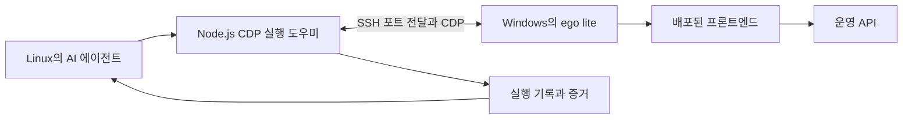

# AI 에이전트를 활용한 Lore Sentry QA 자동화와 결함 개선

[영문 기준본](ai-assisted-qa-report.md)

Lore Sentry에서는 AI 코딩 에이전트가 저장소를 분석해 기능을 목록화하고, 테스트 케이스를 준비한 뒤 배포된 서비스를 브라우저로 조작했다. 화면·네트워크·서버 상태를 근거로 실패를 분석하고, 승인된 수정 사항을 배포한 뒤 같은 조건으로 재검증했다. 전체 프론트엔드 QA를 먼저 수행했으며, 그래프 최신화의 백엔드 연동이 완료된 후에는 해당 기능을 별도로 검증했다.

초기 프론트엔드 QA는 303개 실행 단위를 기록했다. 수정 후 선별 검증에서는 57개 단위가 통과했고, 추적한 문제 35건을 해결로 처리했다. 이후 그래프 최신화 QA는 34개 케이스를 83개 변형으로 나누어 검증하고 결함 4건을 발견했다. 프론트엔드 3건과 동료가 담당한 GraphRAG 1건을 수정한 뒤에는 후속 시나리오 5개가 모두 통과했다. 각 실행은 범위가 다르고 서로 겹치므로, 이 숫자를 합쳐 고유 테스트 수나 전체 기능의 통과 여부로 해석하지 않는다.

이 보고서의 대상은 2026년 10월 22~24일 수행한 작업이다. 결과와 배포 정보는 당시 실행을 설명하며, 보고서를 작성하면서 QA를 새로 실행한 것은 아니다.

## 1. 배경과 목표

Lore Sentry는 작가가 원고·캐릭터·장소와 문서 사이의 관계를 관리하는 서비스다. 프론트엔드는 문서 편집, 검색, 그래프와 타임라인, 메모, 계정 관리, AI 챗을 제공한다. 그래프 최신화는 저장된 내용을 읽어 문서와 관계의 변경안을 생성하고, 작가가 이를 검토한 뒤 적용하는 기능이다.

중요한 오류 중에는 동작 순서에 따라 드러나는 문제가 있었다. 생성을 시작하기 직전에 원고 저장이 실패하거나, 검토 중 로그인이 만료되거나, 서버의 적용은 끝났는데 브라우저가 응답을 받지 못할 수 있다. 화면의 성공 문구만으로는 올바른 데이터가 저장됐는지, 다시 시도해도 중복 처리되지 않는지 판단하기 어렵다.

목표는 선언한 기능 범위를 폭넓게 확인하면서 위험이 큰 동작을 더 깊게 검증하고, 각 판정을 관찰 가능한 증거에 연결하는 반복 가능한 절차를 만드는 것이었다. 자동화 범위에는 케이스 선정, 실행, 판정, 기록, 실패 복구, 보고를 포함했다.

## 2. 자동화 범위와 역할 분담

### 사람이 결정한 부분과 AI가 수행한 부분

| 영역 | 사람의 역할 | AI의 역할 |
| --- | --- | --- |
| 범위와 통과 기준 | 제품 요구사항·우선순위를 정하고 잘못 해석한 기준을 정정했다. | 경로·서비스 계약·화면 동작·문서를 분석하고 기능별 케이스 연결을 제안했다. |
| 실행 조건 | 환경·테스트 계정·허용할 데이터 변경과 수행 요청을 정했다. | 접속과 실제 계정 신원을 확인하고 합성 데이터와 격리 컨텍스트를 준비했다. |
| 테스트 수행 | 필요한 인증 입력을 제공하고 제품 결정을 확정했다. | 브라우저 조작, 요청과 상태 관찰, 범위를 제한한 장애 주입, 증거 수집을 수행했다. |
| 실패 처리 | 불명확한 요구사항을 확인하고 수정 범위를 선택했다. | 제품 결함·실행 도구 오류·준비 부족을 구분하고 원인과 안전한 복구 방법을 조사했다. |
| 수정과 재검증 | 수정·배포를 승인했으며 GraphRAG 수정은 동료가 담당했다. | 승인된 프론트엔드 수정, 회귀 검사 추가, 배포 확인, 관련 브라우저 재검증을 수행했다. |

QA를 수행하는 에이전트와 제품 내부의 AI 생성 서비스는 역할이 다르다. 에이전트는 테스트를 구성하고 판정했다. GraphRAG는 테스트 대상 시스템의 일부이며, 생성한 사실과 제안도 검증 대상이었다.

### 재사용 가능한 워크플로우

작업공간의 공통 QA 기능과 서비스별 케이스를 분리했다.

| 워크플로우 | 수행 내용 | 주요 산출물 |
| --- | --- | --- |
| Prepare QA | 기능 목록화, 기본·심화 케이스 연결, 브라우저·환경·계정·로그인·허용 데이터 변경 설정 | `coverage.md`, `README.md`, `extended-cases.md`, `execution.json`. 실서버 최신화는 `graph-refresh.md`를 별도로 사용했다. |
| Execute QA | 준비 확인, 실행 변형 선택, 브라우저 조작, 기대·실제 결과 비교, 시도 기록 | 실행별 설정 사본, `run.json`, 스크린샷, DOM 관찰, 네트워크·API 증거 |
| Handle Failure | 실패 분류, 불확실한 반영 여부 조회, 재시도 판단, 이전 시도 보존 | 재현 절차, 결함 기록, 복구 이유, 차단 사유 |
| Report QA | 최신 판정을 집계하고 이력과 남은 범위를 함께 보고 | 같은 실행 기록에서 생성한 HTML·Markdown 보고서 |

Prepare는 별도로 요청했다. 명세를 준비한 뒤에는 Run QA가 Execute QA, Handle Failure, Report QA를 순서대로 연결했다. 코드 수정과 배포는 별도로 승인된 작업이었다. QA에서 결함을 찾았다는 사실만으로 운영 코드를 수정할 권한이 생기는 구조는 아니었다.

## 3. 실행 환경과 자동화 구조

AI 에이전트는 Linux 호스트에서 실행했다. 작업용 Node.js 도우미가 SSH 포트 전달을 통해 Windows의 ego lite 브라우저에 연결하고, CDP라는 브라우저 제어 프로토콜을 사용했다. 브라우저는 지정된 QA 계정으로 배포된 프론트엔드와 운영 API를 사용했다.

도우미는 실제 마우스·키보드·텍스트 입력 이벤트를 보냈다. DOM 조회, 스크린샷, 네트워크 관찰 결과를 에이전트가 다음 행동의 근거로 사용했다. 브라우저 안에서 API를 호출하는 방식은 명시적인 기준 데이터 준비, 상태 재조회, API의 거절 조건 검증에도 사용했다. 이는 UI를 조작한 결과와 구분했으며, React나 제품 서비스 내부 함수를 호출해 성공 상태를 만들어 내지는 않았다.

에이전트는 현재 화면과 증거를 케이스의 기대 결과에 대조하고 다음 행동을 정했다. 실제 화면 문구가 예상과 다르면 선택자를 고쳤고, 장애 주입이 의도하지 않은 요청까지 막으면 적용 범위를 좁혔다. 도우미는 브라우저의 구체적인 조작을 제공하고, 에이전트는 조작 순서와 결과 해석을 담당했다.

실행 설정에는 환경·버전·브라우저·계정 역할·언어·화면 크기·허용 효과를 기록했다. 자격증명은 보고서에 넣지 않았다. 정답이 알려진 합성 프로젝트와 문서를 만들고, 관련 없는 사용자 데이터는 건드리지 않았다. 실제 API와 MOCK은 컨텍스트를 분리해 실행했으며, MOCK에서 통과한 결과를 운영 백엔드 연동의 성공으로 옮겨 적지 않았다.

이 방식은 사용자의 수행 요청으로 시작하는 에이전트 실행이다. CI/CD는 승인된 코드의 검사와 배포에 사용했다. 브라우저 조사와 후속 검증은 에이전트가 수행한 세션이며, 별도로 예약해 무인 실행하는 브라우저 테스트 스위트를 구축한 것은 아니다.

## 4. 테스트 설계와 수행 방법

### 기능은 폭넓게 확인하고 위험 동작은 더 깊게 검증

프론트엔드의 `coverage.md`에서 공개 경로, 작업공간 화면, 서비스 동작, 브라우저 안에서만 처리하는 사용자 행동을 케이스에 연결했다. QA README에는 기본 시나리오를 두고, `extended-cases.md`에는 입력·실패·복구 조건을 보완했다. 우선순위는 실행 순서와 깊이를 정했으며, 낮은 우선순위 기능을 목록에서 제외하는 기준으로 사용하지 않았다.

실서버 연동이 완료된 그래프 최신화에는 34개 케이스를 별도로 설계했다. 이를 83개 실행 변형으로 나누어 시작 전 저장, 변경 문서 선택, 잠금, 결과 도착, 검토 편집과 자동 저장, 다른 탭과의 충돌, 확정, 인증·권한, 서식, 생성 결과의 의미를 확인했다. 한 케이스에 여러 변형이 연결될 수 있으며, 케이스 수와 변형 수 모두 소스 코드 커버리지 백분율을 뜻하지 않는다.

### 세 가지 관찰 방식을 조합

| 방식 | 예시 | 확인할 수 있는 범위 |
| --- | --- | --- |
| 실제 연동 | 제안 생성, 검토 저장, 변경 확정, 문서 다시 열기 | 검증한 경로의 공개 서버 상태·저장·버전·화면 동작 |
| 실제 연동과 통제한 통신 장애 | 저장 오류, PATCH 지연, 서버 성공 후 적용 응답만 유실 | 지정한 장애에서의 클라이언트 동작. 가능한 경우 실제 서버 결과와 대조했다. |
| 격리 MOCK·통제 응답 | 추가 운영 생성 없이 특정 오류나 스트림을 재현 | 해당 fixture 조건의 프론트엔드 동작. 실제 백엔드 관찰과 구분했다. |

데이터 변경 후에는 화면 표시와 서버의 재조회 결과를 비교했다. 적용 결과가 불확실하면 같은 요청의 상태부터 확인하고, 그 전에 확정 요청을 다시 보내지 않았다. 브라우저의 통신 오류를 서버 트랜잭션 실패로 바로 해석하지 않기 위한 절차였다.

생성 결과는 합성 원고의 사실과 비교했다. 열쇠의 소유자, 열 수 있는 문, 비가 오는 날에만 적용되는 허가, 망토 색, 일부러 알려 주지 않은 정보가 기준이었다. 기존 본문과 서식도 보존해야 했다. 실제 생성 한 번의 결과로 여러 검토·저장 케이스를 수행했으며, 실행 변형 수와 생성 작업 수는 별도로 관리했다.

### 판정과 이력을 보존하고 기준도 검토

PASS는 기대한 동작을 실제로 확인한 경우다. FAIL은 제품의 기대·실제 동작이 다른 경우, ERROR는 실행 도구 문제로 판정하지 못한 경우, BLOCKED는 전제가 부족한 경우로 구분했다. N/A와 NOT RUN도 별도로 관리했다. 나중에 통과하더라도 이전 실패나 실행 오류를 지우지 않았다.

사람의 검토로 잘못된 기준도 바로잡았다. 초기에는 편집 서식을 여러 문서에 공통 적용해야 한다고 기대했지만, 실제 요구사항은 문서별 서식이었다. 원래 관찰은 보존하고 기대 기준을 정정했으며, 이를 새 제품 결함을 수정한 성과로 세지 않고 오탐으로 분류했다. 타임라인 등장 막대의 클릭 동작은 별도의 요구사항 확인 항목으로 남겼다.

## 5. 발견한 결함과 해결 과정

실제 그래프 최신화 연동을 조사하면서 발견한 네 결함을 대표 사례로 정리한다. 이 가운데 프론트엔드 3건은 [`cfb1fbb`](https://github.com/soma-lorekeeper/loresentry-frontend/commit/cfb1fbbad8da54e1a6a1729056f8e833334f02a3)에서 수정했고, 생성 오류는 동료가 GraphRAG에서 수정했다.

### 5.1 원고 저장이 실패했는데도 최신화 시작

**재현과 영향.** 원고를 수정한 뒤 저장 요청을 HTTP 500으로 실패시키고 그래프 최신화를 시작했다. 저장이 실패했는데도 시작 요청이 전송됐다. 저장 전의 오래된 원고로 생성할 위험이 있었다. 초기 실패 상황 검증에서는 시작 응답을 통제해 실제 생성 작업은 만들지 않았다.

**원인과 수정.** 문서 저장 세션은 실패를 상태로 알리고 Promise는 정상 종료했다. `saveOpenDocuments`는 `Promise.allSettled`로 완료만 기다렸으며 미저장 내용이 남았는지 확인하지 않았다. 수정 후에는 Promise 처리 결과와 실제 미저장 상태로 저장 성공 여부를 반환하고, 저장이 끝나지 않았으면 시작 처리를 중단하고 안내하도록 했다.

**재검증.** 저장 오류가 있을 때 입력이 유지되고 시작 중단 안내가 표시됐으며, 최신화 시작 요청은 0건이었다. 장애를 제거한 뒤에는 원고가 revision 3으로 저장된 다음 실제 생성이 시작됐고, 생성 입력에도 해당 revision이 포함됐다.

### 5.2 정상 원고의 생성이 본문 조립 검증에서 실패

**재현과 영향.** 첫 실제 생성이 약 6분 20초 뒤 `INVALID_CHANGE_PLAN: Candidate body differs from server paragraph assembly`로 실패했다. 한 번 재시도하자 성공했지만, 재시도 성공만으로 원인이 해결됐다고 판단하지 않았다.

**수정과 담당.** 동료가 GraphRAG의 본문 처리 방식을 수정했다. 기존에는 반환한 본문과 서버의 문단 조립 결과가 다르면 검증에 실패했다. 수정 후에는 관련 계획·범위 검증을 유지하면서 서버가 조립한 본문을 사용하도록 바꿨다. 변경 방식은 [GraphRAG PR 5](https://github.com/soma-lorekeeper/loresentry-graph-rag/pull/5)에 설명돼 있다. 동료의 수정 완료를 이후 사용자가 확인했으며, 에이전트가 수행한 프론트엔드 3건의 수정과는 담당을 구분했다.

**재검증.** 후속 검증의 첫 생성은 약 75초 만에 READY가 됐으며 기존 문서 수정 5개와 신규 문서 제안 1개를 반환했다. 이후 증분 생성도 약 22초 만에 제안 1개를 반환했다. 원고의 핵심 사실과 기존 굵은 문단 보존을 확인했다. 이 시간은 개별 실행의 관찰값이며 통제된 성능 개선 실험의 결과가 아니다. 브라우저 실행만으로 운영 백엔드의 정확한 커밋을 확인하지는 않았다.

### 5.3 검토 중 세션 만료 후 재로그인하면 미저장 내용 유실

**재현과 영향.** 검토 설명을 수정하고 자동 저장 전에 QA 앱의 세션만 만료시켰다. 실제 PATCH가 HTTP 401과 재로그인 지시를 반환했지만, 기존 화면에는 일반 저장 실패만 표시됐다. 로그인 화면으로 이동하면 서버에 저장되지 않은 입력이 사라졌다.

**원인과 수정.** 검토 자동 저장이 인증 만료를 구분하지 않았다. 수정 후에는 전송을 멈추고 만료 안내와 새 탭 로그인 링크를 표시하며 원래 검토창을 유지했다. 명시적인 재저장 때 실제 계정과 READY 작업본의 revision을 확인했다. 활성 검토창은 포커스 복귀·재연결 시 자동 재조회로 초기화되지 않도록 했고, 저장에 실패한 채 창을 닫는 것도 막았다. 서버에서 검토 내용이 바뀌었다면 사용자가 명시적으로 다시 불러오도록 했다.

**재검증.** 실제 401과 새 탭의 같은 계정 Google 재로그인을 거친 뒤에도 원래 입력이 유지됐다. 로컬에서 모든 제안을 맞춰도 다시 저장하기 전에는 확정할 수 없었고 Escape로 창이 닫히지도 않았다. 재저장 후에는 수정 설명과 6개 작업본의 일치를 서버에서 확인했다. 다른 계정·동시 수정 보호는 자동 테스트에서도 확인했다. 이 결과는 열린 검토창의 입력 보존을 뜻하며, 브라우저 강제 종료 후의 복구까지 보장하는 것은 아니다.

### 5.4 적용 성공 응답을 잃으면 실패한 검토창 유지

**재현과 영향.** 확정 요청은 서버에서 정상 처리하되 HTTP 200 응답이 브라우저에 전달되기 전에 유실시켰다. 서버는 APPLIED였지만 화면에는 실패 안내와 검토창이 남았다. 초기 검증에서 중복 적용은 관찰되지 않았으나 수동 새로고침이 있어야 완료 상태로 돌아왔다.

**원인과 수정.** 기존 오류 처리는 실제 반영 여부를 조회하지 않고 실패를 표시했다. 수정 후에는 결과가 불확실하면 같은 최신화 요청을 재조회했다. APPLIED이면 완료 처리와 문서·그래프·잠금·버전 캐시를 갱신하고, READY이면 선택을 유지해 명시적으로 재시도할 수 있도록 했다. 조회도 실패하면 결과 확인 기능을 제공하고, 확인 전까지 재확정을 막았다.

**재검증.** 응답만 유실한 경우 자동으로 성공 안내를 표시하고 검토창을 닫았다. 추가 시나리오에서는 응답 유실에 상세 GET의 HTTP 503도 겹치게 했다. 결과 미확인 안내를 유지하고 중복 확정·닫기를 막았으며, 조회를 복구한 뒤 ‘결과 다시 확인’만으로 APPLIED를 확인했다. 성공한 각 시나리오에서 서버가 수락한 확정은 한 번, 확인 대상 캐릭터 문서의 신규 버전도 한 개였고, 중복 문서는 생성되지 않았다.

## 6. 결과와 성과 및 남은 범위

### 실행 범위별 결과

아래 수치는 실행 단위별 최신 판정이다. 재시도 이력은 원본 기록에 남겼다. 선정 수에는 차단·해당 없음도 포함한다. 초기 프론트엔드 303개 중 296개, 그래프 변형 83개 중 75개가 실제 PASS 또는 FAIL 판정에 도달했다.

| 실행 | 선정 단위·변형 수 | PASS | FAIL | BLOCKED | N/A | 해석 |
| --- | ---: | ---: | ---: | ---: | ---: | --- |
| 초기 프론트엔드 QA, 10월 22~23일 | 303 | 228 | 68 | 3 | 4 | 실제 API·MOCK을 구분해 폭넓게 검증했고, 초기 지적 37건을 등록했다. |
| 프론트엔드 수정 후 선별 검증, 10월 23일 | 57 | 57 | 0 | 0 | 0 | 추적한 문제 35건 해결. 오탐 1건과 기준 미확정 1건은 수정 건수에서 제외했다. |
| 실연동 그래프 최신화 QA, 10월 24일 | 83 | 72 | 3 | 8 | 0 | 34개 케이스를 변형으로 나누었으며 제품 결함 4건을 기록했다. |
| 그래프 최신화 수정 후 검증, 10월 24일 | 5 | 5 | 0 | 0 | 0 | 네 결함의 시나리오와 추가 결과 조회 실패 시나리오. 연결된 네 결함 모두 해결로 처리했다. |

그래프 QA의 최신 FAIL은 3개인데 결함이 4건인 이유는, 재시도로 성공한 첫 생성 오류도 결함으로 유지했기 때문이다. 전체 프론트엔드의 실패 단위 68개와 등록한 지적 37건 역시 서로 다른 집계다.

프론트엔드 후속 검증 57개는 기록된 배치별 버전에서 관련 수정 사항을 확인한 것이다. 최종 배포 하나에서 원래 303개를 전부 다시 실행한 것은 아니다. 그래프 후속 검증 5개도 초기 83개 변형 전체의 재실행이 아니다. 후속 5개에는 시도 7개를 기록했으며, 로그인 버튼 선택자 차이와 확정 요청까지 막은 장애 주입 도구 오류 2회도 복구 이력으로 보존했다. 후자는 서버 미반영을 확인한 뒤 GET만 실패시키도록 좁혀 다시 검증했다.

별도의 코드 검증으로 프론트엔드 수정은 테스트 파일 97개의 자동 테스트 756개, 포맷·디자인 토큰·린트·타입 검사, 한국어·영어 빌드와 정적 export 검증을 통과했다. 이는 코드 검사 결과이며 브라우저 QA 시나리오가 756개 추가됐다는 뜻은 아니다. 운영 브라우저 재검증 전 해당 프론트엔드 커밋의 [CI/CD 실행](https://github.com/soma-lorekeeper/loresentry-frontend/actions/runs/40081666347)이 성공했음을 확인했다.

### 자동화로 얻은 결과

재사용할 수 있는 기능 대응표와 실행 절차, 반복 가능한 장애 시나리오, 증거가 연결된 결함 보고서, 승인된 배포 후의 운영 재검증 결과를 남겼다. 클라이언트의 안내와 서버 상태를 비교해 저장 순서, 인증, 비동기 결과의 불확실성에 걸친 문제를 발견했다. 정답이 있는 합성 사실을 사용해 생성 완료 여부뿐 아니라 내용의 정확성도 검토했다.

기록으로 확인할 수 있는 성과는 이러한 산출물과 검증 결과다. 수작업 감소율, 소요 시간 절감률, 전체 모델 토큰, 비용 대비 효과는 측정하지 않았다. 실제 생성 작업 하나가 여러 모델 호출을 사용할 수 있으므로 생성 작업 수를 모델 호출 수나 비용으로 계산하지 않았다.

### 남은 검증 범위

초기 프론트엔드 실행의 차단 3개 변형은 API·MOCK의 챗 비활성 계정 조건과 지원하지 않는 불완전 스트림 표식 fixture에 관한 것이었다. 수정 후 선별 검증에서 이 미확인 조건을 통과로 바꾸지는 않았다.

그래프의 차단 8개 변형은 변경 문서 충돌의 실제 롤백, 전체 제안 필터링, 저장소 장애, 잘못된 완료 결과, 타임아웃과 늦은 완료, 전송 계보, 중복·늦은 이벤트, Neptune 투영을 위한 격리 데이터나 관찰 환경이 필요했다. 프론트엔드 오류를 통제해 표시한 결과로 이 백엔드 동작까지 검증했다고 판단하지 않았다. 공개 그래프 조회는 Content/RDB 데이터 관찰이며 Neptune의 소비·투영을 확인한 결과가 아니다.

다음 실행에서는 격리된 장애 환경, 재현 가능한 케이스·증거 보관 방식, 사람의 개입 횟수·확정 결함 대비 오탐·반복 실행 안정성의 측정이 도움이 된다. 불명확한 요구사항, 계정 접근, 수정 범위의 결정에는 사람의 확인이 계속 필요하다.

## 부록. 근거 기록과 구현 참조

아래 경로는 `loresentry-frontend` 저장소 기준이다. 해당 저장소의 `docs/qa`는 의도적으로 Git에서 제외했으므로 로컬에 보관한 원본 경로이며 GitHub에서 열리는 링크를 뜻하지 않는다. 이 보고서는 당시 결과를 설명하며 원본 기록을 대체하지 않는다.

| 근거 | 프론트엔드 기준 경로 | 확인할 내용 |
| --- | --- | --- |
| 범위·실행 명세 | `docs/qa/coverage.md`, `docs/qa/README.md`, `docs/qa/extended-cases.md`, `docs/qa/execution.json` | 기능 대응, 케이스, 실행 조건, 판정 기준 |
| 초기 프론트엔드 실행 | `docs/qa/runs/20261022-1554/run.json` | 303개 실행 단위, 초기 지적 37건, 원래 관찰 |
| 프론트엔드 수정 실행 | `docs/qa/runs/20261023-fixes/run.json` | 57개 통과, 해결 35건, 기준 정정과 검증 한계 |
| 실연동 최신화 계획 | `docs/qa/graph-refresh.md` | 34개 케이스와 실제 서버 연동의 기대 동작 |
| 초기 최신화 실행 | `docs/qa/runs/20261024-1406-graph-refresh/run.json` | 83개 변형, 실패·복구 이력, 차단 조건, 결함 4건 |
| 최신화 케이스 집계 | `docs/qa/runs/20261024-1406-graph-refresh/case-coverage.md` | 전체 변형 기준의 케이스 대응. 공통 보고서의 기본 검증 표에서는 심화 전용 항목이 빠진다. |
| 최신화 수정 실행 | `docs/qa/runs/20261024-1817-graph-refresh-fixes/run.json` | 후속 5개 통과, 시도 7개, 결함 해결과 수정 담당 |
| 실제 결과 비교 | `docs/qa/runs/20261024-1817-graph-refresh-fixes/evidence/fix-response-loss-assertions.json`, `docs/qa/runs/20261024-1817-graph-refresh-fixes/evidence/fix-result-recheck-assertions.json` | 실제 적용, 결과 복구, 버전 수, 중복 방지 |
| 코드·배포 검사 | `docs/qa/runs/20261024-1817-graph-refresh-fixes/evidence/local-verification.json`, `docs/qa/runs/20261024-1817-graph-refresh-fixes/evidence/deployment.json` | 테스트 756개와 고정한 프론트엔드 커밋의 배포 성공 |

구현 근거는 [프론트엔드 수정 커밋](https://github.com/soma-lorekeeper/loresentry-frontend/commit/cfb1fbbad8da54e1a6a1729056f8e833334f02a3)과 [GraphRAG 수정 PR](https://github.com/soma-lorekeeper/loresentry-graph-rag/pull/5)이다. 프론트엔드 수정은 `main`에 직접 커밋·푸시했고, 동료의 GraphRAG 변경은 PR로 병합했다. 이 사실만으로 개별 브라우저 요청을 처리한 백엔드 이미지가 식별되는 것은 아니다.
