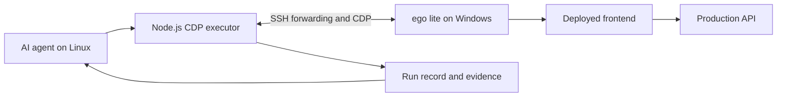

# AI assisted QA automation and defect resolution in Lore Sentry

[한국어](ai-assisted-qa-report.ko.md)

Lore Sentry used an AI coding agent to turn repository knowledge into browser QA: identify features, prepare cases, operate the deployed application, collect evidence, investigate failures, and verify approved fixes after deployment. The work covered the frontend broadly, followed by a separate investigation of graph refresh after its backend integration became available.

The initial frontend run recorded 303 execution units. Its targeted repair follow-up passed 57 units and marked 35 tracked issues resolved. The later graph-refresh run recorded 83 variants across 34 cases and identified four defects. After three frontend fixes and a teammate's GraphRAG fix, all five selected follow-up scenarios passed. These are separate runs with overlapping coverage; their counts are not a combined count of unique tests or proof that every feature passed.

This report describes the work performed on October 22–24, 2026. Results and deployment references describe those executions, rather than a new QA run on the report preparation date.

## 1. Background and objectives

Lore Sentry helps writers manage manuscripts, characters, locations, and their relationships. Its frontend includes document editing, search, graph and timeline views, notes, account flows, and AI chat. Graph refresh reads saved material, generates proposed document and relationship changes, and lets the writer review and apply them.

Several important failures depend on the order of events. A save can fail immediately before generation starts; a login session can expire during review; or the server can finish applying changes while its response never reaches the browser. Verifying only the visible success message cannot establish whether the correct data was saved or whether a retry would duplicate an operation.

The objective was to build a repeatable process that covers the declared feature scope, examines high-risk behavior more deeply, and connects each verdict to observable evidence. The automation included case selection, execution, evaluation, recording, failure recovery, and reporting.

## 2. Automation scope and responsibilities

### Human decisions and agent execution

| Responsibility | Human contribution | AI contribution |
| --- | --- | --- |
| Scope and acceptance criteria | Set product expectations, priorities, and corrections to requirements. | Inspect routes, service contracts, UI behavior, and documentation; propose feature-to-case mappings. |
| Execution conditions | Designate the environment, test accounts, permitted effects, and execution requests. | Check connectivity and actual account identity; prepare owned synthetic data and isolated contexts. |
| Test execution | Supply authentication input if required and resolve product decisions. | Operate the browser, observe requests and state, inject scoped failures, and retain evidence. |
| Failure handling | Confirm ambiguous requirements and choose implementation scope. | Separate product defects, executor errors, and missing prerequisites; investigate causes and select safe recovery. |
| Repair and verification | Authorize fixes and deployment; a teammate implemented the GraphRAG repair. | Implement the approved frontend fixes, add regression checks, observe deployment, and rerun affected browser scenarios. |

The QA agent and the product's AI generation service had different roles. The agent organized and evaluated tests. GraphRAG was part of the system under test, whose generated facts and proposals also needed verification.

### Reusable workflow

The workspace QA capability separated shared procedures from application-specific cases.

| Workflow | Work performed | Main artifacts |
| --- | --- | --- |
| Prepare QA | Inventory features; map basic and deeper cases; configure browser, environment, accounts, login, and permitted data changes. | `coverage.md`, `README.md`, `extended-cases.md`, `execution.json`; `graph-refresh.md` for the integrated refresh flow. |
| Execute QA | Check readiness, select execution variants, act through the browser, compare expected and actual results, and record attempts. | Per-run configuration, `run.json`, screenshots, DOM observations, and network/API evidence. |
| Handle Failure | Classify the failure, inspect uncertain effects, decide whether to retry, and preserve previous attempts. | Reproduction details, issue records, recovery reasons, and blocked prerequisites. |
| Report QA | Aggregate the latest verdicts while retaining history and unresolved scope. | HTML and Markdown reports derived from the same run record. |

Prepare was requested separately. Once the specification was ready, Run QA coordinated Execute QA, Handle Failure, and Report QA. Approved source changes and deployment were additional work; discovering a defect did not itself grant permission to modify production code.

## 3. Execution environment and control loop

The agent ran on a Linux host. A task-owned Node.js helper used the Chrome DevTools Protocol, or CDP, to control an ego lite browser on Windows through SSH port forwarding. The browser loaded the deployed frontend and called the production API with a designated QA account.

The helper issued native mouse, keyboard, and text-input events. DOM inspection, screenshots, and network observations supplied the next state to the agent. Browser-side API calls were also used for explicit fixture preparation, state rechecks, and negative API tests. Those calls were distinguished from UI execution; product success was not manufactured through React or application-service internals.

The agent read the current page and evidence, compared them with the case's expected result, and chose the next action. It could correct a selector after observing the actual UI, or narrow a fault rule after discovering that it blocked an unintended request. The helper supplied concrete browser operations; the agent coordinated their order and interpreted their results.

The execution configuration recorded environment, revision, browser, account role, locale, viewport, and permitted effects. Credentials remained outside the reports. Synthetic projects and documents provided known facts and avoided changing unrelated user material. API and MOCK contexts were separated, and a passing MOCK scenario was not treated as proof of a working production backend.

The workflow was initiated by a user request. CI/CD checked and deployed approved source changes; the browser investigation and follow-up were agent-driven sessions, not an independently scheduled unattended browser test suite.

## 4. Test design and execution method

### Broad feature coverage and deeper risk checks

The frontend's `coverage.md` mapped public routes, workspace views, service operations, and browser-only user actions to cases. Its QA README described the basic scenarios, while `extended-cases.md` supplied additional input, error, and recovery conditions. Priority controlled order and depth rather than silently removing lower-priority features.

Graph refresh received a separate 34-case plan after server integration. Its 83 execution variants covered starting and saving, changed-document selection, locks, result arrival, review editing and autosave, cross-tab conflicts, confirmation, authentication, permissions, formatting, and the meaning of generated facts. A case could have several variants; neither count is a source-code coverage percentage.

### Three complementary forms of observation

| Method | Example | What the observation established |
| --- | --- | --- |
| Real integration | Generate proposals, save review drafts, apply changes, and reopen documents. | Public server state, persistence, versions, and visible behavior for the tested path. |
| Real integration with controlled transport faults | Return a save error, delay a PATCH, or drop an apply response after the server returned success. | Client behavior under the specified fault, checked against the actual server result where available. |
| Isolated MOCK or controlled response fixtures | Exercise specific frontend errors or streams without issuing another paid production generation. | The tested frontend behavior under that fixture, with its limits recorded. |

After a mutation, the agent compared the UI with a fresh read of the relevant server state. For an uncertain apply result, it checked the same request before sending another confirmation. This prevented a browser communication error from being interpreted automatically as a failed server transaction.

Generated content was checked against synthetic facts: who owned a key, which gate it could open, a rain-only permission, a character's cloak color, and information deliberately left unknown. Formatting and existing text also had to survive. Several review and persistence cases reused a real generation result; execution variants and generation jobs were accounted for separately.

### Verdicts, history, and corrected criteria

PASS meant the expected behavior was observed. FAIL identified a product mismatch. ERROR identified a tool or execution problem that prevented a verdict. BLOCKED identified missing prerequisites. N/A and NOT RUN remained distinct. A later pass did not erase a failed or erroneous attempt.

Human review also corrected a mistaken criterion. An earlier expectation assumed editor formatting should be shared across documents. The actual product requirement was document-specific formatting. The records retained the original observation, corrected the criterion, and classified the finding as a false positive rather than counting it as a newly repaired defect. A separate timeline-bar click expectation remained a requirement-confirmation item.

## 5. Defects and how they were resolved

The integrated graph-refresh investigation produced four illustrative defects. Three were fixed in the frontend commit [`cfb1fbb`](https://github.com/soma-lorekeeper/loresentry-frontend/commit/cfb1fbbad8da54e1a6a1729056f8e833334f02a3). A teammate fixed the generation issue in GraphRAG.

### 5.1 Generation started despite a failed manuscript save

**Reproduction and impact.** After editing a manuscript, the test returned HTTP 500 for its save request and started graph refresh. The client still sent the refresh-start request. This could generate from an older saved manuscript. In the initial negative test, the start response was controlled so that the defect did not launch a real generation job.

**Cause and repair.** The document session reported save failure through its state while resolving the save promise. `saveOpenDocuments` waited with `Promise.allSettled` but did not check whether unsaved changes remained. The fix made it return a success decision based on settled results and actual unsaved state. The start handler stopped and displayed an explanation when saving was incomplete.

**Verification.** With the save failure in place, the browser preserved the new input, displayed the stop notice, and sent zero refresh-start requests. After the fault was removed, the manuscript saved as revision 3 before the real generation began; that revision appeared in the generation input.

### 5.2 A valid generation failed on body assembly

**Reproduction and impact.** The first real generation failed after approximately 6 minutes 20 seconds with `INVALID_CHANGE_PLAN: Candidate body differs from server paragraph assembly`. One retry succeeded. That retry did not establish that the underlying defect had been repaired.

**Repair and attribution.** A teammate changed GraphRAG's body handling. The original validation failed when the returned body differed from the server's paragraph assembly. The change used the server-assembled result while continuing to validate the relevant plan and scope. The mechanism is documented in [GraphRAG PR 5](https://github.com/soma-lorekeeper/loresentry-graph-rag/pull/5). The teammate's repair was subsequently confirmed by the user; it was not authored as part of the agent's three frontend fixes.

**Verification.** The follow-up's first generation reached READY in approximately 75 seconds with five existing-document proposals and one new-document proposal. A later incremental generation reached READY in approximately 22 seconds with one proposal. The tested facts and preserved bold paragraph matched expectations. These are individual observations, not a controlled latency-improvement benchmark. The browser run did not independently identify the exact running backend commit.

### 5.3 Session expiry lost unsaved review input after login

**Reproduction and impact.** The test edited a review description and expired only the QA application's session before autosave. The PATCH returned a real HTTP 401 with a relogin instruction. The old client showed a generic save failure. Navigating away to log in discarded input that had not reached the server.

**Cause and repair.** Review autosave did not distinguish authentication expiry. The fix paused sends, displayed a specific notice and a new-tab login link, and kept the original review mounted. Explicit resaving checked the actual account and the READY draft revisions before sending. Focus/reconnection refetches were disabled for the active review, and unsuccessful saving prevented closing it. Conflicting server changes required an explicit reload decision.

**Verification.** The original input remained visible after the real 401 and same-account Google reauthentication in a new tab. Even after all proposals were matched locally, confirmation remained disabled until resaving. Escape did not close the unsaved review. Resaving persisted the description and all six matched drafts, confirmed by server requery. Other-account and changed-review safeguards were additionally checked by automated tests; preserving the open review does not promise recovery after forced browser termination.

### 5.4 A lost apply response left a failed review on screen

**Reproduction and impact.** The confirmation reached the server successfully, but the helper dropped its HTTP 200 response before delivery to the browser. The server was already APPLIED while the UI still displayed failure and retained the review. The original test observed no duplicate apply, but recovery required a manual reload.

**Cause and repair.** The error path displayed failure without checking the actual outcome. The fix queried the same refresh request when the result was uncertain. APPLIED triggered completion and document, graph, lock, and version-cache updates. READY retained choices for an explicit retry. If the read also failed, the UI offered a result check and blocked another confirmation until the outcome could be established.

**Verification.** Response loss alone recovered automatically, with a success notice and a closed review. A second scenario combined response loss with controlled HTTP 503 failures on the detail GET. The UI retained an unverified-result notice and blocked duplicate confirmation and closing. Restoring the read and selecting Check result again recovered APPLIED without another confirmation. Each successful scenario produced one server-accepted confirmation and one new version of the checked character document, with no duplicate document creation.

## 6. Results, practical value, and remaining scope

### Results by execution scope

Counts below use each unit's latest recorded verdict. Retries remain in the source histories. The selected totals include blocked and inapplicable units: 296 of the initial 303 frontend units and 75 of the 83 graph variants reached a PASS or FAIL verdict.

| Execution | Selected units or variants | PASS | FAIL | BLOCKED | N/A | Interpretation |
| --- | ---: | ---: | ---: | ---: | ---: | --- |
| Initial frontend QA, October 22–23 | 303 | 228 | 68 | 3 | 4 | Broad API/MOCK investigation; 37 findings were initially registered. |
| Targeted frontend repair follow-up, October 23 | 57 | 57 | 0 | 0 | 0 | 35 tracked issues resolved; one false positive and one unconfirmed criterion were outside the repair count. |
| Integrated graph-refresh QA, October 24 | 83 | 72 | 3 | 8 | 0 | 34 cases expanded into variants; four product defects recorded. |
| Graph-refresh repair follow-up, October 24 | 5 | 5 | 0 | 0 | 0 | Four defect scenarios and one additional result-read failure scenario; all four linked defects resolved. |

The graph investigation had three latest FAIL verdicts but four defects because the initial generation error remained an issue even after a retry succeeded. Likewise, 68 failed frontend units and 37 registered findings are different measures, not inconsistent counts.

The 57-unit frontend follow-up tested selected repairs at their recorded batch revisions. It did not rerun all 303 units on a single final deployment. The five graph follow-ups did not rerun all 83 graph variants. Seven attempts were retained for those five scenarios, including two recovered executor errors: a login-button selector mismatch and a transport fault that initially blocked confirmation as well as reading. Server non-application was verified before retrying the latter with a GET-only fault.

Separately, the frontend fix passed 756 automated tests across 97 files, formatting, design-token, lint, and type checks, Korean and English builds, and static-export validation. These are code-verification results, not 756 additional browser QA scenarios. The exact frontend commit's [CI/CD run](https://github.com/soma-lorekeeper/loresentry-frontend/actions/runs/40081666347) completed successfully before production browser rechecks.

### What the automation delivered

The work produced reusable feature mappings and execution procedures, repeatable fault scenarios, evidence-backed issue reports, and production follow-up checks after approved deployment. Comparing client messages with server state exposed failures involving save ordering, authentication, and uncertain asynchronous results. Synthetic expected facts also made generated content reviewable instead of relying only on whether generation completed.

The records support those concrete outputs. They do not measure a percentage reduction in manual effort, elapsed-time savings, total model tokens, or monetary return. A real generation job can involve several model calls, so job counts are not model-call or cost counts.

### Remaining scope

The initial frontend run's three blocked variants concerned chat-disabled account conditions in API/MOCK and an unsupported partial-stream markup fixture. The targeted repair follow-up did not turn these unverified conditions into passes.

The eight blocked graph variants required isolated backend fixtures or observation for changed-document rollback, fully filtered proposals, storage failure, malformed completion, timeout and late completion, transport lineage, duplicate/late events, and Neptune projection. A controlled frontend error did not establish those backend behaviors. Public graph reads observed Content/RDB data, not Neptune consumption or projection.

Future execution would benefit from an isolated fault environment, reproducible case-to-evidence storage, and measurements of human intervention, confirmed defects versus false positives, and rerun stability. Human confirmation remains important for ambiguous requirements, account access, and implementation decisions.

## Appendix. Evidence and implementation references

The paths below are relative to the `loresentry-frontend` repository. Its `docs/qa` directory was intentionally excluded from Git, so these are local source records, not promised GitHub-hosted links. They remain the underlying records for the historical results; this report does not replace them.

| Evidence | Frontend-relative path | Supports |
| --- | --- | --- |
| Scope and execution specification | `docs/qa/coverage.md`, `docs/qa/README.md`, `docs/qa/extended-cases.md`, `docs/qa/execution.json` | Scope mapping, cases, execution conditions, and verdict policy. |
| Initial frontend execution | `docs/qa/runs/20261022-1554/run.json` | 303 units, 37 initial findings, and original observations. |
| Frontend repair execution | `docs/qa/runs/20261023-fixes/run.json` | 57 passing units, 35 resolved issues, criterion corrections, and limits. |
| Integrated refresh plan | `docs/qa/graph-refresh.md` | 34 cases and actual server-integration expectations. |
| Initial refresh execution | `docs/qa/runs/20261024-1406-graph-refresh/run.json` | 83 variants, failed/recovered attempts, blocked prerequisites, and four defects. |
| Refresh case aggregation | `docs/qa/runs/20261024-1406-graph-refresh/case-coverage.md` | All-variant case mapping; the generic report's baseline-only map omits deep-only entries. |
| Refresh repair execution | `docs/qa/runs/20261024-1817-graph-refresh-fixes/run.json` | Five passing follow-ups, seven attempts, resolved issues, and repair attribution. |
| Outcome assertions | `docs/qa/runs/20261024-1817-graph-refresh-fixes/evidence/fix-response-loss-assertions.json`, `docs/qa/runs/20261024-1817-graph-refresh-fixes/evidence/fix-result-recheck-assertions.json` | Actual apply, result recovery, version counts, and duplicate prevention. |
| Local and deployment checks | `docs/qa/runs/20261024-1817-graph-refresh-fixes/evidence/local-verification.json`, `docs/qa/runs/20261024-1817-graph-refresh-fixes/evidence/deployment.json` | 756 tests and successful deployment of the pinned frontend commit. |

Implementation references: [frontend repair commit](https://github.com/soma-lorekeeper/loresentry-frontend/commit/cfb1fbbad8da54e1a6a1729056f8e833334f02a3), [GraphRAG repair PR](https://github.com/soma-lorekeeper/loresentry-graph-rag/pull/5). The frontend fixes were committed and pushed directly to `main`; the teammate's GraphRAG change was merged by PR. Neither fact alone identifies the backend image that was serving a particular browser request.
