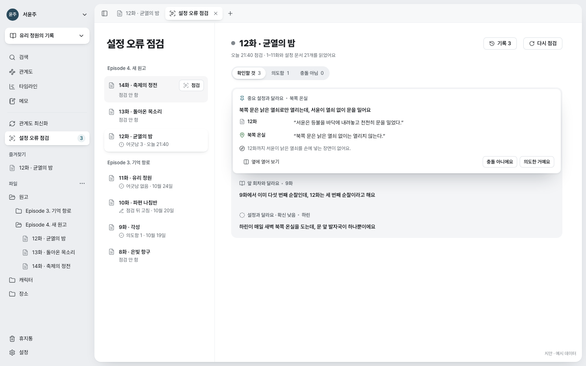
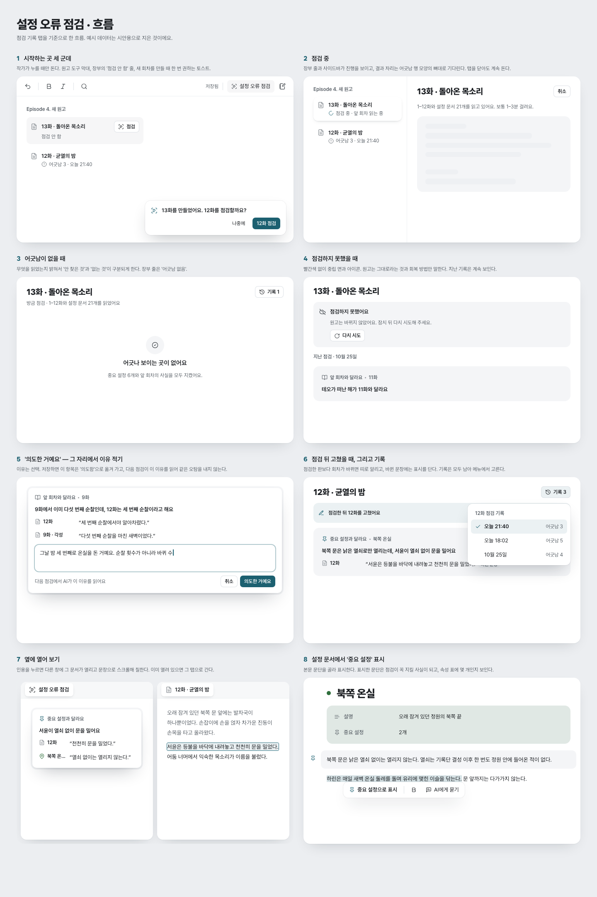

# 설정 오류 점검

> 작성일: 2026-10-27
> 상태: **설계 확정, 구현 전.** 화면 구조는 후보 셋을 시안으로 비교해 "점검 기록 탭"으로 정했다.
> 시안 원본: `loresentry-frontend/.impeccable/mocks/decision/consistency/` (HTML). 화면 속 어긋남 세 건은 시안용으로 지은 것이다.

원고 회차 하나를 그 앞 회차들과 설정 문서에 대조해, 어긋나 보이는 곳을 찾아 작가에게 보여 준다. 관계도 최신화가 **원고 → 설정 문서**(새 원고로 설정을 갱신)라면, 이 기능은 **설정 문서 → 원고**다. 작가가 설정 문서에 정리한 사실이 판단의 근거가 된다. AI는 어긋남과 고칠 방향만 말하고 원고를 고치지 않는다.

## 1. 정한 것

| 항목 | 결정 | 이유 |
|---|---|---|
| 점검 단위 | 원고 회차 하나 | 연재 작가는 회차를 쓰고 고친다. 작품 전체 점검은 범위 밖 |
| 대조 범위 | 그 회차 + **앞 회차들** + 설정 문서 | 연재 순서 그대로 "지금까지 나온 것과 맞나"를 본다 |
| 찾는 충돌 | ① 설정 → 원고: 원고가 설정 문서의 사실과 어긋남 ② 원고 회차끼리: 이 회차가 앞 회차와 어긋남 | 설정끼리, 표기·말투 흔들림은 빼서 오탐을 줄인다 |
| 중요 설정 | 설정 문서 본문에서 작가가 표시한 문단. **점검이 꼭 지킬 사실**로 읽는다 | 설정 전체를 같은 무게로 비교하면 오탐이 많다. 작가가 고른 몇 줄은 정밀하게 본다 |
| 메모 | 읽지 않는다 | 메모는 작업 노트라 사실의 근거가 아니다 |
| 정확도 | 중간: 후보를 두 방식으로 찾고 후보마다 한 번 판정 | 1–3분 안에 끝나는 쪽을 골랐다(추정, 1단계에서 잰다) |
| 사용 한도 | 당분간 없음 | 실제 비용을 잰 뒤 정한다 |
| 고칠 방향 | 무엇이 빠졌는지까지만. 고친 문장은 주지 않는다 | "AI는 원고를 고치지 않는다" |
| 결과 보관 | 점검 기록을 **모두** 남긴다 | 같은 회차를 고치며 여러 번 돌린다 |
| 작가 판정 | "의도한 거예요"·"충돌 아니에요"는 다음 점검에서 숨기고, 적은 이유를 다음 점검이 읽는다 | 회차 점검은 자주 다시 돌려서 같은 오탐이 되풀이되기 쉽다 |
| 실행 | 작가가 누를 때만. 새 회차를 만들 때 직전 회차 점검을 한 번 권한다 | 개인정보 처리방침 제4조("저장만으로 자동 분석하지 않음")와 맞는다 |
| 결과 화면 | 작업공간의 **설정 오류 점검 탭**(회차 목록 + 결과) | §6 |
| 이름 | 설정 오류 점검 | 사용자 결정(2026-10-27) |

## 2. 화면

### 2.1 설정 오류 점검 탭

사이드바 "관계도 최신화" 아래 **설정 오류 점검** 항목이 탭을 연다(`kind: "setting-check"`). 배지는 회차마다 최신 점검의 "확인할 것" 수를 더한 값이다.

| 자리 | 내용 |
|---|---|
| 왼쪽 · 회차 목록 | 에피소드별 원고 회차. 줄마다 마지막 점검 상태: 어긋남 n · 시각 / 어긋남 없음 / 점검 뒤 고침 / 의도함 n / 점검 안 함. 고른 줄은 pill. "점검 안 함" 줄에는 가리킬 때 "점검" 단추 |
| 오른쪽 · 머리 | 회차 제목(제목 서체 22px), "오늘 21:40 점검 · 1–11화와 설정 문서 21개를 읽었어요", "기록 n" 메뉴, "다시 점검" |
| 오른쪽 · 걸러 보기 | 분할 단추 `확인할 것 n · 의도함 n · 충돌 아님 n` |
| 오른쪽 · 어긋남 목록 | 들어간 판 안의 행. 누르면 그 자리에서 펼친다 |

창 폭 744px 이하(`@container lk-pane`)에서는 회차 목록이 결과 위의 선택 메뉴로 접힌다.

### 2.2 어긋남 행

| 줄 | 내용 |
|---|---|
| 종류 | 아이콘 + 12px 600: `중요 설정과 달라요`(핀, 청록 상태 아이콘) / `설정과 달라요` / `앞 회차와 달라요` · 근거 문서 이름. 확신이 낮으면 "확신 낮음"을 글자로 붙인다(빨간색 없음) |
| 요약 | 13px 600 한 줄. "북쪽 문은 낡은 열쇠로만 열리는데, 서윤이 열쇠 없이 문을 밀어요" |
| 인용 | 두 줄. 이 회차 문장과 근거 문장(설정 문서 문단 또는 앞 회차 문장). 앞에 종류 아이콘과 문서 이름 |
| 고칠 방향 | 12px secondary 한 줄. "12화까지 서윤이 낡은 열쇠를 손에 넣는 장면이 없어요." |
| 동작 | `옆에 열어 보기` · `충돌 아니에요` · `의도한 거예요` |

인용을 누르면 다른 창(분할 보기)에 그 문서가 열리고 그 문장으로 스크롤해 Change Teal로 칠한다. 이미 열려 있으면 그 탭으로 간다. 에디터의 찾기 명령(`setFindQuery`)을 쓴다.

### 2.3 흐름

| 장면 | 동작 |
|---|---|
| 1 시작 | 원고 도구 막대의 "설정 오류 점검" 단추, 목록 줄의 "점검", 새 회차를 만들 때 토스트 "13화를 만들었어요. 12화를 점검할까요?"(나중에 / 12화 점검) |
| 2 점검 중 | 목록 줄이 "점검 중 · 앞 회차 읽는 중", 결과 자리는 어긋남 행 모양의 뼈대(The Same Shape Rule). 취소 가능. 탭을 닫아도 돌고 끝나면 토스트 |
| 3 어긋남 없음 | 빈 상태 원 + "어긋나 보이는 곳이 없어요" + 무엇을 읽었는지. "찾지 않은 것"과 "없는 것"을 구분한다 |
| 4 실패 | 중립 면 + "점검하지 못했어요" + "원고는 바뀌지 않았어요" + 다시 시도. 지난 기록은 그대로 보인다 |
| 5 의도한 거예요 | 행 안에서 이유 입력칸이 열린다(선택). 저장하면 "의도함"으로 옮겨 가고 "다음 점검에서 AI가 이 이유를 읽어요" |
| 6 점검 뒤 고침 | 점검한 판(`revision_no`)보다 회차가 새로우면 띠 "점검한 뒤 12화를 고쳤어요 · 다시 점검", 바뀐 인용에 "바뀐 문장" 표시. "기록 n" 메뉴에서 지난 점검을 고른다 |
| 7 옆에 열어 보기 | §2.2 |
| 8 중요 설정 표시 | §2.4 |

### 2.4 중요 설정 표시 (설정 문서 에디터)

- 본문 문단을 고르면 뜨는 막대에 **중요 설정으로 표시**. 다시 누르면 푼다.
- 표시한 문단은 sunken 바탕(10px)과 왼쪽 여백의 청록 핀. 색 막대 테두리는 쓰지 않는다.
- 속성 표에 `중요 설정 n개` 줄이 생긴다. 누르면 첫 문단으로 스크롤한다.
- 원고 문서에서는 이 동작이 없다.

## 3. 판정 방식

| 단계 | 하는 일 |
|---|---|
| 입력 | 점검 회차 본문, 앞 회차 본문(순서대로), 설정 문서(제목·속성·본문, 중요 설정 문단 표시), 이 프로젝트의 작가 판정과 이유 |
| 이름 묶기 | 설정 문서 제목과 속성으로 별칭을 묶는다. "레나 = 아르벨 양" |
| 후보 ① 전체 대조 | 점검 회차를 앞 회차·설정 전체와 한 번에 대조한다 |
| 후보 ② 중요 설정별 대조 | 중요 설정 문단마다 점검 회차를 따로 대조한다 |
| 판정 | 후보마다 한 번: 진짜 어긋남 / 시간이 지나 바뀐 것 / 인물의 거짓말·착각 / 근거 부족. 진짜 어긋남만 남기고, 확신이 낮으면 표시한다 |
| 인용 확인 | 두 인용이 원문에 그대로 있는지 서버가 대조한다(`citations.py` 방식). 없으면 버린다 |
| 작가 판정 반영 | 같은 근거 문장을 쓰는 "의도함·아님"은 숨기고, 이유는 판정 입력에 넣는다 |

정확도는 AI 챗 평가 세트 세 편에 심어 둔 충돌(예: 안개 항구의 "선장은 차를 안 마심" vs 13화)과, 깨끗한 원고에 일부러 심은 모순·정당한 변화로 잰다. 놓친 것(재현율)과 잘못 잡은 것(정밀도)을 함께 본다.

## 4. 서버 (제안)

이름과 모양은 구현에서 바뀔 수 있다.

**ai-chat** — OpenAI 연결, content 내부 API, 평가 도구가 이미 있다. 점검은 몇 분 걸리고 gateway가 180초에 끊으므로 비동기 작업으로 돈다. 작업자는 요약 스케줄러처럼 같은 이미지의 별도 Deployment.

| 표 | 내용 |
|---|---|
| `setting_check_runs` | id, project_id, document_id, revision_no(점검한 판), status(QUEUED·RUNNING·DONE·FAILED·CANCELLED), 읽은 범위, 모델·토큰, 시각 |
| `setting_check_findings` | run_id, kind(SETTING·MANUSCRIPT), core, confidence, 요약, 고칠 방향, 인용(JSONB), fingerprint(근거 문장 기준) |
| `setting_check_verdicts` | project_id, fingerprint, verdict(INTENDED·NOT_CONFLICT), reason, 시각. 점검 기록과 따로 있어 다시 점검해도 남는다 |

| 요청 | 하는 일 |
|---|---|
| `POST /projects/{id}/setting-checks` `{document_id}` | 점검 시작, 202. 프로젝트당 한 번에 하나 |
| `GET /projects/{id}/setting-checks/summary` | 회차마다 최신 점검 요약(목록과 배지) |
| `GET /files/{id}/setting-checks` | 그 회차의 점검 기록 |
| `GET /setting-checks/{runId}` | 점검 하나와 어긋남 |
| `POST /setting-checks/{runId}/cancel` | 취소 |
| `PUT` / `DELETE /setting-check-findings/{id}/verdict` | 작가 판정과 이유 |

**content** — 중요 설정은 본문 JSON의 문단 속성(`attrs.core: true`)으로 저장한다. `validateBody`는 노드·마크 종류만 보고 속성은 보지 않으므로 저장 형식은 바뀌지 않는다. 대신 내부 API(`chat-documents`)가 설정 문서마다 표시된 문단을 `core_facts`로 따로 돌려줘야 한다.

**gateway** — 위 경로를 BFF에 선언한다. 응답 필드를 하나씩 선언하므로 빠뜨리면 조용히 사라진다.

**삭제** — 프로젝트 삭제는 `ProjectDeleted`, 탈퇴는 `DELETE /users/me/data`에 점검 표들을 더한다. 처리방침의 보유·파기 표에 점검 기록을 넣어야 한다.

## 5. 구현 순서

| PR | 저장소 | 범위 |
|---|---|---|
| A | content | 중요 설정 문단 속성 허용 확인, `core_facts` 내부 API |
| B | ai-chat | 표, 작업자, 판정, 인용 확인, API, 평가 세트 |
| C | gateway | 경로와 DTO |
| D | frontend | 탭·목록·결과·판정·흐름, 원고 도구 막대 단추, 새 회차 토스트, 설정 문서의 중요 설정 표시, mock |
| E | docs | 이 문서의 상태, `api-adapter.md`·`mock-and-server-contract.md` |

frontend는 관계도·문서 이미지 작업과 같은 시기에 진행된다. 화면 문구는 "그래프" 대신 "관계도"를 쓴다.

## 6. 비교한 후보

| 후보 | 모양 | 고르지 않은 이유 |
|---|---|---|
| **점검 기록 탭** (채택) | 회차 목록 + 결과 | 회차별 기록을 모두 남기는 결정과 맞고, 점검 안 한 회차가 보여 다음 점검을 이끈다 |
| AI 챗 안 리포트 | 챗 창의 점검 대화, 근거 칩 | 470px 창에서 인용 둘과 판정을 다루기 비좁고, 점검 기록이 일반 대화와 섞인다 |
| 대조 탁자 | 큰 창에서 두 문서를 나란히 놓고 하나씩 판정 | 창이 원고를 가려 고치려면 나가야 하고, 결과가 두세 개일 때도 무겁다 |

## 7. 남은 결정

1. 정확도·비용 실측 뒤 사용 한도를 둘지.
2. 작가 판정의 이유를 같은 근거를 쓰는 **이후 회차 점검에도** 넘긴다(기본값). 너무 넓으면 같은 회차로 좁힌다.
3. 회차가 수백 개일 때 앞 회차 전체를 한 번에 넣을지, 요약(`document_summaries`)으로 줄일지.
