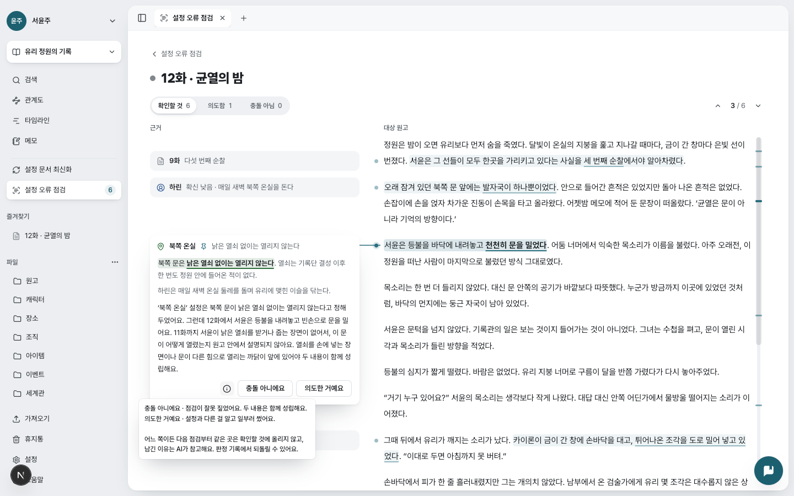
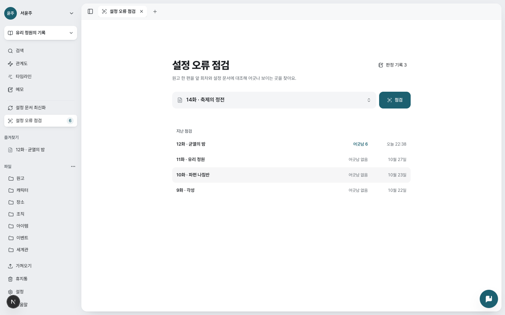
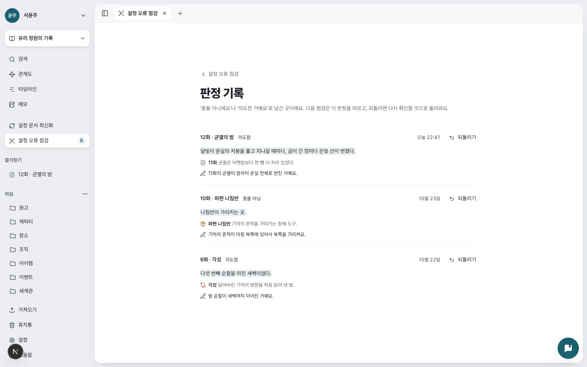
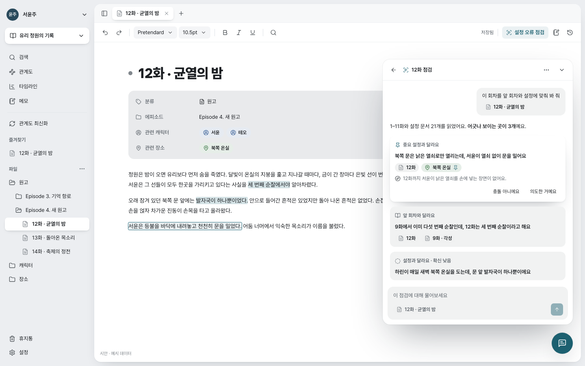
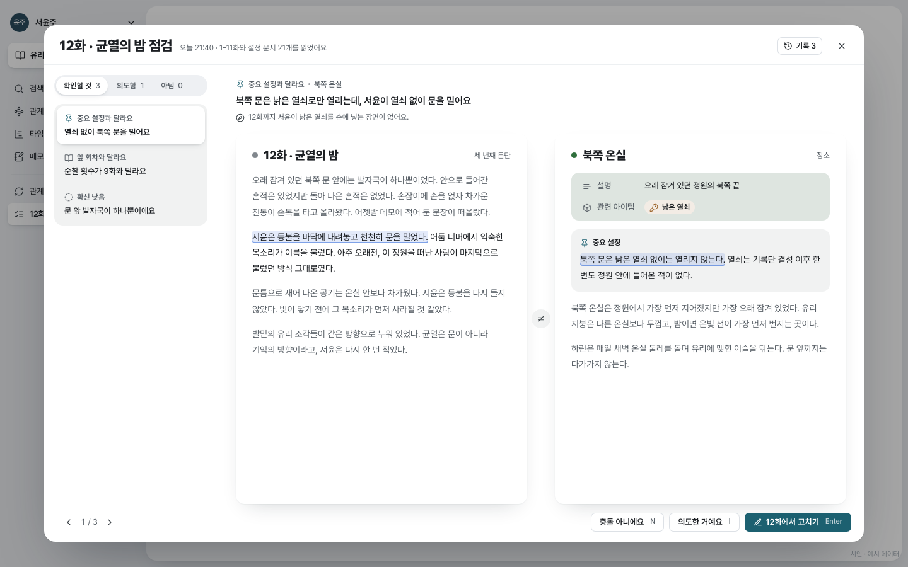

# 설정 오류 점검

> 작성일: 2026-10-27 · 고침: 2026-10-31
> 상태: **구현 완료.** content #27 · ai-chat #16·#21 · gateway #21 · frontend #74·#76·#77.
> 시안 원본: `loresentry-frontend/.impeccable/mocks/decision/consistency/` (HTML). 처음 화면·결과 화면은 `task/` 아래 후보를 비교해 정했다.

원고 회차 하나를 그 앞 회차들과 설정 문서에 대조해, 설정 충돌을 찾아 작가에게 보여 준다. 관계도 최신화가 **원고 → 설정 문서**(새 원고로 설정을 갱신)라면, 이 기능은 **설정 문서 → 원고**다. 작가가 설정 문서에 정리한 사실이 판단의 근거가 된다. AI는 왜 충돌인지만 말하고 원고를 고치지 않는다.

## 1. 정한 것

| 항목 | 결정 | 이유 |
|---|---|---|
| 점검 단위 | 원고 회차 하나 | 연재 작가는 회차를 쓰고 고친다. 작품 전체 점검은 범위 밖 |
| 대조 범위 | 그 회차 + **앞 회차들** + 설정 문서 | 연재 순서 그대로 "지금까지 나온 것과 맞나"를 본다 |
| 찾는 충돌 | ① 설정 → 원고: 원고가 설정 문서의 사실과 충돌 ② 원고 회차끼리: 이 회차가 앞 회차와 충돌 | 설정끼리, 표기·말투 흔들림은 빼서 오탐을 줄인다 |
| 중요 설정 | 설정 문서 본문에서 작가가 표시한 문단. **점검이 꼭 지킬 사실**로 읽는다 | 설정 전체를 같은 무게로 비교하면 오탐이 많다. 작가가 고른 몇 줄은 따로 한 번 더 본다 |
| 메모 | 읽지 않는다 | 메모는 작업 노트라 사실의 근거가 아니다 |
| 정확도 | 후보를 두 방식으로 찾고 후보마다 한 번 판정 | 1–3분 안에 끝나는 쪽을 골랐다(실측 전) |
| 사용 한도 | 당분간 없음. 모든 사용자가 쓴다(AI 챗 허용 목록 `LORESENTRY_CHAT_ALLOWED_USERS`가 `*`) | 실제 비용을 잰 뒤 정한다 |
| 판단 근거 | 서너 문장. 근거 문서가 정한 것, 회차가 보인 것, 둘이 함께 성립하지 않는 까닭, 무엇이 빠졌는지. 고친 문장은 주지 않는다 | 한 줄 요약으로는 작가가 납득하지 못했다(2026-10-30 사용자 피드백) |
| 결과 보관 | 점검 기록을 **모두** 남긴다. 화면은 회차마다 최근 점검만 보여 준다 | 같은 회차를 고치며 여러 번 돌린다 |
| 작가 판정 | "충돌 아니에요"·"의도한 거예요". 프로젝트의 **판정 기록**에 모이고, 다음 점검에서 같은 곳은 확인할 것에 올리지 않으며, 적은 이유를 판정 단계가 읽는다 | 회차 점검은 자주 다시 돌려서 같은 오탐이 되풀이되기 쉽다 |
| 실행 | 작가가 누를 때만. 원고 도구 막대에서는 확인 창을 거친다. 새 회차를 만들 때 직전 회차 점검을 한 번 권한다 | 개인정보 처리방침 제4조("저장만으로 자동 분석하지 않음")와 맞는다 |
| 점검 뒤 고친 회차 | 결과는 그대로 두고 "점검한 뒤 원고가 바뀌었어요 · 다시 점검하기"만 띄운다 | 지난 결과를 고친 원고에 맞춰 다시 짓지 않는다(사용자 결정) |
| 이름 | 설정 오류 점검 | 사용자 결정(2026-10-27) |
| 용어 | 찾은 곳은 **설정 충돌**이라 부른다. "어긋남"은 쓰지 않는다 | 사용자 결정(2026-10-31) |

## 2. 화면

작업공간의 **설정 오류 점검 탭**(`kind: "setting-check"`) 하나에서 한 장씩 넘긴다: 처음 화면 → 분석 중 → 결과, 그리고 처음 화면에서 들어가는 판정 기록. 사이드바 "설정 문서 최신화" 아래 항목이 탭을 열고, 배지는 회차마다 최근 점검의 "확인할 것"을 더한 값이다. 탭이 보는 회차는 탭 밖(원고 도구 막대, 끝남 토스트)에서도 고르므로 프로젝트마다 하나를 둔다(`focus.ts`).

### 2.1 처음 화면

| 자리 | 내용 |
|---|---|
| 머리 | "설정 오류 점검" + 오른쪽 "판정 기록 n" |
| 원고 고르기 | 에피소드별 원고 메뉴 + "점검". 다른 회차가 도는 중이면 단추가 잠기고 "{회차} 점검이 끝나면 시작할 수 있어요." |
| 지난 점검 | 점검한 회차마다 최근 점검 한 줄: 분석 중 / 설정 충돌 n / 설정 충돌 없음 / 점검하지 못함 / 취소함 · 시각. 누르면 그 회차의 결과 |

회차마다 상태를 늘어놓던 원장(첫 설계)은 쓰지 않는다. 사용자가 점검하지 않은 회차까지 상태를 보여 주는 것을 원하지 않았다.

### 2.2 분석 중

"설정 충돌을 찾고 있어요", 단계 세 개(앞 회차와 설정 읽기 · 설정 충돌 찾기 · 다시 확인)와 진행 막대, "보통 1–3분 걸려요. 다른 작업을 해도 계속돼요.", 취소. 탭을 닫아도 돌고 끝나면 토스트를 띄운다.

### 2.3 결과

왼쪽에 근거 카드, 오른쪽에 점검한 원고를 두고 카드를 충돌하는 문장 높이에 붙인다.

| 자리 | 내용 |
|---|---|
| 머리 | "‹ 설정 오류 점검", 회차 제목, 걸러 보기 `확인할 것 n · 의도함 n · 충돌 아님 n`, 이전·다음 설정 충돌 `n / m` |
| 근거 카드(접힘) | 근거 문서 종류 아이콘 · 짧은 이름(앞 회차는 "9화") · 중요 설정이면 핀 · 근거에서 충돌하는 표현. 확신이 낮으면 "확신 낮음 · " |
| 근거 카드(펼침) | ① 근거 문장과 그 **앞뒤 문장**(근거 문서에서 읽는다. 한쪽에 둘까지, 60자가 차면 그만). 근거 문장은 칠하고 문맥은 흐리게. 누르면 옆 창에 근거 문서를 열고 그 문장으로 간다 ② 판단 근거 서너 문장 ③ 작가가 남긴 이유(판정했으면) ④ ⓘ · 충돌 아니에요 · 의도한 거예요(판정했으면 되돌리기) |
| 원고 | 열 이름은 "근거"와 **회차 제목**. 회차 본문에서 충돌하는 문장은 칠하고 충돌하는 표현에 밑줄. 문장을 누르면 그 문장의 카드를 연다(겹치면 차례로) |
| 연결선 | 연 카드와, 마우스를 올린 문장의 카드에만 긋는다. 설정 충돌이 많아도 엉키지 않게 |
| 긴 원고 | 충돌하는 문단과 그 앞뒤 한 문단만 남기고 세 문단 이상 이어지는 구간을 "문단 n개 펼치기"로 접는다. 원고가 창보다 길면 오른쪽에 설정 충돌 위치 막대 |

- ⓘ에 마우스를 올리거나 키보드로 오면 "충돌 아니에요: …", "의도한 거예요: …" 꼴로 두 판정의 뜻과 다음 점검에 쓰이는 방식을 설명한다. 누르는 단추가 아니라 커서는 바꾸지 않는다(물음표 커서를 없앴다).
- 판정을 고르면 이유 입력칸이 열린다(선택, 500자). 저장하면 다음 설정 충돌로 넘어간다.
- 근거 문서를 점검 뒤 고쳐 근거 문장을 찾지 못하면(또는 속성 값에서 온 근거면) 근거 문장만 보인다.
- 고친 원고에서 인용을 찾지 못한 설정 충돌은 자리 없이 맨 위에 서고, 카드에 회차 문장을 함께 보인다.
- 창 폭 760px 이하(`@container lk-pane`)에서는 원고를 빼고 카드만 쌓으며, 카드에 회차 문장을 보인다.

### 2.4 판정 기록

프로젝트에서 남긴 판정을 최근 것부터. 줄마다 회차 제목 · 의도함/충돌 아님 · 판정한 때 · 되돌리기, 회차 문장(누르면 옆 창에서 그 문장), 근거 문서와 근거 문장, 남긴 이유. 되돌리면 그 곳은 다시 확인할 것으로 올라온다.

### 2.5 시작하는 곳

| 곳 | 동작 |
|---|---|
| 처음 화면 | 원고를 골라 "점검" |
| 원고 도구 막대 "설정 오류 점검" | 확인 창("설정 오류 점검을 시작할까요?" · 대상 회차 · 중요 설정을 꼭 지킬 사실로 본다 · 보통 1–3분) 뒤 시작하고 탭을 연다 |
| 새 회차 토스트 | "새 회차를 만들었어요. 앞 회차를 점검할까요?" |
| 결과 화면 | 점검 뒤 고친 회차의 "다시 점검하기", 취소한 점검의 "다시 점검하기", 실패의 "다시 시도"(다시 해도 같은 실패면 없음) |

시작하기 전에 열려 있는 문서를 저장한다. 서버는 저장된 판을 읽고 그 판을 점검한 판(`revision_no`)으로 남긴다.

### 2.6 중요 설정 표시 (설정 문서 에디터)

- 본문 문단을 고르면 뜨는 막대에 **중요 설정으로 표시**. 다시 누르면 푼다.
- 표시한 문단은 sunken 바탕과 왼쪽 여백의 청록 핀. 색 막대 테두리는 쓰지 않는다.
- 속성 표에 `중요 설정 n개` 줄이 생긴다. 누르면 첫 문단으로 스크롤한다.
- 원고 문서에서는 이 동작이 없다.

### 2.7 기능을 알리는 곳

| 곳 | 내용 |
|---|---|
| 온보딩 | "새 회차를 쓰면 설정 문서 최신화" 다음, AI 챗 앞에 **"설정 충돌은 AI가 짚어요"** 단계. 무대(`onboarding/scenes.tsx`의 `CheckView`)는 결과 화면을 줄여 옮긴 것이다: 사이드바 항목이 점검 중으로 바뀌고, 분석 중 화면을 거쳐 근거 카드(북쪽 온실 · 중요 설정 "낡은 열쇠 없이는 열리지 않는다")가 12화의 "서윤은 등불을 바닥에 내려놓고 천천히 문을 밀었다"와 선으로 이어진다. 챗 장면이 묻는 문장과 같다 |
| 랜딩 | 최신화와 챗 사이의 장 **"설정 충돌을 근거와 함께 짚어요"**(창 왼쪽·설명 오른쪽, 같은 무대). 점: 중요 설정은 꼭 지켜요 · 판정은 다음 점검이 기억해요 · 원고를 고치면 알려 줘요. 첫 화면 소개와 검색용 설명에도 "AI가 설정 충돌을 짚고"를 넣었다 |
| 작업공간 투어 | AI 챗 다음, 최신화 앞에 두 단계: 원고 도구 막대의 "설정 오류 점검" 단추(`data-tour="check-start"`)와 사이드바 항목(`setting-check`). 서버에 기능이 없으면(준비 중) 건너뛴다 |
| 도움말 | 주제 "설정 오류 점검"(시작하기 · 중요 설정 표시하기 · 결과 읽기 · 판정 남기기 · 원고를 고친 뒤). "작업공간 둘러보기"의 사이드바 목록에도 한 줄 |

영어판 무대는 문장이 길어 카드가 창 아래로 잘렸다. 앞 회차 근거 하나만 남기고(확인할 것 2) 강조한 카드의 판정 단추까지 보이게 했다.

## 3. 판정 방식 (ai-chat)

| 단계 | 하는 일 |
|---|---|
| 읽기(`READING`) | 점검 회차, 앞 회차 전부(순서대로), 설정 문서(제목·속성·본문·중요 설정 `core_facts`)를 `chat-documents`로 100개씩. `SETTING_CHECK_MAX_CHARS`를 넘으면 오래된 회차부터 뺀다 |
| 후보(`FINDING`) | ① 전체 대조: 점검 회차를 앞 회차·설정 전체와. 후보마다 관련 앞 회차(최대 셋)를 짚는다 ② 설정 대조: 설정 문서를 하나씩 점검 회차와(설정 문서가 없으면 ①만). 두 인용이 원문에 그대로 있어야 남고, 같은 근거 문서에서 회차 인용이 겹치는 후보는 하나로 |
| 판정(`JUDGING`) | 후보마다 한 번: 진짜 충돌 / 시간이 지나 바뀐 것 / 인물의 거짓말·착각 / 근거 부족. 진짜 충돌만 남긴다. 근거 문서 하나만이 아니라 설정 문서 전체, 최근 앞 회차(3만 자까지), 후보가 짚은 관련 회차를 함께 읽는다. 확신(HIGH·LOW), **판단 근거(`explanation`) 서너 문장**, 두 인용에서 충돌을 담은 가장 짧은 표현(`quote_focus`) |
| 작가 판정 반영 | 판정은 프로젝트와 fingerprint(종류·근거 문서·두 인용)에 붙어 다음 점검의 같은 설정 충돌에 그대로 걸린다. 같은 근거 문서를 쓰는 판정과 이유는 판정 단계 입력에 넣는다 |

정확도는 `loresentry-ai-chat/evaluation/setting_check.py`로 잰다. 평가 세트는 잡아야 할 모순과 잡으면 안 되는 함정(꿈·회상·소문·거짓말·시간의 흐름·예외가 나온 규칙)을 섞은 개발용 14케이스와, 고치기 전에 따로 쓴 검증셋 셋이다. 2026-10-31 실측(`gpt-6-luna`, 케이스마다 3회, ai-chat #21): 재현율 개발 0.77→0.94, 검증셋 2 0.75→0.83, 검증셋 3 0.89→1.00. 모든 세트에서 함정 0, 정밀도 1.0. 점검 한 번의 입력 토큰은 약 1.9배(77%는 캐시), 출력은 1.5배가 됐다.

## 4. 서버

**ai-chat** — 점검은 몇 분 걸리고 gateway가 180초에 끊으므로 API 프로세스의 백그라운드 작업으로 돈다. 프로젝트당 한 번에 하나.

| 표 | 내용 |
|---|---|
| `setting_check_runs` | 회차와 점검한 판, status(RUNNING·DONE·FAILED·CANCELLED)와 stage, 읽은 범위, 모델·토큰 |
| `setting_check_findings` | 끝난 점검의 설정 충돌(회차 순서): kind, core, confidence, explanation, 두 인용과 표현, fingerprint |
| `setting_check_verdicts` | 프로젝트·fingerprint마다 작가 판정과 이유. 점검 기록과 따로 있어 다시 점검해도 남는다 |

| 요청(gateway 경로 같음) | 하는 일 |
|---|---|
| `POST /projects/{id}/setting-checks` `{document_id}` | 시작, 202 |
| `GET /projects/{id}/setting-checks/summary` | 진행 중 점검과 회차마다 최근 점검(처음 화면, 배지) |
| `GET /projects/{id}/setting-checks?document_id=` | 그 회차의 점검 기록 |
| `GET /projects/{id}/setting-checks/verdicts` | 판정 기록: 판정마다 가장 최근 점검의 설정 충돌, 그 회차, 판정한 때 |
| `GET /setting-checks/{id}` | 점검 하나와 설정 충돌 |
| `POST /setting-checks/{id}/cancel` | 취소 |
| `PUT` / `DELETE /setting-check-findings/{id}/verdict` | 작가 판정과 이유 |

**content** — 중요 설정은 본문 JSON의 문단 속성(`attrs.core: true`)으로 저장한다. 내부 API(`chat-documents`)가 설정 문서마다 표시된 문단을 `core_facts`로 돌려준다.

**gateway** — 위 경로를 BFF에 선언하고 AI 챗 허용 목록을 따른다(prod는 `*`로 모두에게 열려 있다). 응답 필드를 하나씩 선언하므로 빠뜨리면 조용히 사라진다.

**삭제** — 프로젝트 삭제와 탈퇴 때 점검 표들을 지운다.

## 5. 비교한 후보

### 5.1 탭의 모양

| 후보 | 모양 | 결과 |
|---|---|---|
| 점검 기록 탭 | 회차 목록(회차마다 상태) + 결과 | 첫 설계로 구현했다가 바꿨다. 회차마다 상태를 일일이 보여 주는 것이 번잡했다 |
| **한 장씩** (채택) | 처음 화면(원고 고르기·지난 점검) → 분석 중 → 결과 | 점검을 작업 하나로 다룬다. 요소가 적다 |
| AI 챗 안 리포트 | 챗 창의 점검 대화, 근거 칩 | 470px 창에서 인용 둘과 판정을 다루기 비좁고, 점검 기록이 일반 대화와 섞인다 |
| 대조 탁자 | 큰 창에서 두 문서를 나란히 놓고 하나씩 판정 | 창이 원고를 가려 고치려면 나가야 하고, 결과가 두세 개일 때도 무겁다 |

### 5.2 결과 화면

근거 문서와 대상 원고를 나란히 놓는 세 안(마주 보는 두 문서, 짝지은 줄, 여백 카드) 가운데 **여백 카드**를 골랐다. 원고가 길고 설정 충돌이 다대다일 수 있어, 선은 연 카드에만 긋고 같은 문장의 카드는 쌓고 먼 문단은 접는다.

## 6. 남은 결정

1. 정확도·비용 실측 뒤 사용 한도를 둘지.
2. 작가 판정의 이유를 같은 근거 문서를 쓰는 **이후 회차 점검에도** 넘긴다(지금 동작). 너무 넓으면 같은 회차로 좁힌다.
3. 회차가 수백 개일 때 앞 회차 전체를 한 번에 넣을지, 요약(`document_summaries`)으로 줄일지.
